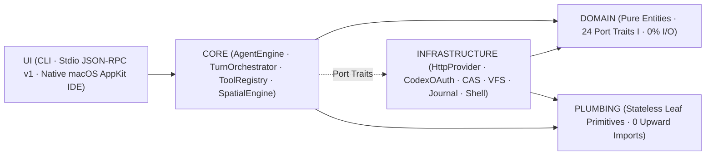

<!-- [LAYER: UI] -->
# HEAV3NS-MICRO (`v0.1.0`) — The Sovereign Intelligence Runtime

**Hyper-Compressed, Architecturally Sovereign Rust Intelligence Runtime, Double-Wrapped Spatial Action Engine & Native macOS AppKit IDE (`HEAV3NS-CODE`)** — structured under the **HEAV3NS-JOY** 5-Zone Joyzoning architecture (`100%` Stability Index, `0` blocking violations, `0` advisories, all `343` workspace files `< 800` lines Tier 1 Optimal).

<p align="center">
  <a href="doc.md">Sovereign Charter (doc.md)</a> ·
  <a href="AGENTS.md">AGENTS.md</a> ·
  <a href="SOUL.md">SOUL.md</a> ·
  <a href="ROADMAP.md">Aspirational Roadmap</a> ·
  <a href="docs/README.md">Documentation Hub</a> ·
  <a href="docs/papers/ascendant-intelligence.md">Ascendant Intelligence Paper</a> ·
  <a href="docs/PROJECT_MAP.md">Project Map</a> ·
  <a href="docs/CONSTITUTION.md">Constitution</a> ·
  <a href="VALIDATION_REPORT.md">Validation Report</a> ·
  <a href="native/PRODUCT.md">Native Product Spec</a>
</p>

<p align="center">
  <a href="docs/i18n/README.zh-CN.md">简体中文</a> ·
  <a href="docs/i18n/README.ja-JP.md">日本語</a> ·
  <a href="docs/i18n/README.vi.md">Tiếng Việt</a> ·
  <a href="docs/i18n/README.id.md">Bahasa Indonesia</a> ·
  <a href="docs/i18n/README.ko-KR.md">한국어</a> ·
  <a href="docs/i18n/README.es-419.md">Español</a> ·
  <a href="docs/i18n/README.pt-BR.md">Português</a> ·
  <a href="docs/i18n/README.ru.md">Русский</a> ·
  <a href="docs/i18n/README.uk.md">Українська</a> ·
  <a href="docs/i18n/README.fr.md">Français</a> ·
  <a href="docs/i18n/README.de.md">Deutsch</a> ·
  <a href="docs/i18n/README.zh-TW.md">繁體中文</a> ·
  <a href="docs/i18n/README.hi.md">हिन्दी</a> ·
  <a href="docs/i18n/README.tr.md">Türkçe</a> ·
  <a href="docs/i18n/README.it.md">Italiano</a> ·
  <a href="docs/i18n/README.pl.md">Polski</a> ·
  <a href="docs/i18n/README.ar.md">العربية</a> ·
  <a href="docs/i18n/README.ca.md">Català</a>
</p>

---

## The Seven Sovereign Pillars (`HEAV3NS`)

> *"Not an agent. Not a swarm. Not an operating system. A computational civilization of cooperating intelligence — where the system doesn't merely execute instructions: it understands its environment, learns its structure, remembers its experience, and acts with intent."* — [`doc.md`](doc.md)

| Pillar | Designation | Core Implementation |
| :--- | :--- | :--- |
| **1. `HEAV3NS-MICRO`** | **The Distilled Intelligence Runtime** | [`AgentEngine`](src/core/engine.rs) multi-turn ReAct state machine, KV-cache-deterministic [`SystemPromptSpec`](src/domain/prompt_spec.rs) (`Standard`, `Compact`, `SwarmSpecialist`, `SideQuestion`), [`ContextInspectionSnapshot`](src/core/context_inspector.rs) (`/context` & `/prompt`), 3-stage self-healing [`ToolCallArgParser`](src/domain/tool_parser.rs), and `FT-01..FT-05` [`flight_runner`](src/core/flight_runner.rs). |
| **2. `SPIDER`** | **Structural Perception & Environmental Understanding** | [`environmental_diff.rs`](src/plumbing/environmental_diff.rs) (`analyze_spider_structural_relationships`, `classify_element_affordance`, `detect_modal_or_dialog`), [`EnvironmentalObservation`](src/domain/types/environmental_types.rs), and `spider.check` AST audits. |
| **3. `REWIND`** | **Temporal Cognition, Continuity & Recoverability** | 16-MiB [`ArenaAllocator`](src/domain/arena.rs) with $O(1)$ `SlabBufferSnapshot` rewind, pure-Rust SHA-256 [`WorkspaceSnapshotCas`](src/infrastructure/workspace_cas.rs) (`WouldBlock`-protected `/undo`, `/restore`, non-Git `/diff`), two-phase [`SessionVfs`](src/infrastructure/vfs_store.rs) baseline verification, [`TransactionJournal`](src/infrastructure/transaction_journal.rs) rollback, and 32-deep [`VirtualDisplayState`](src/domain/computer_use.rs) undo/redo. |
| **4. `BROCCOLI`** | **Persistent Knowledge, Memory & Historical Evolution** | [`BehavioralKnowledgeStore`](src/infrastructure/behavioral_store.rs) with Laplace-smoothed confidence calibration & [`LearnedWorkflowProcedure`](src/domain/types/learned_knowledge_types.rs) synthesis, hybrid TF-IDF [`MemoryStore`](src/domain/memory.rs), and Kahn-verified [`SkillTreeCatalog`](src/domain/skill_tree.rs) DAG. |
| **5. `SYNTHETIC SWARM`** | **Distributed Collective Intelligence** | 5-specialist parallel consultation ([`ComputerUseOrchestrator::consult`](src/core/computer_use_orchestrator.rs): `VisualPerceiver`, `StructuralAnalyst`, `WorkflowNavigator`, `RiskAssessor`, `RecoverySpecialist` + `ConflictResolver`) and 7-specialist [`Legion`](src/domain/swarm.rs) topological formations with exclusive file reservations & bounded handoffs. |
| **6. `COMPUTER USE`** | **Embodied Agency: Observation, Interpretation, Action, Adaptation** | 9-stage closed-loop [`ComputerUseOrchestrator`](src/core/computer_use_orchestrator.rs), Double-Wrapped [`SpatialActionMediator`](src/domain/spatial_mediator.rs) (`Wrapper A` Grounding + `Wrapper B` Assurance), [`SpatialInteractionEngine`](src/core/spatial_engine.rs) (off-screen auto-scroll & multi-step `execute_plan`), and zero-trust `browser_use`. |
| **7. `THE HARNESS`** | **The Computational Substrate That Binds It All Together** | 31 native tools (`tool_search` 8-slot LRU + `execute_tools` 32-step batch) & DAG Wave Scheduler ([`ToolRegistry`](src/core/tool_registry.rs)), 5-stop [`ExecutionPosture`](src/domain/types/posture_types.rs) (`Shift+Tab` / fail-closed `RepoConstitution`), macOS Seatbelt [`seatbelt_profile.rs`](src/plumbing/seatbelt_profile.rs), [`TurnReceipt`](src/domain/turn_receipt.rs) (`heav3ns.receipt/v1`), multiplexed `"v": 1` stdio JSON-RPC worker ([`stdio_worker.rs`](src/ui/stdio_worker.rs)), and Native macOS AppKit IDE ([`native/`](native/)). |

---

## 5-Zone Joyzoning Architecture (`96` Rust Modules · `343` Workspace Files)

Every source file belongs to one of five strictly enforced architectural zones, verified by `joy-check --theme strict`:

| Zone | Path | Responsibility & Invariants |
| :--- | :--- | :--- |
| **`PLUMBING`** | [`src/plumbing/`](src/plumbing/mod.rs) (`14` modules), `native/...` | Stateless leaf primitives: `hash_and_math.rs`, `text_tokens.rs`, `oauth_pkce.rs`, `json_repair.rs`, `schema_and_sse.rs`, `secret_redactor.rs`, `seatbelt_profile.rs`, `shell_guard.rs`, `fuzzy_patch.rs`, `vision_and_dom.rs`, `spatial_geometry.rs`, `environmental_diff.rs`, `display_telemetry.rs`. **0 upward imports, 0 mutable state (`SPI-205`).** |
| **`DOMAIN`** | [`src/domain/`](src/domain/mod.rs) (`34` modules) | Pure entities & `24` port traits ([`interfaces/`](src/domain/interfaces/mod.rs)), behavioral & value types ([`types/`](src/domain/types/mod.rs), [`model_catalog.rs`](src/domain/types/model_catalog.rs), [`posture_types.rs`](src/domain/types/posture_types.rs), [`provider_registry.rs`](src/domain/types/provider_registry.rs)), [`SystemPromptSpec`](src/domain/prompt_spec.rs), [`PrefixStabilityTracker`](src/domain/prefix_and_manifest.rs), [`BillingMetering`](src/domain/pricing_and_taxonomy.rs), [`TurnReceipt`](src/domain/turn_receipt.rs), [`ArenaAllocator`](src/domain/arena.rs), [`VirtualDisplayState`](src/domain/computer_use.rs), [`SpatialActionMediator`](src/domain/spatial_mediator.rs), [`SkillTreeCatalog`](src/domain/skill_tree.rs), [`MemoryStore`](src/domain/memory.rs), [`CompactionPolicy`](src/domain/compaction.rs), [`SwarmAssignment`](src/domain/swarm.rs), and [`ToolCallArgParser`](src/domain/tool_parser.rs). **0% I/O (`SPI-206`), `<= 3` structs/file (`SPI-203`).** |
| **`INFRASTRUCTURE`** | [`src/infrastructure/`](src/infrastructure/mod.rs) (`16` modules) | Concrete I/O adapters: [`HttpProvider`](src/infrastructure/http_provider.rs), [`wire_dialects`](src/infrastructure/wire_dialects.rs), [`sse_and_response_parsers`](src/infrastructure/sse_and_response_parsers.rs), [`CodexAccountStore`](src/infrastructure/codex_oauth.rs), [`ProjectRunner`](src/infrastructure/project_runner.rs), [`pricing_updater`](src/infrastructure/pricing_updater.rs) (`ModelPricingRegistry`), [`ScriptedProvider`](src/infrastructure/scripted_provider.rs), [`SessionVfs`](src/infrastructure/vfs_store.rs), [`WorkspaceSnapshotCas`](src/infrastructure/workspace_cas.rs), [`BehavioralKnowledgeStore`](src/infrastructure/behavioral_store.rs), [`TransactionJournal`](src/infrastructure/transaction_journal.rs), [`execute_shell_command_sandboxed`](src/infrastructure/shell_runner.rs), [`dispatch_fs_tool`](src/infrastructure/fs_tools.rs), and [`search_tools`](src/infrastructure/search_tools.rs). |
| **`CORE`** | [`src/core/`](src/core/mod.rs) (`23` modules) | Use-case orchestration: [`AgentEngine`](src/core/engine.rs), [`turn_orchestrator`](src/core/turn_orchestrator.rs), [`batch_executor`](src/core/batch_executor.rs), [`context_inspector`](src/core/context_inspector.rs), [`ComputerUseOrchestrator`](src/core/computer_use_orchestrator.rs), [`SpatialInteractionEngine`](src/core/spatial_engine.rs), [`slash_and_swarm`](src/core/slash_and_swarm.rs), [`SessionStore`](src/core/session_store.rs), [`ToolRegistry`](src/core/tool_registry.rs), [`tool_specs`](src/core/tool_specs.rs), [`ToolOutputGovernor`](src/core/tool_governor.rs), [`RuntimeRequestQueue`](src/core/request_queue.rs), [`flight_runner`](src/core/flight_runner.rs), [`benchmark_runner`](src/core/benchmark_runner.rs), and test suites (`substrate_tests`, `spatial_tests`, `computer_use_tests`, `zenith_tests`, `codewhale_zenith_tests`, `codex_oauth_e2e_tests`, `zenith_hardening_tests`). |
| **`UI`** | [`src/ui/`](src/ui/mod.rs) (`7` modules + roots), [`native/`](native/) | CLI presenter (`cli_presenter.rs`, `onboarding.rs`), multiplexed stdio JSON-RPC worker (`stdio_worker.rs`, `worker_handlers.rs`, `provider_rpc.rs`), desktop RPC router (`rpc_dispatch.rs`), AppKit Native Desktop IDE (`native/Sources/Heav3nsCode/`), and Composition Roots ([`lib.rs`](src/lib.rs), [`main.rs`](src/main.rs)). |



---

## Multi-Provider Routing, Wire Dialects & Auth (`43` Providers)

[`provider_registry.rs`](src/domain/types/provider_registry.rs), [`wire_dialects.rs`](src/infrastructure/wire_dialects.rs), and [`codex_oauth.rs`](src/infrastructure/codex_oauth.rs) support multi-provider routing with `ProviderChain` fallback, `ModelPricingRegistry` live OpenRouter synchronization (`12h` TTL), and isolated credential handling:

| Wire Dialect | Target Providers & Capabilities | Hardening Invariants |
| :--- | :--- | :--- |
| **OpenAI Chat (`/v1/chat/completions`)** | OpenAI, OpenRouter, DeepSeek, Qwen, Z.AI, MiniMax, Groq, Together, Fireworks, local OpenAI-compatible endpoints | Streaming SSE delta accumulation (`schema_and_sse.rs`), `json_repair.rs`, and `canonical_vendor_prefix` fallback resolution. |
| **OpenAI Responses (`/v1/responses`)** | OpenAI reasoning & responses endpoints | `sanitize_tool_schema_for_responses` (`allOf` `required` union + dangling-key pruning) and strict schema normalization. |
| **OpenAI Codex OAuth PKCE** | `openai-codex` via `CodexAccountStore` (`ICodexAccountStore`) | Pure S256 PKCE + `127.0.0.1:1455` loopback callback, `0600` atomic persistence, single-flight `AsyncMutex` refresh, `429` account auto-switch. |
| **Anthropic (`/v1/messages`)** | Anthropic Claude & `*-anthropic` compatible endpoints | Adaptive thinking blocks, dangling `tool_use` repair, `Role::User` compaction checkpoints for strict `user`-first alternation. |
| **Google Gemini & Local** | Gemini `generateContent` / SSE, Ollama, deterministic `ScriptedProvider` (`FT-01..FT-05`) | Credential-unsent preflight (`CREDENTIAL_REJECTED_UNSENT_CODE`), SSRF/IPv6 endpoint guards, and zero-network flight replay. |

---

## Governance, Tooling & Execution Postures

- **5-Stop `ExecutionPosture` (`Shift+Tab`)**: `Ask -> AcceptEdits -> Plan -> AutoReview -> FullAccess` enforced monotonically alongside fail-closed `.heav3ns/constitution.json` (`RepoConstitution`) across tool calls, `AgentEngine::run_swarm`, and `handle_automation_rpc`.
- **31 Native Tools & Parallel Wave Scheduler**: `15` always-loaded core tools + `16` on-demand specialist tools (`tool_search` 8-slot LRU + `execute_tools` 32-step batch) partitioned into parallel read waves and serialized mutation waves in [`tool_registry.rs`](src/core/tool_registry.rs).
- **35 Interactive Slash Commands**: Includes `/mode`, `/posture`, `/preview-request`, `/receipts`, `/turn`, `/restore`, `/undo`, `/models`, `/context`, `/prompt`, `/tools`, `/vfs`, `/diff`, `/commit`, `/skills`, `/rewind`, `/doctor`, `/computer`, `/browser`, `/vision`, `/spatial`, and `/legion`.

---

## Hardening & Reliability Guarantees (Waves 4–21)

- **Workspace, Sandbox & Credential Isolation**: Dangling-symlink resolution (`canonicalize_best_effort` 16-hop `read_link`), lexical `..` resolution in `classify_sensitive_path`, parent-symlink & `..` rejection in `SessionVfs::commit_all`, child-process credential env scrubbing (`SafetyPolicy::is_sensitive_env_var`), `@` userinfo rejection in `is_safe_oauth_url`, `USER_CONFIG_IO_LOCK` config serialization, and hardened `inspect_command_security` / `ShellCommandGuard` (16-level `sh -c` cap, `rm` normalization, bundled `curl` short-flag & credential-pipe `Deny`, `sort -o`/`rg --pre`/`git -C ... -c` filtering, `&>`/`&>>` heredocs, POSIX `>&1`/`>&2`/`>&-` handling, and macOS Seatbelt).
- **Durable Persistence, Bounded I/O & Parser Safety**: `sync_all()` + temp-rename atomic writes across CAS blobs, manifests, and filesystem tools; fail-closed `WorkspaceSnapshotCas` GC and `rewind_to_snapshot` receipt/CAS alignment; `SessionCompactor` active-turn `[User, Assistant(tc), Tool]` preservation; `ProviderChain` `:model` override retention; bounded `is_file()` disk reads; $O(N)$ SSE/JSON stream parsing, UTF-8 char-boundary pagination, and overflow-safe geometry/CUA checks.
- **Turn Serialization & AppKit Lifecycle**: `legacy_turn_gate` serialization across `task.submit` (`32`-task `RUNTIME_QUEUE_FULL` cap), monotonic `MODEL_SELECT_SEQ` gating, `TURN_IN_PROGRESS` guards on mid-turn conversation switches, posture-checked automation RPC routing, `RuntimeClient.deinit` reservation release, `NSTableView` row bounds guards, viewport clamping/reset on conversation switch, and `client === source` / `closing` / `conversationSwitchGeneration` guards across AppKit windows and stores. See [`CHANGELOG.md`](CHANGELOG.md) and [`docs/SECURITY_BEST_PRACTICES.md`](docs/SECURITY_BEST_PRACTICES.md).

---

## Quick Start & Verification

| Gate | Command | Current Verified Baseline |
| :--- | :--- | :--- |
| **1. Rust Test Suite** | `cargo test` | **128 passed**, `0` failed (unit, spatial, computer-use, OAuth E2E, Wave 4–21 hardening) |
| **2. Agent Flight Suite** | `cargo run -- --flight` | **5 scenarios** (`FT-01..FT-05`, `19/19` checks passing) |
| **3. Native macOS AppKit** | `cd native && swift test` | **323 executed**, `6` skipped, `0` failed |
| **4. Joyzoning & Doctor** | `joy-check . --theme strict` / `--doctor` | **100% Stability Index**, `343` files, `0` errors, `0` warnings |
| **5. Documentation Guardrails** | `node bin/docs-check.mjs` | **72** required docs (`16` ADRs, `6` playbooks, `4` wiki, `5` postmortems, `3` KB), `438` verified links |

```bash
# 1. Run Rust unit, spatial, computer-use, zenith, codewhale, OAuth & hardening test suites (128 tests)
cargo test

# 2. Run Native macOS AppKit test suite (323 tests; 6 skipped)
cd native && swift test && cd ..

# 3. Inspect live prompt & context budget HUD, outbound request manifest, receipts, and Flight Suite
cargo run -- context
cargo run -- preview-request
cargo run -- receipts
cargo run -- doctor
cargo run -- --flight
cargo run -- --smoke

# 4. Run strict Joyzoning architectural audit & Stability Doctor (100% SI, Grade A+)
node /Users/bozoegg/Desktop/HEAV3NS-JOY/bin/joy-check.mjs . --theme strict
node /Users/bozoegg/Desktop/HEAV3NS-JOY/bin/joy-check.mjs . --doctor

# 5. Run documentation guardrails check
node bin/docs-check.mjs
```

---

## Documentation Index

- **Architecture & Governance**: [`docs/architecture/current.md`](docs/architecture/current.md) · [`docs/CONSTITUTION.md`](docs/CONSTITUTION.md) · [`docs/adr/README.md`](docs/adr/README.md) · [`CHANGELOG.md`](CHANGELOG.md)
- **Operations & Security**: [`docs/SECURITY_BEST_PRACTICES.md`](docs/SECURITY_BEST_PRACTICES.md) · [`docs/playbooks/README.md`](docs/playbooks/README.md) · [`docs/api/errors.md`](docs/api/errors.md) · [`docs/api/cli.md`](docs/api/cli.md)
- **Knowledge & Benchmarks**: [`docs/wiki/README.md`](docs/wiki/README.md) · [`docs/kb/README.md`](docs/kb/README.md) · [`docs/papers/README.md`](docs/papers/README.md) · [`VALIDATION_REPORT.md`](VALIDATION_REPORT.md)
