<!-- [LAYER: UI] -->
# HEAV3NS-MICRO (`v0.1.0`) — The Sovereign Intelligence Runtime

<p align="center">
  
  
  
  
  
</p>

**Hyper-Compressed, Architecturally Sovereign Rust Intelligence Runtime, Double-Wrapped Spatial Action Engine & Native macOS AppKit IDE (`HEAV3NS-CODE`)** — structured under the **HEAV3NS-JOY** 5-Zone Joyzoning architecture (`100%` Stability Index, `0` blocking violations, `0` advisories, all `343` workspace files `< 800` lines Tier 1 Optimal).

<p align="center">
  <a href="doc.md">Sovereign Charter (doc.md)</a> ·
  <a href="AGENTS.md">AGENTS.md</a> ·
  <a href="SOUL.md">SOUL.md</a> ·
  <a href="ROADMAP.md">Aspirational Roadmap</a> ·
  <a href="docs/README.md">Documentation Hub</a> ·
  <a href="docs/papers/ascendant-intelligence.md">Ascendant Intelligence Paper</a> ·
  <a href="docs/PROJECT_MAP.md">Project Map</a> ·
  <a href="docs/CONSTITUTION.md">Constitution</a> ·
  <a href="VALIDATION_REPORT.md">Validation Report</a> ·
  <a href="native/PRODUCT.md">Native Product Spec</a>
</p>

<p align="center">
  <a href="docs/i18n/README.zh-CN.md">简体中文</a> ·
  <a href="docs/i18n/README.ja-JP.md">日本語</a> ·
  <a href="docs/i18n/README.vi.md">Tiếng Việt</a> ·
  <a href="docs/i18n/README.id.md">Bahasa Indonesia</a> ·
  <a href="docs/i18n/README.ko-KR.md">한국어</a> ·
  <a href="docs/i18n/README.es-419.md">Español</a> ·
  <a href="docs/i18n/README.pt-BR.md">Português</a> ·
  <a href="docs/i18n/README.ru.md">Русский</a> ·
  <a href="docs/i18n/README.uk.md">Українська</a> ·
  <a href="docs/i18n/README.fr.md">Français</a> ·
  <a href="docs/i18n/README.de.md">Deutsch</a> ·
  <a href="docs/i18n/README.zh-TW.md">繁體中文</a> ·
  <a href="docs/i18n/README.hi.md">हिन्दी</a> ·
  <a href="docs/i18n/README.tr.md">Türkçe</a> ·
  <a href="docs/i18n/README.it.md">Italiano</a> ·
  <a href="docs/i18n/README.pl.md">Polski</a> ·
  <a href="docs/i18n/README.ar.md">العربية</a> ·
  <a href="docs/i18n/README.ca.md">Català</a>
</p>

<p align="center">
  <strong>Jump to:</strong>
  <a href="#start-here-in-60-seconds-the-surgical-cockpit-mental-model">60-Sec Mental Model</a> ·
  <a href="#your-first-5-minutes-adoption-ladder">Adoption Ladder & Drills</a> ·
  <a href="#visual-deep-dives-how-key-subsystems-work">Visual Deep-Dives (1–8)</a> ·
  <a href="#5-zone-joyzoning-architecture-96-rust-modules--343-workspace-files">5-Zone Architecture</a> ·
  <a href="#hardening--reliability-guarantees-waves-425">5 Security Rings</a> ·
  <a href="#quick-start--verification">Quick Start</a>
</p>

---

## Start Here in 60 Seconds: The "Surgical Cockpit" Mental Model

If you are opening **HEAV3NS-MICRO** for the first time, think of it not as a single chat wrapper around an LLM, but as a **surgical cockpit** built from seven cooperating subsystems.

### Three Golden Rules to Internalize in 10 Seconds

1. **Nothing is permanent until you say so:** `Plan` prevents edits, `/vfs` + `/diff` drafts them in pencil, and `/undo` rewinds committed disk & memory state via SHA-256 CAS.
2. **One runway, many readers:** Read-only tools run in parallel, while writes and turns queue cleanly in FIFO order (`legacy_turn_gate`, max `32` holding) so nothing collides.
3. **Trust, then verify on screen:** Spatial/GUI actions ground coordinates first (`Wrapper A`) and prove an observable delta afterward (`Wrapper B`).

> [!TIP]
> **New to the codebase?** Start in `Plan` posture (`Shift+Tab`) and run `cargo run -- --flight` — you can explore every tool, prompt budget, and safety gate offline with zero API calls or disk mutations.

### If You Already Know X, Here Is How `HEAV3NS-MICRO` Maps

| Familiar Engineering Concept | Closest `HEAV3NS-MICRO` Equivalent | Why It Exists |
| :--- | :--- | :--- |
| **`git diff` + `git commit`** | [`SessionVfs`](src/infrastructure/vfs_store.rs) (`/vfs`, `/diff`, `/commit`) | Stage agent edits in memory and verify disk baseline hashes *before* writing. |
| **Time-Machine Snapshot / `git reset`** | [`WorkspaceSnapshotCas`](src/infrastructure/workspace_cas.rs) (`/undo`, `/restore`) + [`ArenaAllocator`](src/domain/arena.rs) | Rewind files and conversation state in $O(1)$ even in non-Git folders. |
| **Compiler AST + Browser DevTools** | `SPIDER` ([`environmental_diff.rs`](src/plumbing/environmental_diff.rs)) | Understand code structure, UI affordances, and modal occlusion before acting. |
| **`chmod` / `sudo` / Seatbelt** | [`ExecutionPosture`](src/domain/types/posture_types.rs) (`Shift+Tab`) + [`seatbelt_profile.rs`](src/plumbing/seatbelt_profile.rs) | Dial autonomy up or down per task; `.heav3ns/constitution.json` rules always win. |
| **`make -j` Dependency Waves** | [`ToolRegistry`](src/core/tool_registry.rs) Wave Scheduler | Run reads in parallel while serializing file/shell writes to avoid races. |

> [!NOTE]
> **Plain-English No-Jargon Decoder:**
> - **KV-Locked Prefix:** The unchanging "instruction header" stays pinned in the LLM's cache so every follow-up turn is faster and cheaper.
> - **SHA-256 CAS:** A content-addressed vault that stores every file version once by its fingerprint, making `/undo` and `/restore` instant.
> - **Seatbelt Sandbox:** macOS kernel-level rules (`sandbox-exec`) that stop shell commands from reading secrets or escaping your workspace.
> - **Joyzoning:** Strict folder-by-folder import boundaries (`PLUMBING` -> `DOMAIN` <- `INFRASTRUCTURE` <- `CORE` <- `UI`) verified automatically by `joy-check`.

| Pillar | Everyday Analogy | What It Actually Does | Core Implementation |
| :--- | :--- | :--- | :--- |
| **1. `HEAV3NS-MICRO`** | **The Flight Computer** | Runs the deterministic ReAct loop with a cache-locked system prompt prefix so turns stay fast and predictable. | [`AgentEngine`](src/core/engine.rs), [`SystemPromptSpec`](src/domain/prompt_spec.rs), [`ContextInspectionSnapshot`](src/core/context_inspector.rs), [`ToolCallArgParser`](src/domain/tool_parser.rs), [`flight_runner`](src/core/flight_runner.rs) (`FT-01..FT-05`) |
| **2. `SPIDER`** | **The Structural Radar** | Maps code ASTs, UI affordances, and modal/occlusion relationships *before* anything touches disk or screen. | [`environmental_diff.rs`](src/plumbing/environmental_diff.rs), [`EnvironmentalObservation`](src/domain/types/environmental_types.rs), `spider.check` |
| **3. `REWIND`** | **The Time Machine** | Takes instant SHA-256 workspace snapshots and $O(1)$ Arena checkpoints so every edit can be `/diff`ed, `/undo`ne, or `/restore`d. | [`ArenaAllocator`](src/domain/arena.rs), [`WorkspaceSnapshotCas`](src/infrastructure/workspace_cas.rs), [`SessionVfs`](src/infrastructure/vfs_store.rs), [`TransactionJournal`](src/infrastructure/transaction_journal.rs), [`VirtualDisplayState`](src/domain/computer_use.rs) |
| **4. `BROCCOLI`** | **Long-Term Muscle Memory** | Remembers which workflows succeeded or failed with Laplace-smoothed confidence instead of repeating mistakes. | [`BehavioralKnowledgeStore`](src/infrastructure/behavioral_store.rs), [`LearnedWorkflowProcedure`](src/domain/types/learned_knowledge_types.rs), [`MemoryStore`](src/domain/memory.rs), [`SkillTreeCatalog`](src/domain/skill_tree.rs) |
| **5. `SYNTHETIC SWARM`** | **The Specialist Council** | Splits complex work into non-overlapping file waves (`Legion`) or consults 5 GUI specialists before risky UI clicks. | [`ComputerUseOrchestrator::consult`](src/core/computer_use_orchestrator.rs), [`Legion`](src/domain/swarm.rs) |
| **6. `COMPUTER USE`** | **Gloved Hands + Double-Check** | Grounds every click/type to a safe hitbox (`Wrapper A`) and verifies an observable state change afterward (`Wrapper B`). | [`ComputerUseOrchestrator`](src/core/computer_use_orchestrator.rs), [`SpatialActionMediator`](src/domain/spatial_mediator.rs), [`SpatialInteractionEngine`](src/core/spatial_engine.rs), `browser_use` |
| **7. `THE HARNESS`** | **The Guardrails & Toolbelt** | Enforces your `Shift+Tab` safety posture, macOS Seatbelt sandbox, 31 tools, and native AppKit IDE (`HEAV3NS-CODE`). | [`ToolRegistry`](src/core/tool_registry.rs), [`ExecutionPosture`](src/domain/types/posture_types.rs), [`seatbelt_profile.rs`](src/plumbing/seatbelt_profile.rs), [`TurnReceipt`](src/domain/turn_receipt.rs), [`stdio_worker.rs`](src/ui/stdio_worker.rs), [`native/`](native/) |

### Visual Walkthrough: How a Single Turn Executes Safely

> *"Not an agent. Not a swarm. Not an operating system. A computational civilization of cooperating intelligence — where the system doesn't merely execute instructions: it understands its environment, learns its structure, remembers its experience, and acts with intent."* — [`doc.md`](doc.md)

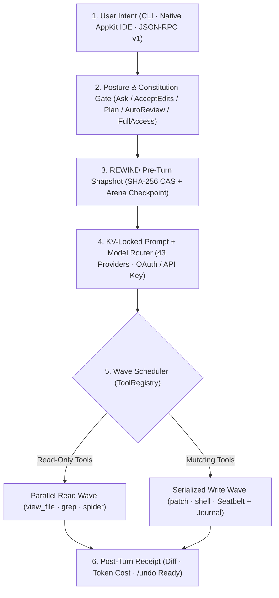

---

## Your First 5 Minutes: Adoption Ladder

Smooth your onboarding by progressing through four natural stages — you never have to adopt the whole stack at once:

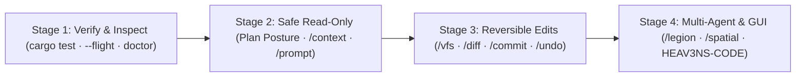

| Stage | Everyday Analogy | Try This First | What You Gain |
| :--- | :--- | :--- | :--- |
| **1. Verify Offline** | *Pre-flight instrument check* | `cargo run -- --flight` and `cargo run -- doctor` | Zero-network proof that tools, CAS, and Joyzoning invariants work on your machine. |
| **2. Read-Only Recon** | *Look before you touch* | Cycle `Shift+Tab` to `Plan`, then run `/context` and `/prompt` | Inspect exact token budgets, active tools, and prompt prefixes with zero disk mutations. |
| **3. Reversible Editing** | *Drafting in pencil first* | Stage edits with `/vfs`, inspect `/diff`, then `/commit` or `/undo` | Every file change is hash-verified against disk baselines and instantly rollable back. |
| **4. Swarm & Spatial** | *Delegating to a crew* | Use `/legion` for parallel tasks or `/spatial` for GUI automation | Exclusive file locks prevent worker collisions; Double-Wrapped spatial grounding prevents blind clicks. |

### Learn by Doing: 3 Thirty-Second Micro-Drills

| Drill | 1. Try This | 2. Notice This | 3. Concept Internalized |
| :--- | :--- | :--- | :--- |
| **Drill A: Safe Recon** | Run `cargo run -- --flight` then `cargo run -- context` | All 5 scenarios pass offline; context budget shows locked prefix + 15 core tools. | **Zero-trust deterministic runtime** (no black-box prompts). |
| **Drill B: Pencil -> Ink** | In REPL, press `Shift+Tab` to `Plan`, then `AcceptEdits`; try `/vfs`, `/diff`, `/undo` | `Plan` blocks writes; `/diff` previews staged changes before `/commit`; `/undo` restores prior state. | **Reversible editing** (`REWIND` + `ExecutionPosture`). |
| **Drill C: Runway Queue** | Submit a task, then immediately queue a 2nd task while #1 runs | #2 waits in `HoldingPattern` (`[Edit \| Drop]`) without interrupting #1's disk state. | **Single-runway turn safety** (`RuntimeRequestQueue`). |

### Choose Your Cockpit (3 Ways to Run)

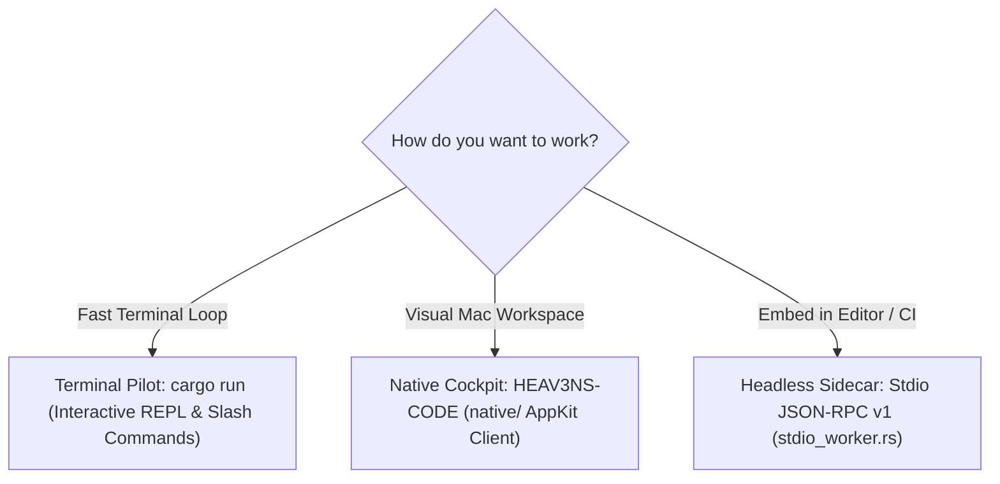

### A Real 60-Second Bugfix Story (Putting It All Together)

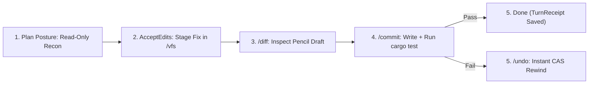

---

## Visual Deep-Dives: How Key Subsystems Work

### 1. `REWIND`: Pencil Draft (`SessionVfs`) vs. Time Machine (`WorkspaceSnapshotCas`)

Think of **VFS Staging** as writing in **pencil** before you ink it onto disk, and **CAS Snapshots** as a **time machine** that can rewind even after ink hits disk:

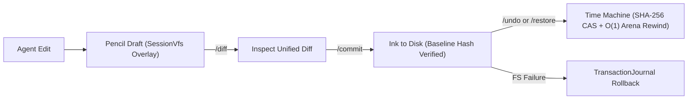

### 2. `COMPUTER USE` & `SYNTHETIC SWARM`: Gloved Hands + Air-Traffic Control

Instead of firing blind screen coordinates or letting parallel workers overwrite each other's files, **HEAV3NS-MICRO** wraps every GUI action in **Double-Wrapped Verification** and every swarm wave in **Exclusive File Locks**:

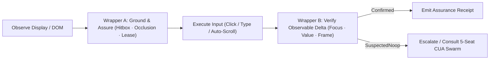

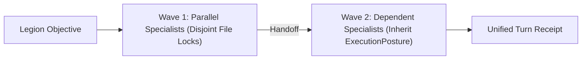

### 3. `BROCCOLI` & Toolbelt Scaling: Muscle Memory + Pegboard vs. Rolling Tool Chest

To keep prompts fast and cache-friendly without losing power, **HEAV3NS-MICRO** keeps **15 core tools** on an always-visible *"workshop pegboard"* and stores **16 specialist tools** in a *"rolling tool chest"* (`tool_search` 8-slot LRU), while `BROCCOLI` distills repeated outcomes into calibrated priors:

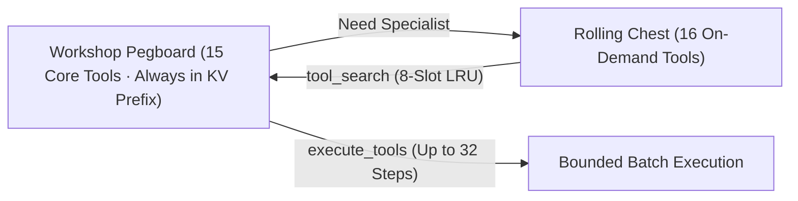

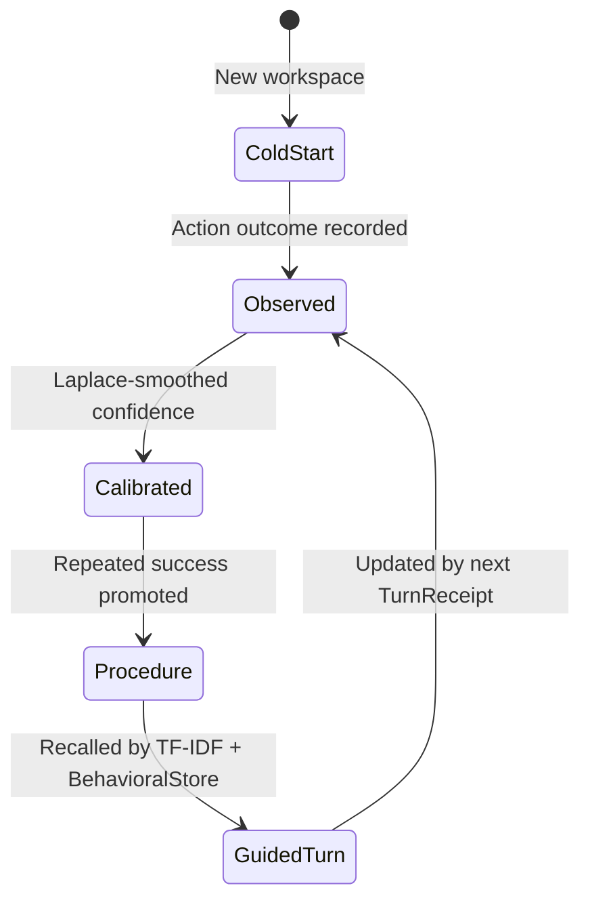

### 4. End-to-End Reversible Turn Lifecycle (`sequenceDiagram`)

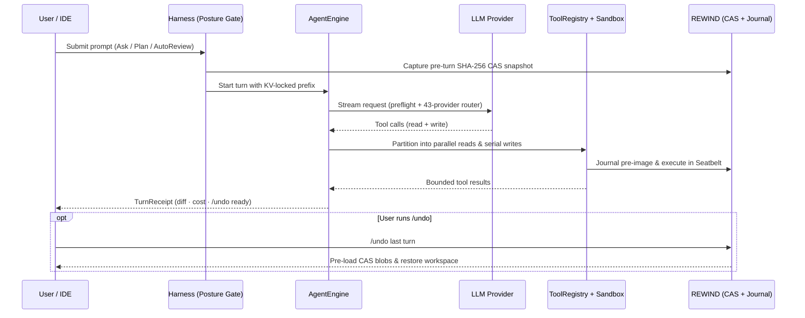

### 5. Native macOS AppKit IDE (`HEAV3NS-CODE`) Architecture

Think of **`HEAV3NS-CODE`** ([`native/`](native/)) as the **glass flight deck** bolted onto the Rust engine over a multiplexed stdio JSON-RPC v1 bridge:

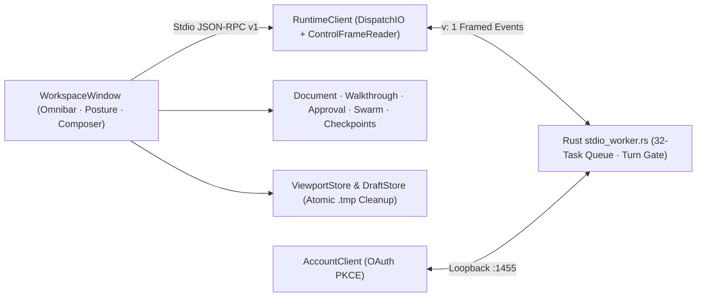

### 6. What the Cockpit HUD Looks Like in Action

```text
┌─ HEAV3NS-MICRO v0.1.0 ── Posture: [AutoReview] (Shift+Tab) ── CAS: snap_4_a91f3c ──┐
│ Context Budget :  18,420 / 200,000 tok (9.2%)  │ KV Prefix : LOCKED (98.4% hit)     │
│ Active Tools   :  15 core + 2 unlocked (spatial_interact, browser_use)               │
│ Last Receipt   :  turn_0004 · 2 files modified · $0.014 · /diff or /undo ready       │
└──────────────────────────────────────────────────────────────────────────────────────┘
```

### 7. Clear & Present Queues: Single-Runway Air-Traffic Control

What happens if you type three follow-up instructions while the agent is still mid-turn? **Nothing gets lost, and nothing collides.** Think of [`RuntimeRequestQueue`](src/core/request_queue.rs), [`stdio_worker.rs`](src/ui/stdio_worker.rs), and `QueuedInstructions.swift` as **single-runway air-traffic control**:

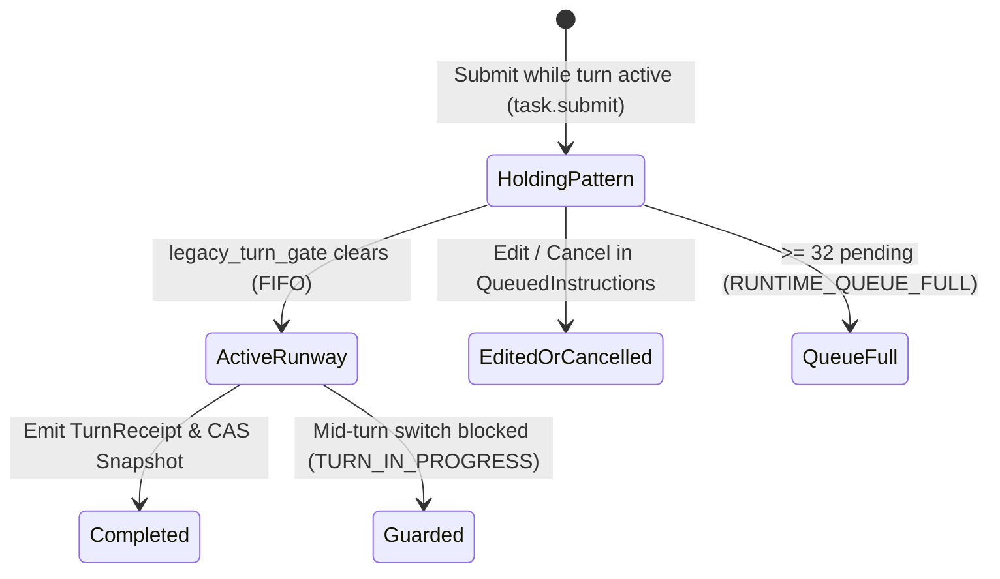

```text
┌─ Instruction Queue (1 Running · 2 Waiting · Cap: 32) ────────────────────────────────┐
│  ▶ [RUNNING]  turn_0005  "Refactor auth middleware & run cargo test"                 │
│  ⏳ [QUEUED 1] req_0006   "Update CHANGELOG.md with the auth changes"  [Edit | Drop] │
│  ⏳ [QUEUED 2] req_0007   "Run joy-check --theme strict"               [Edit | Drop] │
└──────────────────────────────────────────────────────────────────────────────────────┘
```

### 8. Long-Session Context Hygiene: Carry-On Suitcase + Spillover Locker

What happens when a command dumps 10,000 lines or a session runs for 50 turns? **HEAV3NS-MICRO** never silently crashes or forgets your active tool call:

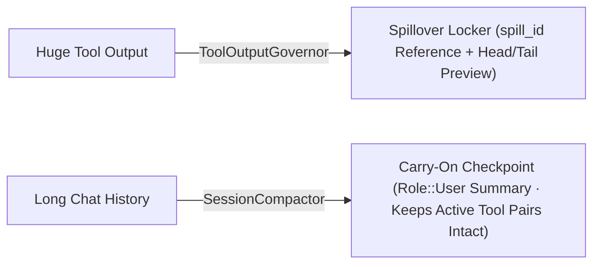

---

## 5-Zone Joyzoning Architecture (`96` Rust Modules · `343` Workspace Files)

> [!IMPORTANT]
> **The Kitchen Analogy for Joyzoning:** `PLUMBING` is the knives and thermometers (stateless utilities), `DOMAIN` is the recipes and contracts (pure rules, 0% I/O), `INFRASTRUCTURE` is the stove and pantry (concrete I/O adapters), `CORE` is the head chef (orchestrating turns via domain traits), and `UI` is the dining room (CLI, JSON-RPC, and native macOS AppKit IDE). Dependencies flow strictly inward — never upward.

Every source file belongs to one of five strictly enforced architectural zones, verified by `joy-check --theme strict`:

| Zone | Path | Responsibility & Invariants |
| :--- | :--- | :--- |
| **`PLUMBING`** | [`src/plumbing/`](src/plumbing/mod.rs) (`14` modules), `native/...` | Stateless leaf primitives: `hash_and_math.rs`, `text_tokens.rs`, `oauth_pkce.rs`, `json_repair.rs`, `schema_and_sse.rs`, `secret_redactor.rs`, `seatbelt_profile.rs`, `shell_guard.rs`, `fuzzy_patch.rs`, `vision_and_dom.rs`, `spatial_geometry.rs`, `environmental_diff.rs`, `display_telemetry.rs`. **0 upward imports, 0 mutable state (`SPI-205`).** |
| **`DOMAIN`** | [`src/domain/`](src/domain/mod.rs) (`34` modules) | Pure entities & `24` port traits ([`interfaces/`](src/domain/interfaces/mod.rs)), behavioral & value types ([`types/`](src/domain/types/mod.rs), [`model_catalog.rs`](src/domain/types/model_catalog.rs), [`posture_types.rs`](src/domain/types/posture_types.rs), [`provider_registry.rs`](src/domain/types/provider_registry.rs)), [`SystemPromptSpec`](src/domain/prompt_spec.rs), [`PrefixStabilityTracker`](src/domain/prefix_and_manifest.rs), [`BillingMetering`](src/domain/pricing_and_taxonomy.rs), [`TurnReceipt`](src/domain/turn_receipt.rs), [`ArenaAllocator`](src/domain/arena.rs), [`VirtualDisplayState`](src/domain/computer_use.rs), [`SpatialActionMediator`](src/domain/spatial_mediator.rs), [`SkillTreeCatalog`](src/domain/skill_tree.rs), [`MemoryStore`](src/domain/memory.rs), [`CompactionPolicy`](src/domain/compaction.rs), [`SwarmAssignment`](src/domain/swarm.rs), and [`ToolCallArgParser`](src/domain/tool_parser.rs). **0% I/O (`SPI-206`), `<= 3` structs/file (`SPI-203`).** |
| **`INFRASTRUCTURE`** | [`src/infrastructure/`](src/infrastructure/mod.rs) (`16` modules) | Concrete I/O adapters: [`HttpProvider`](src/infrastructure/http_provider.rs), [`wire_dialects`](src/infrastructure/wire_dialects.rs), [`sse_and_response_parsers`](src/infrastructure/sse_and_response_parsers.rs), [`CodexAccountStore`](src/infrastructure/codex_oauth.rs), [`ProjectRunner`](src/infrastructure/project_runner.rs), [`pricing_updater`](src/infrastructure/pricing_updater.rs) (`ModelPricingRegistry`), [`ScriptedProvider`](src/infrastructure/scripted_provider.rs), [`SessionVfs`](src/infrastructure/vfs_store.rs), [`WorkspaceSnapshotCas`](src/infrastructure/workspace_cas.rs), [`BehavioralKnowledgeStore`](src/infrastructure/behavioral_store.rs), [`TransactionJournal`](src/infrastructure/transaction_journal.rs), [`execute_shell_command_sandboxed`](src/infrastructure/shell_runner.rs), [`dispatch_fs_tool`](src/infrastructure/fs_tools.rs), and [`search_tools`](src/infrastructure/search_tools.rs). |
| **`CORE`** | [`src/core/`](src/core/mod.rs) (`23` modules) | Use-case orchestration: [`AgentEngine`](src/core/engine.rs), [`turn_orchestrator`](src/core/turn_orchestrator.rs), [`batch_executor`](src/core/batch_executor.rs), [`context_inspector`](src/core/context_inspector.rs), [`ComputerUseOrchestrator`](src/core/computer_use_orchestrator.rs), [`SpatialInteractionEngine`](src/core/spatial_engine.rs), [`slash_and_swarm`](src/core/slash_and_swarm.rs), [`SessionStore`](src/core/session_store.rs), [`ToolRegistry`](src/core/tool_registry.rs), [`tool_specs`](src/core/tool_specs.rs), [`ToolOutputGovernor`](src/core/tool_governor.rs), [`RuntimeRequestQueue`](src/core/request_queue.rs), [`flight_runner`](src/core/flight_runner.rs), [`benchmark_runner`](src/core/benchmark_runner.rs), and test suites (`substrate_tests`, `spatial_tests`, `computer_use_tests`, `zenith_tests`, `codewhale_zenith_tests`, `codex_oauth_e2e_tests`, `zenith_hardening_tests`). |
| **`UI`** | [`src/ui/`](src/ui/mod.rs) (`7` modules + roots), [`native/`](native/) | CLI presenter (`cli_presenter.rs`, `onboarding.rs`), multiplexed stdio JSON-RPC worker (`stdio_worker.rs`, `worker_handlers.rs`, `provider_rpc.rs`), desktop RPC router (`rpc_dispatch.rs`), AppKit Native Desktop IDE (`native/Sources/Heav3nsCode/`), and Composition Roots ([`lib.rs`](src/lib.rs), [`main.rs`](src/main.rs)). |

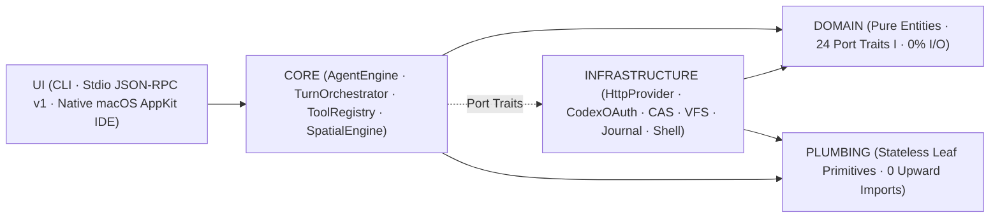

### "Where Does Everything Live?" Folder-to-Kitchen Map

Think of the repository like a well-run restaurant kitchen — every folder has one clear job and never crosses into another station's lane:

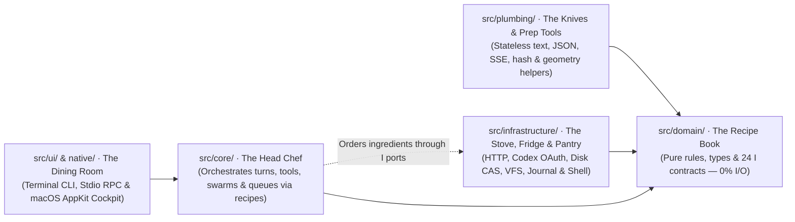

| If You Want to Change... | Open This Folder | Kitchen Rule |
| :--- | :--- | :--- |
| How text, diffs, JSON, or safety checks work | [`src/plumbing/`](src/plumbing/) | Pure tools only — never reads files, network, or other zones |
| Core data shapes, budgets, or `I<Name>` contracts | [`src/domain/`](src/domain/) | Zero I/O — recipes only, never talks to disk or network |
| Provider HTTP dialects, OAuth, CAS, or shell runners | [`src/infrastructure/`](src/infrastructure/) | Implements `src/domain/interfaces/mod.rs` — never touches UI |
| Turn loop, tool routing, swarms, or queue orchestration | [`src/core/`](src/core/) | Coordinates domain & `I<Name>` ports — never imports UI |
| Terminal output, JSON-RPC, or the macOS AppKit app | [`src/ui/`](src/ui/) · [`native/`](native/) | Talks to `core` only — never reaches straight into `infrastructure` |

---

## Multi-Provider Routing, Wire Dialects & Auth (`43` Providers)

[`provider_registry.rs`](src/domain/types/provider_registry.rs), [`wire_dialects.rs`](src/infrastructure/wire_dialects.rs), and [`codex_oauth.rs`](src/infrastructure/codex_oauth.rs) support multi-provider routing with `ProviderChain` fallback, `ModelPricingRegistry` live OpenRouter synchronization (`12h` TTL), and isolated credential handling:

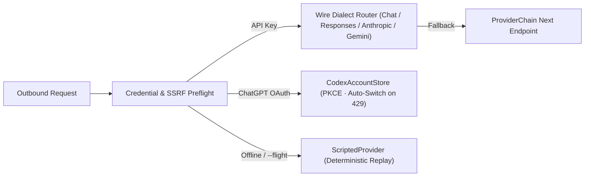

| Wire Dialect | Target Providers & Capabilities | Hardening Invariants |
| :--- | :--- | :--- |
| **OpenAI Chat (`/v1/chat/completions`)** | OpenAI, OpenRouter, DeepSeek, Qwen, Z.AI, MiniMax, Groq, Together, Fireworks, local OpenAI-compatible endpoints | Streaming SSE delta accumulation (`schema_and_sse.rs`), `json_repair.rs`, and `canonical_vendor_prefix` fallback resolution. |
| **OpenAI Responses (`/v1/responses`)** | OpenAI reasoning & responses endpoints | `sanitize_tool_schema_for_responses` (`allOf` `required` union + dangling-key pruning) and strict schema normalization. |
| **OpenAI Codex OAuth PKCE** | `openai-codex` via `CodexAccountStore` (`ICodexAccountStore`) | Pure S256 PKCE + `127.0.0.1:1455` loopback callback, `0600` atomic persistence, single-flight `AsyncMutex` refresh, `429` account auto-switch. |
| **Anthropic (`/v1/messages`)** | Anthropic Claude & `*-anthropic` compatible endpoints | Adaptive thinking blocks, dangling `tool_use` repair, `Role::User` compaction checkpoints for strict `user`-first alternation. |
| **Google Gemini & Local** | Gemini `generateContent` / SSE, Ollama, deterministic `ScriptedProvider` (`FT-01..FT-05`) | Credential-unsent preflight (`CREDENTIAL_REJECTED_UNSENT_CODE`), SSRF/IPv6 endpoint guards, and zero-network flight replay. |

---

## Governance, Tooling & Execution Postures

Think of `ExecutionPosture` (`Shift+Tab`) as a **5-stop safety dimmer switch** — you choose how much autonomy the runtime has at any moment, and fail-closed `.heav3ns/constitution.json` (`RepoConstitution`) rules always win:

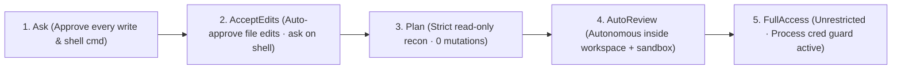

- **5-Stop `ExecutionPosture` (`Shift+Tab`)**: `Ask -> AcceptEdits -> Plan -> AutoReview -> FullAccess` enforced monotonically alongside fail-closed `.heav3ns/constitution.json` (`RepoConstitution`) across tool calls, `AgentEngine::run_swarm`, and `handle_automation_rpc`.
- **31 Native Tools & Parallel Wave Scheduler**: `15` always-loaded core tools + `16` on-demand specialist tools (`tool_search` 8-slot LRU + `execute_tools` 32-step batch) partitioned into parallel read waves and serialized mutation waves in [`tool_registry.rs`](src/core/tool_registry.rs).
- **35 Interactive Slash Commands**: Includes `/mode`, `/posture`, `/preview-request`, `/receipts`, `/turn`, `/restore`, `/undo`, `/models`, `/context`, `/prompt`, `/tools`, `/vfs`, `/diff`, `/commit`, `/skills`, `/rewind`, `/doctor`, `/computer`, `/browser`, `/vision`, `/spatial`, and `/legion`.

### Command Cheat Sheet by Goal (No Memorization Required)

| What You Want to Do | Command / Shortcut | Plain-English Analogy |
| :--- | :--- | :--- |
| **Change autonomy level** | `Shift+Tab` or `/posture` | Turn the 5-stop safety dimmer switch. |
| **See what the model sees** | `/context`, `/prompt`, `/preview-request` | Open the cockpit dashboard before takeoff. |
| **Review staged edits safely** | `/vfs`, `/diff`, `/commit` | Read your pencil draft before inking it to disk. |
| **Undo a mistake instantly** | `/undo`, `/restore`, `/rewind` | Hit the time-machine rewind button. |
| **Switch models or providers** | `/models` | Swap engines mid-flight without losing context. |
| **Run parallel / GUI agents** | `/legion`, `/spatial`, `/computer`, `/browser` | Dispatch the specialist crew or gloved hands. |
| **Check architectural health** | `/doctor` | Run a full diagnostic scan on the airframe. |

---

## Hardening & Reliability Guarantees (Waves 4–25)

Think of **HEAV3NS-MICRO**'s security as **five concentric airport-security & bank-vault rings** — a single bypass attempt has to clear every independent ring before touching your machine or credentials:

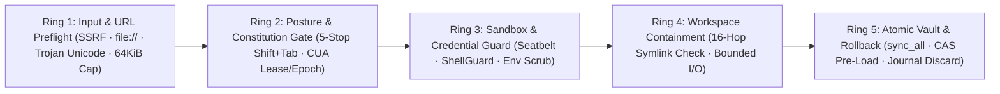

- **Workspace, Sandbox & Credential Isolation**: Dangling-symlink resolution (`canonicalize_best_effort` 16-hop `read_link`), lexical `..` resolution in `classify_sensitive_path`, parent-symlink & `..` rejection in `SessionVfs::commit_all`, child-process credential env scrubbing (`SafetyPolicy::is_sensitive_env_var`), `@` userinfo rejection in `is_safe_oauth_url`, `USER_CONFIG_IO_LOCK` config serialization, and hardened `inspect_command_security` / `ShellCommandGuard` (16-level `sh -c` cap, `rm` normalization, bundled `curl` short-flag & credential-pipe `Deny`, `sort -o`/`rg --pre`/`git -C ... -c` filtering, `&>`/`&>>` heredocs, POSIX `>&1`/`>&2`/`>&-` handling, and macOS Seatbelt).
- **Durable Persistence, Bounded I/O & Parser Safety**: `sync_all()` + temp-rename atomic writes across CAS blobs, manifests, and filesystem tools; fail-closed `WorkspaceSnapshotCas` GC and `rewind_to_snapshot` receipt/CAS alignment; `SessionCompactor` active-turn `[User, Assistant(tc), Tool]` preservation; `ProviderChain` `:model` override retention; bounded `is_file()` disk reads; $O(N)$ SSE/JSON stream parsing, UTF-8 char-boundary pagination, and overflow-safe geometry/CUA checks.
- **Turn Serialization & AppKit Lifecycle**: `legacy_turn_gate` serialization across `task.submit` (`32`-task `RUNTIME_QUEUE_FULL` cap), monotonic `MODEL_SELECT_SEQ` gating, `TURN_IN_PROGRESS` guards on mid-turn conversation switches, posture-checked automation RPC routing, `RuntimeClient.deinit` reservation release, `NSTableView` row bounds guards, viewport clamping/reset on conversation switch, and `client === source` / `closing` / `conversationSwitchGeneration` guards across AppKit windows and stores. See [`CHANGELOG.md`](CHANGELOG.md) and [`docs/SECURITY_BEST_PRACTICES.md`](docs/SECURITY_BEST_PRACTICES.md).

---

## Zero-to-Ready in 3 Commands

If you want to go from a fresh clone to your first live session in under a minute, run these three steps in order:

| Step | Plain-English Goal | Command | What Success Looks Like |
| :---: | :--- | :--- | :--- |
| **1** | **Verify offline** — prove every safety & replay engine works with zero API keys | `cargo run -- --flight` | 5 deterministic flight scenarios pass locally |
| **2** | **Plug in a brain** — save your provider API key or sign in with ChatGPT OAuth | `cargo run -- init` | Key/OAuth stored and provider route ready |
| **3** | **Open the cockpit** — start talking in the terminal or launch the macOS app | `cargo run` *(or `cd native && swift run`)* | Interactive prompt or native macOS IDE opens |

---

## Quick Start & Verification

| Gate | Command | Current Verified Baseline |
| :--- | :--- | :--- |
| **1. Rust Test Suite** | `cargo test` | **129 passed**, `0` failed (unit, spatial, computer-use, OAuth E2E, Wave 4–25 hardening) |
| **2. Agent Flight Suite** | `cargo run -- --flight` | **5 scenarios** (`FT-01..FT-05`, `19/19` checks passing) |
| **3. Native macOS AppKit** | `cd native && swift test` | **323 executed**, `6` skipped, `0` failed |
| **4. Joyzoning & Doctor** | `joy-check . --theme strict` / `--doctor` | **100% Stability Index**, `343` files, `0` errors, `0` warnings |
| **5. Documentation Guardrails** | `node bin/docs-check.mjs` | **72** required docs (`16` ADRs, `6` playbooks, `4` wiki, `5` postmortems, `3` KB), `438` verified links |

```bash
# 1. Run Rust unit, spatial, computer-use, zenith, codewhale, OAuth & hardening test suites (129 tests)
cargo test

# 2. Run Native macOS AppKit test suite (323 tests; 6 skipped)
cd native && swift test && cd ..

# 3. Inspect live prompt & context budget HUD, outbound request manifest, receipts, and Flight Suite
cargo run -- context
cargo run -- preview-request
cargo run -- receipts
cargo run -- doctor
cargo run -- --flight
cargo run -- --smoke

# 4. Run strict Joyzoning architectural audit & Stability Doctor (100% SI, Grade A+)
node /Users/bozoegg/Desktop/HEAV3NS-JOY/bin/joy-check.mjs . --theme strict
node /Users/bozoegg/Desktop/HEAV3NS-JOY/bin/joy-check.mjs . --doctor

# 5. Run documentation guardrails check
node bin/docs-check.mjs
```

---

## "Wait — Why Did the Cockpit Stop Me?" (Guardrail Decoder)

When **HEAV3NS-MICRO** refuses an action, it is almost always protecting you from a silent hazard. Use this quick decoder:

| What Happened | Everyday Analogy | Why It Stopped | 1-Step Fix |
| :--- | :--- | :--- | :--- |
| **Write/command blocked in `Plan`** | *Museum "Look, Don't Touch" mode* | `ExecutionPosture::Plan` forbids all disk & shell mutations. | Press `Shift+Tab` to cycle to `AcceptEdits` or `AutoReview`. |
| **`.env` / `~/.aws` / `~/.ssh` refused** | *Sealed biohazard container* | `ModelContext` credential guard blocks secret files from entering LLM context (even via `cat` or `file://`). | Inspect secrets yourself locally, or pass non-sensitive mock fixtures. |
| **Edit rejected ("stale read")** | *Editing an outdated Google Doc tab* | `FileReadTracker` detected disk changes since the agent last read the file. | Let the agent re-read the file, or run `/undo` if unexpected. |
| **Symlink / `..` path refused** | *Locked emergency exit outside building* | Path resolves outside `workspace_root` or exceeds the 16-hop symlink ceiling. | Keep target files inside the active workspace root. |
| **GUI click returned `SuspectedNoop`** | *Pushing a pull-only door* | `Wrapper B` saw no focus/value/frame change after clicking (e.g., modal occlusion or disabled button). | Inspect the returned `AssuranceReceipt` or enable the prerequisite control. |

### 60-Second Self-Check: Have You Internalized the Cockpit?

| Question | Quick Answer |
| :--- | :--- |
| **1. How do I explore a repo with 0% risk of edits?** | Press `Shift+Tab` to select **`Plan`** posture (or run `cargo run -- --flight`). |
| **2. What is the difference between `/diff` and `/undo`?** | `/diff` previews **pencil-staged** VFS edits *before* `/commit`; `/undo` **rewinds** already-committed CAS changes *after* a turn. |
| **3. Can I send a new prompt while a turn is running?** | **Yes** — it waits safely in `HoldingPattern` (up to `32` queued) behind `legacy_turn_gate` until the active runway clears. |
| **4. Where can I add new I/O code without breaking Joyzoning?** | Put the trait in `src/domain/interfaces/mod.rs`, the I/O adapter in `src/infrastructure/`, and wire it into `src/core/`. |

---

## Documentation Index

- **Architecture & Governance**: [`docs/architecture/current.md`](docs/architecture/current.md) · [`docs/CONSTITUTION.md`](docs/CONSTITUTION.md) · [`docs/adr/README.md`](docs/adr/README.md) · [`CHANGELOG.md`](CHANGELOG.md)
- **Operations & Security**: [`docs/SECURITY_BEST_PRACTICES.md`](docs/SECURITY_BEST_PRACTICES.md) · [`docs/playbooks/README.md`](docs/playbooks/README.md) · [`docs/api/errors.md`](docs/api/errors.md) · [`docs/api/cli.md`](docs/api/cli.md)
- **Knowledge & Benchmarks**: [`docs/wiki/README.md`](docs/wiki/README.md) · [`docs/kb/README.md`](docs/kb/README.md) · [`docs/papers/README.md`](docs/papers/README.md) · [`VALIDATION_REPORT.md`](VALIDATION_REPORT.md)
