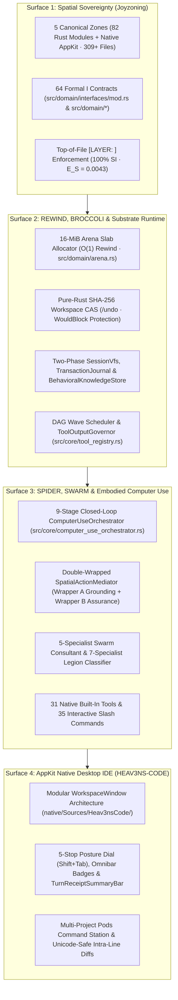

<!-- [LAYER: UI] -->
# HEAV3NS-MICRO Agent Stack & The Seven Sovereign Pillars

<p align="center">
  <a href="README.md">Docs Hub</a> ·
  <a href="../doc.md">Sovereign Charter (doc.md)</a> ·
  <a href="papers/ascendant-intelligence.md">Ascendant Intelligence</a> ·
  <a href="PORTABLE_TRINITY.md">Substrate Primitives</a> ·
  <a href="architecture/current.md">Architecture</a> ·
  <a href="api/public-api.md">Public API</a> ·
  <a href="../AGENTS.md">AGENTS.md</a>
</p>

The **HEAV3NS-MICRO Agent Stack** is the concrete engineering realization of **[`HEAV3NS — The Sovereign Intelligence Architecture`](../doc.md)**. Rather than treating an AI agent as a fragile dynamic wrapper around an LLM endpoint, it organizes cooperating intelligence across **Seven Sovereign Pillars** and **Five Canonical Joyzoning Surfaces**:

1. **`HEAV3NS-MICRO` (The Distilled Intelligence Runtime)**: Multi-turn ReAct engine, KV-cache-deterministic `SystemPromptSpec` (`400t` static prefix, `fnv1a` fingerprint), 3-stage self-healing JSON tool parser, `/context` token HUD, and multi-provider failover.
2. **`SPIDER` (Structural Perception & Environmental Understanding)**: Viewport region partitioning, UI affordance classification, relational graph synthesis, and static AST dependency checks.
3. **`REWIND` (Temporal Cognition, Continuity & Recoverability)**: 16-MiB `ArenaAllocator` ($O(1)$ pointer rewind), pure-Rust SHA-256 `WorkspaceSnapshotCas` (pre/post-turn snapshots, `/undo` with `WouldBlock` protection, non-Git `/diff`), two-phase `SessionVfs` (`VfsDiskBaseline` parity), `TransactionJournal` rollback, 32-deep display undo/redo, and epoch drift reconciliation.
4. **`BROCCOLI` (Persistent Knowledge, Memory & Historical Evolution)**: `BehavioralKnowledgeStore` (Laplace confidence calibration & workflow procedure synthesis), hybrid TF-IDF `MemoryStore`, and Kahn-verified `SkillTreeCatalog` DAG & Soul Drop Vault.
5. **`SYNTHETIC SWARM` (Distributed Collective Intelligence)**: 5-specialist parallel cognitive consultation (`VisualPerceiver`, `StructuralAnalyst`, `WorkflowNavigator`, `RiskAssessor`, `RecoverySpecialist` + `ConflictResolver`) and 7-specialist `Legion` topological task formations with exclusive file reservations & bounded handoffs.
6. **`COMPUTER USE` (Embodied Agency)**: 9-stage closed-loop `ComputerUseOrchestrator`, Double-Wrapped Spatial Action Mediation (`Wrapper A` Grounding + `Wrapper B` Execution Assurance), automatic off-screen pre-scroll, multi-step `execute_plan`, and SSRF-guarded `browser_use`.
7. **`THE HARNESS` (The Sovereign Computational Substrate)**: 5-Zone Joyzoning (`82` Rust modules, `64` `I<Name>` traits), `31` native tools with sticky dynamic schema routing (`15` core active + `16` on-demand via `tool_search` 8-slot LRU + `execute_tools` 32-step batch), 5-stop `ExecutionPosture` (`Shift+Tab`), parameterized macOS Seatbelt sandbox, `ShellCommandGuard` (`ADR-0013`), `ToolOutputGovernor`, `FileReadTracker`, `DeterministicSecretRedactor`, `"v": 1` stdio JSON-RPC bridge, and Native macOS AppKit IDE (`HEAV3NS-CODE`).

---

## The Five Architectural Surfaces



---

## The 31 Native Built-In Agent Tools (`src/core/tool_specs.rs`)

| Category | Tools |
| :--- | :--- |
| **Filesystem & VFS (`12` tools)** | `view_file`, `write_file`, `replace_file_content`, `multi_replace_file_content`, `edit_file_anchored`, `apply_unified_diff`, `delete_file`, `move_file`, `list_dir`, `find_files`, `file_info`, `directory_tree` |
| **Search, Refactor & Git (`4` tools)** | `grep_search`, `search_symbols`, `batch_replace_regex`, `get_workspace_diff` |
| **Execution & Rewind (`2` tools)** | `run_command`, `rollback_last_mutation` |
| **Memory, Spill & Skills (`5` tools)** | `save_memory`, `search_memory`, `retrieve_spill_content`, `list_skills`, `use_skill` |
| **Discovery & Batching (`2` tools)** | `tool_search` (8-slot LRU on-demand tool unlock), `execute_tools` (32-step declarative sequential batch execution) |
| **Embodied CUA, Spatial, Vision & Swarm (`6` tools)** | `computer_use` (`capture`, `click`, `type`, `key`, `scroll`, `orchestrate`, `observe`, `interpret`, `consult_swarm`, `undo`, `redo`, `query_ledger`, `audit_health`), `spatial_interact` (`ground`, `execute`, `plan`, `execute_plan`, `query`, `reconcile`, `audit`, `orchestrate`), `browser_use`, `vision_inspect`, `skill_forge`, `engage_swarm` |

---

## Verification & Guardrails

```bash
# 1. Verify all 77 Rust unit, spatial, computer-use, zenith, Codewhale & substrate tests
cargo test

# 2. Run the 5-scenario Agent Flight suite (FT-01..FT-05, 19 assertion checks)
cargo run -- --flight

# 3. Verify all native macOS AppKit tests (323 executed, 6 skipped)
cd native && swift test && cd ..

# 4. Run strict Joyzoning architectural audit & documentation check
node /Users/bozoegg/Desktop/HEAV3NS-JOY/bin/joy-check.mjs . --theme strict
node bin/docs-check.mjs
```
