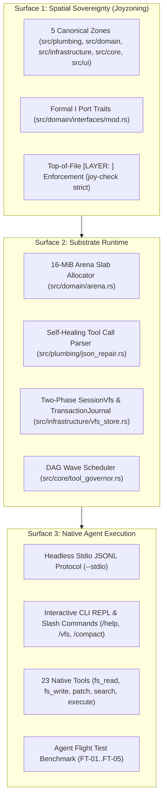

<!-- [LAYER: UI] -->
# HEAV3NS-MICRO Agent Stack

<p align="center">
  <a href="README.md">Docs Hub</a> ·
  <a href="PORTABLE_TRINITY.md">Substrate Primitives</a> ·
  <a href="architecture/current.md">Architecture</a> ·
  <a href="api/public-api.md">Public API</a> ·
  <a href="../AGENTS.md">AGENTS.md</a>
</p>

The **HEAV3NS-MICRO Agent Stack** provides a sovereign, high-throughput execution environment for autonomous AI coding agents. Unlike conventional agent harnesses that rely on fragmented dynamic interpreters, unbounded heap allocations, and brittle tool call regexes, HEAV3NS-MICRO delivers a unified Rust architecture organized across three concrete surfaces:

1. **Spatial Sovereignty (Joyzoning)**: 5 canonical zones (`PLUMBING`, `DOMAIN`, `INFRASTRUCTURE`, `CORE`, `UI`) enforcing strict dependency inversion.
2. **Substrate Runtime**: A 16-MiB contiguous memory arena, $O(1)$ tick pointer rewinding, self-healing JSON parser, and two-phase VFS staging.
3. **Native Agent Execution**: Headless stdio JSONL worker protocol, interactive CLI REPL, 10 slash commands, and a 5-scenario Agent Flight benchmark.

---

## The Three Surfaces



---

## Surface 1: Spatial Sovereignty & Contractual Independence

Every component in HEAV3NS-MICRO resides in its designated Joyzoning zone:

| Zone | Path | Responsibility | Permitted Inward Edges |
| :--- | :--- | :--- | :--- |
| **`PLUMBING`** | `src/plumbing/` | Pure stateless algorithms: FNV-1a hash, Levenshtein, fuzzy patch engine, token counter, JSON repair, and secret redactor. | None. Zero upward dependencies. |
| **`DOMAIN`** | `src/domain/` | State machines, memory models, arena allocator, session compaction, and formal `I<Name>` traits. | May only import `plumbing`. Zero I/O (`SPI-206`). |
| **`INFRASTRUCTURE`** | `src/infrastructure/` | Concrete I/O adapters: HTTP provider, scripted mock provider, disk VFS, transaction journal, shell runner, and search tools. | Implements `domain/interfaces/I*`. |
| **`CORE`** | `src/core/` | Use-case orchestration: agent execution loop, wave scheduler, tool governor, request queue, flight runner, and substrate tests. | Depends on `domain` and `domain/interfaces/I*`. Never on `ui`. |
| **`UI`** | `src/ui/`, `src/lib.rs`, `src/main.rs` | CLI presenter, stdio JSONL worker, command dispatch, and Composition Roots. | Reaches infrastructure only through core. |

---

## Surface 2: High-Performance Substrate Runtime

### 1. 16-MiB Contiguous Arena Allocation
Rather than issuing millions of small heap allocations (`malloc`/`free`) during rapid LLM token generation, HEAV3NS-MICRO pre-allocates a 16-MiB memory slab. Session messages, temporary string tokens, and intermediate tool call buffers are allocated linearly. When a turn finishes, an $O(1)$ pointer rewind resets scratch buffers without memory leaks or fragmentation ([ADR-0002](adr/0002-arena-allocator-and-o1-tick-rewind.md)).

### 2. Self-Healing Streaming Parser
LLM generation frequently exhibits subtle JSON malformations: missing closing braces, unescaped newlines in diff strings, or Markdown codeblock fences (` ```json `). The `json_repair` plumbing automatically repairs truncated JSON objects, normalizes streaming argument deltas, and extracts valid tool calls without failing the agent tick ([ADR-0003](adr/0003-self-healing-tool-call-parser.md)).

### 3. Two-Phase Virtual File System (`SessionVfs`)
Filesystem modifications made by tools (`fs_write`, `patch_apply`) do not touch the underlying disk immediately. Instead:
- Overlays are staged in memory with baseline hash verification (`VfsDiskBaseline`).
- If another process modifies the target file on disk before commit, the commit aborts safely.
- All committed file changes are logged to [`TransactionJournal`](../src/infrastructure/transaction_journal.rs) for instant rollback ([ADR-0004](adr/0004-two-phase-vfs-staging-and-transaction-journal.md)).

### 4. DAG Wave Scheduler
Tool calls emitted in parallel are analyzed by the [`WaveScheduler`](../src/core/tool_governor.rs). Safe read-only operations (`fs_read`, `search_grep`, `git_status`) execute concurrently in parallel worker threads, while mutating actions (`fs_write`, `shell_execute`) are staged into serialized barriers ([ADR-0005](adr/0005-dag-wave-scheduler-concurrency.md)).

---

## Surface 3: Native Agent Execution

### 1. Headless Stdio JSONL Protocol (`--stdio`)
HEAV3NS-MICRO can run as a background coprocessor under IDE plugins, web harnesses, or terminal wrappers. Each interaction follows a standard JSONL schema:
```json
{"jsonrpc":"2.0","method":"turn","params":{"prompt":"audit codebase"},"id":1}
```
Progress events, tool calls, and LLM tokens stream across stdout in deterministic order ([ADR-0006](adr/0006-stdio-jsonl-and-flight-test-harness.md)).

### 2. 23 Native Agent Tools
Built-in tools cover the complete coding spectrum:
- **Filesystem**: `fs_read`, `fs_write`, `fs_remove`, `fs_list`, `fs_stat`
- **Inspection & Search**: `search_grep`, `search_symbol`, `search_path`
- **Patch & Diff**: `patch_apply`, `patch_preview`, `diff_unified`
- **Git & Shell**: `git_status`, `git_diff`, `git_log`, `shell_execute`
- **Session & Memory**: `session_memory_store`, `session_memory_recall`, `session_vfs_status`, `session_vfs_commit`, `session_rollback`
- **Skills & Swarm**: `skill_invoke`, `swarm_delegate`, `agent_status`

---

## Verification & Guardrails

Run the verification suite:
```bash
# Verify all substrate unit and integration tests
cargo test

# Run the 5-scenario Agent Flight suite
cargo run -- --flight

# Verify documentation structure and cross-links
npm run docs:check
```
