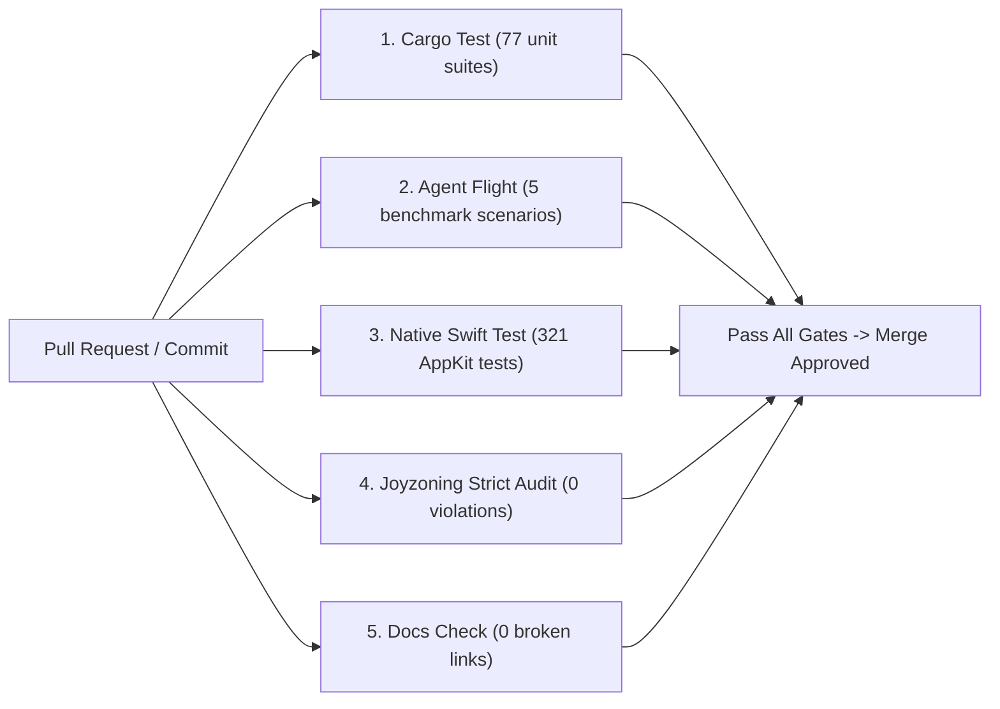

<!-- [LAYER: UI] -->
# Continuous Integration & Verification

<p align="center">
  <a href="README.md">Docs Hub</a> ·
  <a href="MAINTAINER.md">Maintainer Guide</a> ·
  <a href="CODEBASE_STANDARDS.md">Standards</a> ·
  <a href="../AGENTS.md">AGENTS.md</a>
</p>

Guidelines for automated continuous integration, branch protection, and local pre-commit verification for **HEAV3NS-MICRO** and the AppKit Native Desktop client (`native/`).

---

## 1. Automated CI Pipeline

HEAV3NS-MICRO enforces an uncompromising 5-pillar continuous integration pipeline on every pull request:



---

## 2. GitHub Actions Workflow

Below is the standard workflow configuration placed in `.github/workflows/ci.yml`:

```yaml
name: CI Verification

on:
  push:
    branches: [main]
  pull_request:
    branches: [main]

jobs:
  verify-rust:
    name: Rust Substrate & Joyzoning Audit
    runs-on: macos-14
    steps:
      - name: Checkout Codebase
        uses: actions/checkout@v4

      - name: Setup Rust
        uses: dtolnay/rust-toolchain@stable

      - name: Setup Node.js
        uses: actions/setup-node@v4
        with:
          node-version: 20

      - name: Run Cargo Unit Tests
        run: cargo test

      - name: Run Agent Flight Test Suite
        run: cargo run -- --flight

      - name: Run Strict Joyzoning Audit
        run: node /Users/bozoegg/Desktop/HEAV3NS-JOY/bin/joy-check.mjs . --theme strict

  verify-native:
    name: Native macOS AppKit Test Suite
    runs-on: macos-14
    steps:
      - name: Checkout Codebase
        uses: actions/checkout@v4

      - name: Run Swift Package Tests
        run: cd native && swift test
```

---

## 3. Local 8-Point Pre-Commit Verification Checklist

Developers and automated coding agents must execute the standard pre-commit checklist before concluding any turn:

```bash
# 1. Rust unit & integration test suites
cargo test

# 2. Agent Flight benchmark suite
cargo run -- --flight

# 3. Native macOS AppKit test suite
cd native && swift test && cd ..

# 4. Strict Joyzoning architectural audit (must exit 0)
node /Users/bozoegg/Desktop/HEAV3NS-JOY/bin/joy-check.mjs . --theme strict

# 5. StabilityDoctor architectural health check
node /Users/bozoegg/Desktop/HEAV3NS-JOY/bin/joy-check.mjs . --doctor

# 6. Documentation guardrails & link verification
node bin/docs-check.mjs
```
