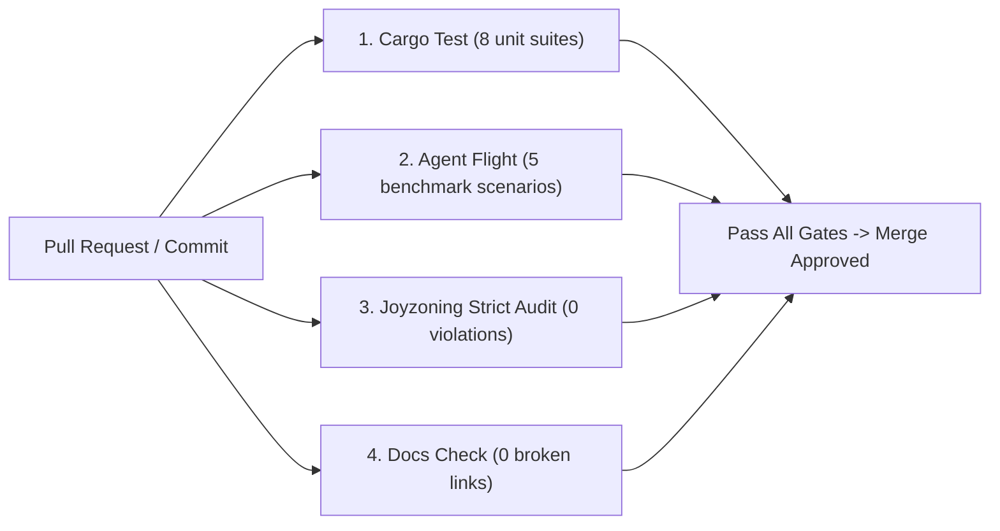

<!-- [LAYER: UI] -->
# Continuous Integration & Verification

<p align="center">
  <a href="README.md">Docs Hub</a> ·
  <a href="MAINTAINER.md">Maintainer Guide</a> ·
  <a href="CODEBASE_STANDARDS.md">Standards</a> ·
  <a href="../AGENTS.md">AGENTS.md</a>
</p>

Guidelines for automated continuous integration, branch protection, and local pre-commit verification for **HEAV3NS-MICRO**.

---

## 1. Automated CI Pipeline

HEAV3NS-MICRO enforces an uncompromising 4-pillar continuous integration pipeline on every pull request:



---

## 2. GitHub Actions Workflow

Below is the standard workflow configuration placed in `.github/workflows/ci.yml`:

```yaml
name: CI Verification

on:
  push:
    branches: [main]
  pull_request:
    branches: [main]

jobs:
  verify:
    runs-on: ubuntu-latest
    steps:
      - name: Checkout Codebase
        uses: actions/checkout@v4

      - name: Setup Rust
        uses: dtolnay/rust-toolchain@stable

      - name: Setup Node.js
        uses: actions/setup-node@v4
        with:
          node-version: 20

      - name: Run Substrate Tests
        run: cargo test

      - name: Run Agent Flight Benchmark
        run: cargo run -- --flight

      - name: Install Joyzoning Tool
        run: npx -y heav3ns-joy@1.0.0 doctor

      - name: Audit Joyzoning Sovereignty
        run: npx -y heav3ns-joy@1.0.0 check . --theme strict

      - name: Verify Documentation Guardrails
        run: node bin/docs-check.mjs
```

---

## 3. Local Git Pre-Commit Hook

Install the local pre-commit hook to catch architectural or test regressions before pushing code:

```bash
mkdir -p .git/hooks
cat << 'HOOK' > .git/hooks/pre-commit
#!/usr/bin/env bash
set -e

echo "==> Running HEAV3NS-MICRO pre-commit checks..."

# 1. Rust unit tests
cargo test --quiet

# 2. Agent flight benchmark
cargo run --quiet -- --flight > /dev/null

# 3. Documentation links and taxonomies
node bin/docs-check.mjs

echo "==> All pre-commit checks passed!"
HOOK
chmod +x .git/hooks/pre-commit
```

---

## 4. Branch Protection Rules

Repositories adopting HEAV3NS-MICRO should configure branch protection on `main`:
- Require status checks to pass before merging:
  - `Substrate Tests`
  - `Agent Flight Benchmark`
  - `Joyzoning Sovereignty`
  - `Docs Check`
- Require linear commit history.
- Disallow force pushes.
