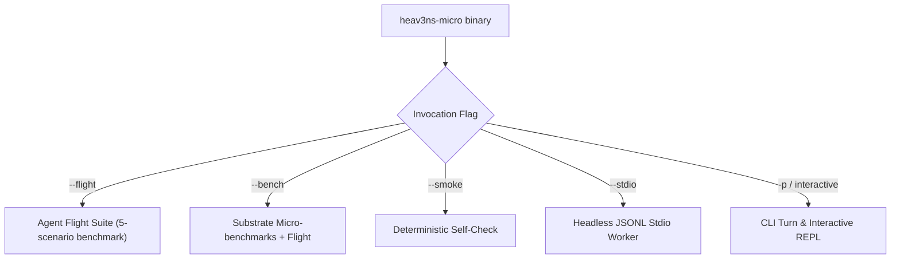

<!-- [LAYER: UI] -->
# Operations Runbook

<p align="center">
  <a href="README.md">Docs Hub</a> ·
  <a href="playbooks/README.md">Playbooks Hub</a> ·
  <a href="api/cli.md">CLI Reference</a> ·
  <a href="SECURITY_BEST_PRACTICES.md">Security</a> ·
  <a href="MAINTAINER.md">Maintainer Guide</a>
</p>

Operational guidelines, execution modes, telemetry monitoring, incident escalation, and runtime management for **HEAV3NS-MICRO**.

---

## 1. Operating Modes

HEAV3NS-MICRO provides four primary execution modes:



### CLI Command Matrix

| Mode | Command | Use Case | Exit Codes |
| :--- | :--- | :--- | :--- |
| **Flight Benchmark** | `heav3ns-micro --flight` | CI/CD gate and post-build verification | `0`: all pass, `1`: failure |
| **Smoke Check** | `heav3ns-micro --smoke` | Fast runtime environment sanity test | `0`: pass, `1`: error |
| **Micro-benchmarks** | `heav3ns-micro --bench` | Arena allocation & parsing throughput analysis | `0`: done |
| **Stdio Worker** | `heav3ns-micro --stdio` | Coprocessor for IDEs (VS Code, Cursor, Windsurf) | Continuous loop |
| **Direct Turn** | `heav3ns-micro -p "<PROMPT>"` | Single headless turn execution | `0`: turn complete, `1`: error |
| **Interactive REPL** | `heav3ns-micro` | Terminal pair-programming and exploration | `0`: clean exit |

---

## 2. Interactive Slash Commands

When running in interactive mode, the following slash commands control session state:

| Command | Action | Substrate Primitive Invoked |
| :--- | :--- | :--- |
| `/help` | Print command usage and active configuration | CLI Presenter |
| `/status` | Display token count, memory arena usage, and authority level | `MicroAgentEngine::session_status` |
| `/compact` | Perform explicit memory arena compaction | `CompactionEngine::compact_session` |
| `/clear` | Reset active session turns and rewind scratch arena | `ArenaAllocator::rewind_to_checkpoint` |
| `/memory` | Inspect stored semantic memories and key-value facts | `AgentMemoryStore::list_memories` |
| `/vfs` | List currently staged Virtual File System overlays | `SessionVfs::export_staged_overlays` |
| `/commit` | Atomically commit staged VFS overlays to disk | `SessionVfs::commit_staged` |
| `/skills` | Display all discovered workspace skill manifests | `SkillsIngestor::discover_manifests` |
| `/rewind` | Roll back the most recent committed file transaction | `TransactionJournal::rollback_last_mutation` |
| `/doctor` | Run comprehensive runtime diagnostic inspection | Substrate health checker |

---

## 3. Stdio Protocol Operations

In `--stdio` mode, the runtime reads newline-delimited JSON RPC messages from `stdin` and writes results to `stdout`:

### Inbound Turn Request
```json
{
  "jsonrpc": "2.0",
  "method": "turn",
  "params": {
    "prompt": "Find all functions returning Result in src/core/engine.rs",
    "authority": "WorkspaceWrite"
  },
  "id": 1
}
```

### Outbound Streaming Progress Event
```json
{
  "jsonrpc": "2.0",
  "method": "progress",
  "params": {
    "step": "executing_tool",
    "tool": "search_symbol",
    "arguments": "{\"path\":\"src/core/engine.rs\",\"query\":\"Result\"}"
  }
}
```

### Outbound Completion Response
```json
{
  "jsonrpc": "2.0",
  "result": {
    "response": "Found 4 functions returning Result in src/core/engine.rs...",
    "tokens_used": 420,
    "staged_files": []
  },
  "id": 1
}
```

---

## 4. Telemetry & Monitoring Invariants

During execution, watch the following metrics:
- **Arena Utilization**: If arena memory usage exceeds 12 MiB (75% of 16-MiB slab), trigger `/compact` or examine token generation depth ([PB-02](playbooks/arena-exhaustion-and-oom-triage.md)).
- **VFS Staged Overlays**: Ensure uncommitted overlays are committed or discarded before starting unrelated tasks.
- **Flight Pass Rate**: CI builds must maintain a 100% pass rate across all 5 flight scenarios (`19/19` assertions).

---

## 5. Incident Response & Troubleshooting

When an operational failure occurs:
1. Identify the symptom code from the output.
2. Route the incident using [Playbooks Hub](playbooks/README.md) or the [Symptom Diagnosis Matrix](kb/symptom-diagnosis-matrix.md).
3. If an architectural violation is reported (`SPI-201..209`), follow [PB-01](playbooks/architectural-violation-remediation.md).
