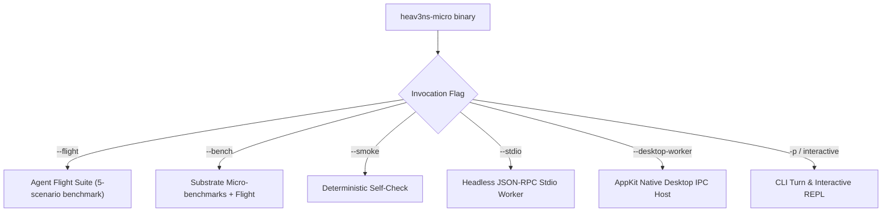

<!-- [LAYER: UI] -->
# Operations Runbook

  <a href="README.md">Docs Hub</a> ·
  <a href="playbooks/README.md">Playbooks Hub</a> ·
  <a href="api/cli.md">CLI Reference</a> ·
  <a href="SECURITY_BEST_PRACTICES.md">Security</a> ·
  <a href="MAINTAINER.md">Maintainer Guide</a> ·
  <a href="architecture/current.md">Architecture</a>

Operational guidelines, execution modes, telemetry monitoring, incident escalation, and runtime management for **HEAV3NS-MICRO** and the AppKit Native Desktop IDE client (`native/`).

---

## 1. Operating Modes

HEAV3NS-MICRO provides five primary execution modes:

### CLI Command Matrix

| Mode | Command | Use Case | Exit Codes |
| :--- | :--- | :--- | :--- |
| **Flight Benchmark** | `heav3ns-micro --flight` | CI/CD gate and post-build verification | `0`: all pass, `1`: failure |
| **Smoke Check** | `heav3ns-micro --smoke` | Fast runtime environment sanity test | `0`: pass, `1`: error |
| **Micro-benchmarks** | `heav3ns-micro --bench` | Arena allocation & parsing throughput analysis | `0`: done |
| **Stdio Worker** | `heav3ns-micro --stdio` | Coprocessor for terminal agents, VS Code, and IDEs | Continuous loop |
| **Desktop Worker** | `heav3ns-micro --stdio --desktop-worker` | Native AppKit Desktop IDE communication host | Continuous loop |
| **Direct Turn** | `heav3ns-micro -p "<PROMPT>"` | Single headless turn execution | `0`: turn complete, `1`: error |
| **Interactive REPL** | `heav3ns-micro` | Terminal pair-programming and exploration | `0`: clean exit |

---

## 2. Desktop Worker Operations (`--desktop-worker`)

When spawned by the native AppKit client (`native/Sources/Heav3nsCode/RuntimeClient.swift`), `heav3ns-micro` operates under the following production constraints:

1. **Protocol Framing (`v: 1`)**: Every outbound message on `stdout` is wrapped in single-line JSON with `"v": 1`.
2. **Diagnostic Stderr Stream**: Diagnostic messages, panic traces, and trace logs are written exclusively to `stderr` to preserve stdout frame integrity.
3. **Session Token Routing**: When `--desktop-account <ACCOUNT>` is passed, the worker initializes with the specific authenticated provider credentials configured by the user.

### Desktop RPC Method Catalog
- `initialize`: Capability negotiation and session initialization.
- `snapshot`: Synchronizes active workspace state, transcripts, and run histories.
- `files.list` / `files.read` / `files.readBinary`: Safe workspace exploration and chunked Base64 binary streaming.
- `changes.read`: Renders unified diffs against Git working tree and staging.
- `spider.check`: Static AST syntax, local imports, and cyclic dependency audits.
- `memory.list` / `memory.save` / `memory.remove`: Persistent conversation memory inspection and modification.
- `task.submit` / `task.stop` / `task.lookup`: Dispatches instructions, handles cooperative cancellation, and reconciles interrupted submissions without replay.
- `swarm.plan` / `swarm.next` / `swarm.report`: Multi-specialist topological swarm orchestration.
- `checkpoint.list` / `checkpoint.restore`: Local Git checkpoint examination and rollback.

---

## 3. Interactive Slash Commands

When running in interactive REPL mode, the following slash commands control session state:

| Command | Action | Substrate Primitive Invoked |
| :--- | :--- | :--- |
| `/help` | Print command usage and active configuration | CLI Presenter |
| `/status` | Display token count, memory arena usage, and authority level | `AgentEngine::config_snapshot` |
| `/compact` | Perform explicit memory arena compaction | `SessionCompactor::compact` |
| `/clear` | Reset active session turns and rewind scratch arena | `ArenaAllocator::rewind_to_checkpoint` |
| `/memory` | Inspect stored semantic memories and key-value facts | `MemoryStore::list_memories` |
| `/vfs` | List currently staged Virtual File System overlays | `SessionVfs::export_staged_overlays` |
| `/commit` | Atomically commit staged VFS overlays to disk | `SessionVfs::commit_staged` |
| `/skills` | Display all discovered workspace skill manifests | `SkillsIngestor::discover_manifests` |
| `/rewind` | Roll back the most recent committed file transaction | `TransactionJournal::rollback_last_mutation` |
| `/doctor` | Run comprehensive runtime diagnostic inspection | Substrate health checker |

---

## 4. Incident Management & Escalation

| Severity | Incident Type | Governing Playbook | Escalation Path |
| :--- | :--- | :--- | :--- |
| **SEV-1** | Arena OOM or heap exhaustion | [`PB-02`](playbooks/arena-exhaustion-and-oom-triage.md) | Runtime Core Team |
| **SEV-1** | Secret detected in event stream | [`PB-05`](playbooks/secret-leakage-and-security-interdiction.md) | Security Lead |
| **SEV-2** | Joyzoning architectural violation (`SPI-201..209`) | [`PB-01`](playbooks/architectural-violation-remediation.md) | Architect on-call |
| **SEV-2** | Desktop IPC disconnect or unconfirmed submission | [`PB-06`](playbooks/desktop-ipc-and-unconfirmed-submission-recovery.md) | Desktop Integration Team |
| **SEV-2** | VFS baseline mismatch or commit conflict | [`PB-04`](playbooks/vfs-commit-conflict-and-journal-rollback.md) | Storage Team |
| **SEV-2** | Flight test regression or parser desync | [`PB-03`](playbooks/flight-test-failures-and-parser-desync.md) | Parser Team |
