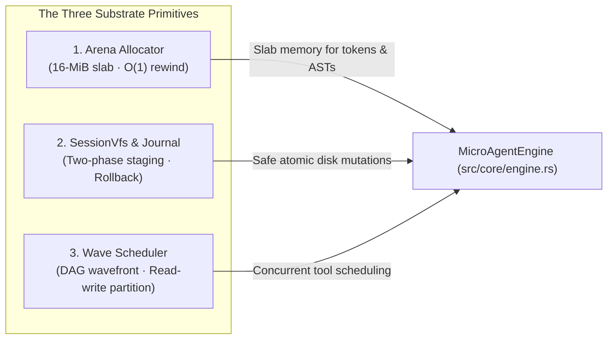

<!-- [LAYER: UI] -->
# Portable Substrate Primitives

<p align="center">
  <a href="README.md">Docs Hub</a> ·
  <a href="AGENT_STACK.md">Agent Stack</a> ·
  <a href="architecture/current.md">Architecture</a> ·
  <a href="api/public-api.md">Public API</a> ·
  <a href="wiki/rust-substrate-architecture.md">Substrate Wiki</a>
</p>

In **HEAV3NS-MICRO**, the operational substrate is anchored by three high-performance Rust primitives—our architectural trinity designed for extreme efficiency, deterministic execution, and sovereign spatial isolation:

1. **`ArenaAllocator`**: Contiguous 16-MiB slab memory manager with $O(1)$ tick pointer rewinding.
2. **`SessionVfs` & `TransactionJournal`**: Two-phase staged filesystem overlays with disk baseline hashing and atomic rollback.
3. **`WaveScheduler` & `ToolGovernor`**: Dependency-aware topological execution wavefront partitioning read-parallelism and write-serialization.

---

## The Substrate Trinity Overview



---

## 1. Contiguous Arena Allocator (`src/domain/arena.rs`)

### Design Motivation
Standard dynamic memory allocators incur synchronization overhead, memory fragmentation, and cache thrashing when thousands of small strings are allocated and discarded during streaming LLM generation. 

### Operational Characteristics
- **Pre-Allocated Memory Slab**: Default 16-MiB contiguous memory block (`DEFAULT_ARENA_CAPACITY_BYTES = 16 * 1024 * 1024`).
- **Bump Pointer Allocation**: Allocations advance an internal offset pointer with 8-byte alignment.
- **$O(1)$ Tick Rewinding**: At turn boundaries, scratch allocations are unwound by resetting the pointer to a recorded watermark (`rewind_to_checkpoint()`).
- **Dynamic Compaction**: If session token depth threatens the watermark threshold, the [`CompactionEngine`](../src/domain/compaction.rs) compresses historical turns into deterministic semantic summaries ([ADR-0002](adr/0002-arena-allocator-and-o1-tick-rewind.md)).

---

## 2. SessionVfs & TransactionJournal (`src/infrastructure/vfs_store.rs`, `src/infrastructure/transaction_journal.rs`)

### Design Motivation
Agent tool execution frequently mutates files on disk (`fs_write`, `patch_apply`). If multiple tools execute concurrently, or if an LLM hallucinates incorrect diff hunks, immediate disk writes can corrupt the host repository.

### Operational Characteristics
- **In-Memory Overlay Staging**: File creations, modifications, and deletions are staged in memory as [`VfsFileOverlay`](../src/domain/types/vfs_types.rs).
- **Disk Baseline Hashing**: Each staged overlay captures the baseline FNV-1a 32-bit hash and byte count of the disk file at read time.
- **Optimistic Concurrency Verification**: During commit ([`SessionVfs::commit_staged`](../src/infrastructure/vfs_store.rs)), disk contents are re-hashed. If an external edit occurred, commit fails safely rather than clobbering work.
- **Atomic Rollback Journal**: Committed operations log reverse undo actions in the [`TransactionJournal`](../src/infrastructure/transaction_journal.rs), allowing instant rollback via `/rewind` or `session_rollback` ([ADR-0004](adr/0004-two-phase-vfs-staging-and-transaction-journal.md)).

---

## 3. Wave Scheduler & Tool Governor (`src/core/tool_governor.rs`)

### Design Motivation
When modern LLMs emit multiple tool calls in a single turn (e.g., searching three directories and reading four files simultaneously), sequential execution wastes time, while unconstrained concurrency risks race conditions.

### Operational Characteristics
- **Read/Write Partitioning**: Tools are categorized by execution side-effects:
  - **Read-Only Tools** (`fs_read`, `search_grep`, `search_symbol`, `git_status`) have zero disk side-effects.
  - **Mutating Tools** (`fs_write`, `patch_apply`, `shell_execute`) alter system state.
- **Topological Wavefronts**: Safe read operations are grouped into a parallel execution wave. Mutating operations are placed into barrier waves executed in deterministic sequence.
- **Authority Level Gates**: Each tool call checks the session [`ExecutionAuthorityLevel`](../src/domain/types/runtime.rs) (ReadOnly, WorkspaceWrite, ShellExecute, FullSovereign) before dispatch ([ADR-0005](adr/0005-dag-wave-scheduler-concurrency.md)).

---

## Substrate Invariants & Guardrails

| Invariant | Enforcement Mechanism | Failure Diagnostic |
| :--- | :--- | :--- |
| Arena Memory Ceiling | Slab capacity check in `ArenaAllocator::allocate` | `ArenaOom` / [PB-02](playbooks/arena-exhaustion-and-oom-triage.md) |
| Disk Reality Parity | FNV-1a hash baseline check in `SessionVfs::commit_staged` | `VfsConflict` / [PB-04](playbooks/vfs-commit-conflict-and-journal-rollback.md) |
| Write Serialization | Mutating barrier partitioning in `WaveScheduler` | `WaveConflict` / [ADR-0005](adr/0005-dag-wave-scheduler-concurrency.md) |
| Credential Redaction | Pattern matching in `DeterministicSecretRedactor` | `SecretSanitized` / [PB-05](playbooks/secret-leakage-and-security-interdiction.md) |

---

## Verification

```bash
cargo test core::substrate_tests
cargo run -- --bench
```
