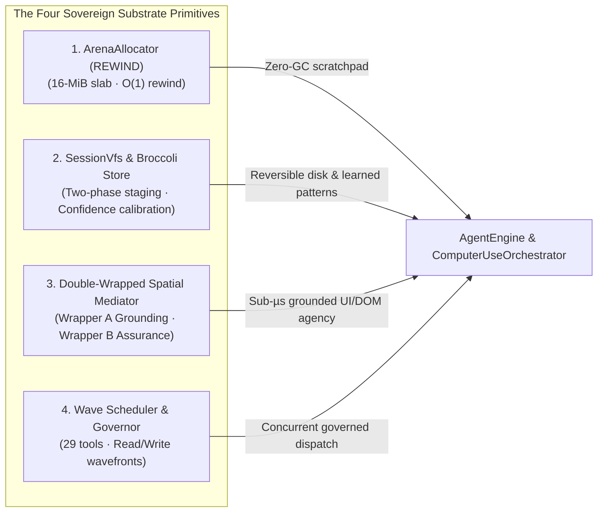

<!-- [LAYER: UI] -->
# Portable Substrate Primitives (`REWIND` · `BROCCOLI` · `COMPUTER USE` · `THE HARNESS`)

<p align="center">
  <a href="README.md">Docs Hub</a> ·
  <a href="../doc.md">Sovereign Charter (doc.md)</a> ·
  <a href="AGENT_STACK.md">Agent Stack</a> ·
  <a href="architecture/current.md">Architecture</a> ·
  <a href="api/public-api.md">Public API</a> ·
  <a href="wiki/rust-substrate-architecture.md">Substrate Wiki</a>
</p>

In **HEAV3NS-MICRO**, the operational substrate is anchored by four high-performance, deterministic Rust primitive families that power **[`HEAV3NS — The Sovereign Intelligence Architecture`](../doc.md)**:

1. **`ArenaAllocator` (`REWIND`)**: Contiguous 16-MiB slab memory manager with $O(1)$ tick pointer rewinding.
2. **`SessionVfs`, `TransactionJournal` & `BehavioralKnowledgeStore` (`REWIND` & `BROCCOLI`)**: Two-phase staged filesystem overlays with FNV-1a disk baseline hashing, atomic rollback, and empirical interaction learning.
3. **`SpatialActionMediator` & `SpatialInteractionEngine` (`COMPUTER USE` & `SPIDER`)**: Double-Wrapped Spatial Action Mediation (`Wrapper A` Grounding in $\le 0.40\ \mu\text{s}$ + `Wrapper B` Execution Assurance) with automatic off-screen pre-scroll and multi-step `SpatialActionPlan` execution.
4. **`WaveScheduler` & `ToolOutputGovernor` (`THE HARNESS`)**: Dependency-aware topological execution wavefront partitioning read-parallelism and write-serialization across 29 built-in tools.

---

## The Sovereign Substrate Overview



---

## 1. Contiguous Arena Allocator (`src/domain/arena.rs`)

- **Pre-Allocated Memory Slab**: Default 16-MiB contiguous memory block (`DEFAULT_ARENA_CAPACITY_BYTES = 16 * 1024 * 1024`).
- **4-Byte Aligned Bump Pointer**: Allocations advance an internal offset pointer with deterministic alignment.
- **$O(1)$ Tick Rewinding**: At turn boundaries, scratch allocations are unwound by resetting the pointer to a recorded `SlabBufferSnapshot` watermark ([ADR-0002](adr/0002-arena-allocator-and-o1-tick-rewind.md)).

---

## 2. Two-Phase `SessionVfs`, `TransactionJournal` & `BehavioralKnowledgeStore`

- **In-Memory Overlay Staging ([`SessionVfs`](../src/infrastructure/vfs_store.rs))**: File writes are staged in memory with FNV-1a 32-bit hash and byte-length baselines (`VfsDiskBaseline`). If an external edit occurs on disk before commit, `commit_staged` aborts safely ([ADR-0004](adr/0004-two-phase-vfs-staging-and-transaction-journal.md)).
- **Atomic Rollback Journal ([`TransactionJournal`](../src/infrastructure/transaction_journal.rs))**: Every direct file mutation records a pre-mutation backup for instant restoration via `/rewind` or `rollback_last_mutation`.
- **Durable Behavioral Knowledge ([`BehavioralKnowledgeStore`](../src/infrastructure/behavioral_store.rs))**: Tracks Laplace-smoothed confidence across UI interaction patterns, synthesizes reusable [`LearnedWorkflowProcedure`](../src/domain/types/learned_knowledge_types.rs) sequences, and reconciles layout epoch drift (`reconcile_state`).

---

## 3. Double-Wrapped Spatial Action Architecture (`src/domain/spatial_mediator.rs`, `src/core/spatial_engine.rs`)

- **Wrapper A (Spatial Grounding Gate)**: Enforces `layout_epoch` freshness, multi-modal target resolution (`som_id`, `s{hex}:{id}`, label, normalized coordinates), exact 2D sweep-line occlusion union (`calculate_rectangles_union_area`), viewport visibility & automatic off-screen pre-scroll (`requires_scroll`), and 15% inset safe points in $\le 0.40\ \mu\text{s}$ ([ADR-0011](adr/0011-sovereign-intelligence-and-spatial-computer-use.md)).
- **Wrapper B (Execution Assurance Gate)**: Enforces `TargetDisabled` and `ActionNotPermittedForRole` preconditions before execution, and verifies observable postconditions (`focus`, `value`, `frame_seq`, `scroll_offset`) after execution.

---

## 4. Wave Scheduler & Tool Governor (`src/core/tool_registry.rs`, `src/core/tool_governor.rs`)

- **Read/Write Wave Partitioning**: Groups read-only tools (`view_file`, `grep_search`, `search_symbols`) into concurrent `futures::future::join_all` waves while isolating mutating tools (`write_file`, `run_command`, `computer_use`, `spatial_interact`) behind serialized barriers ([ADR-0005](adr/0005-dag-wave-scheduler-concurrency.md)).
- **Token-Budget Governor & Loop Breaker**: Truncates oversized outputs using a 65% head / 35% tail budget with disk spill (`retrieve_spill_content`) and halts repetitive tool loops (`ToolLoopBreaker`).

---

## Verification

```bash
cargo test
cargo run -- --bench
```
