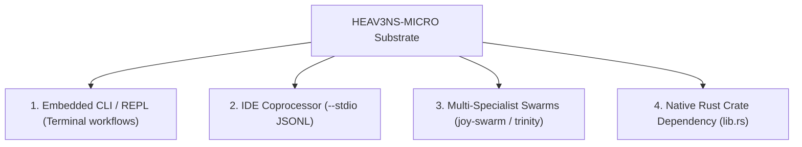

<!-- [LAYER: UI] -->
# Propagation & Adoption Guide

<p align="center">
  <a href="README.md">Docs Hub</a> ·
  <a href="GETTING_STARTED.md">Getting Started</a> ·
  <a href="AGENT_STACK.md">Agent Stack</a> ·
  <a href="../AGENTS.md">AGENTS.md</a>
</p>

How to embed, distribute, and integrate **HEAV3NS-MICRO** into multi-agent systems, IDE extensions, CI workflows, and autonomous developer swarms.

---

## 1. Value Proposition

HEAV3NS-MICRO replaces brittle, memory-leaking Python/JavaScript agent harnesses with an ultra-compact, single-binary Rust runtime:
- **Instant Warmup**: Sub-millisecond startup without runtime interpreter bootstrapping.
- **Fixed Memory Footprint**: Bounded 16-MiB memory slab with zero heap fragmentation.
- **Fail-Safe Mutations**: Two-phase staged filesystem overlays with atomic rollback.
- **Polyglot Agent Support**: Headless stdio JSONL worker protocol compatible with all IDEs.

---

## 2. Integration Archetypes



### 1. Embedded CLI / REPL
Developers use `heav3ns-micro` directly in the shell for autonomous coding tasks, diff reviews, and code refactorings:
```bash
heav3ns-micro -p "Refactor src/domain to extract shared traits"
```

### 2. IDE Coprocessor via Stdio
IDEs (VS Code, Cursor, Windsurf, JetBrains) spawn `heav3ns-micro --stdio` as a persistent child process, exchanging JSON RPC requests over standard I/O.

### 3. Multi-Specialist Swarm Worker
In multi-agent swarms orchestrated by `joy-swarm` or `joy-trinity`, individual specialist roles (Architect, Implementer, Verifier) run on dedicated `heav3ns-micro` instances.

### 4. Direct Crate Dependency
Rust applications include `heav3ns-micro` as a library:
```toml
[dependencies]
heav3ns-micro = { path = "../heav3ns-micro" }
```

---

## 3. Agent Operating Prompts

When deploying autonomous agents to work on a HEAV3NS-MICRO codebase, include the following operational context in agent system prompts:

> **System Prompt Injection**:
> You are operating within HEAV3NS-MICRO, a hyper-compressed Rust micro agent runtime.
> All code must follow the 5-zone Joyzoning architecture (`PLUMBING`, `DOMAIN`, `INFRASTRUCTURE`, `CORE`, `UI`).
> - Every `.rs` file begins with `// [LAYER: <ZONE>]`.
> - `src/domain/` contains zero I/O; `src/plumbing/` contains zero mutable state.
> - Always run `cargo test` and `npm run docs:check` before submitting modifications.

---

## 4. Architectural Cheat Sheet

| Zone | Folder | Allowed Imports | Example Modules |
| :--- | :--- | :--- | :--- |
| **`PLUMBING`** | `src/plumbing/` | None (pure leaf) | `json_repair.rs`, `hash_and_math.rs`, `secret_redactor.rs` |
| **`DOMAIN`** | `src/domain/` | `plumbing` | `arena.rs`, `compaction.rs`, `interfaces/mod.rs` |
| **`INFRASTRUCTURE`** | `src/infrastructure/` | `domain`, `plumbing` | `http_provider.rs`, `vfs_store.rs`, `transaction_journal.rs` |
| **`CORE`** | `src/core/` | `domain`, `infrastructure`, `plumbing` | `engine.rs`, `tool_governor.rs`, `flight_runner.rs` |
| **`UI`** | `src/ui/`, `src/lib.rs`, `src/main.rs` | `core`, `domain`, `plumbing` | `cli_presenter.rs`, `main.rs` |
