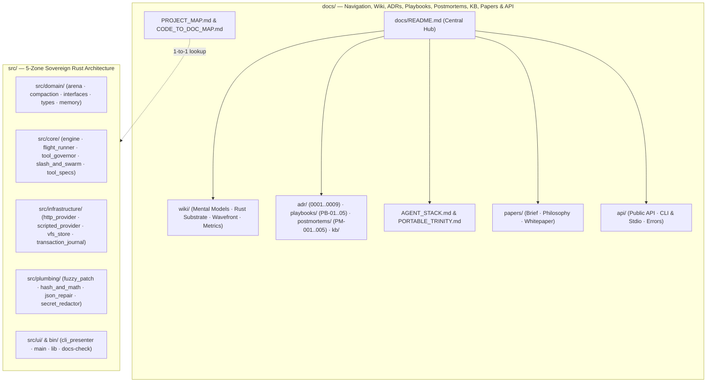

<!-- [LAYER: UI] -->
# HEAV3NS-MICRO Documentation

Documentation for **HEAV3NS-MICRO** (`v0.1.0`), a hyper-compressed, high-performance Rust micro agent runtime structured under the **HEAV3NS-JOY** 5-Zone Joyzoning architecture (`PLUMBING`, `DOMAIN`, `INFRASTRUCTURE`, `CORE`, `UI`). Organized using the **Diátaxis + Institutional Memory** architecture ([ADR-0009](adr/0009-diataxis-documentation-and-knowledge-governance.md)): Tutorials, Operational Playbooks, Normative Specifications & API Reference, Concept Wiki & Papers, Architecture Decision Records (ADRs), Blameless Postmortems, and a 3-Tier Knowledge Base.

<p align="center">
  <a href="GETTING_STARTED.md">Getting Started</a> ·
  <a href="wiki/README.md">Wiki</a> ·
  <a href="adr/README.md">ADRs</a> ·
  <a href="playbooks/README.md">Playbooks</a> ·
  <a href="postmortems/README.md">Postmortems</a> ·
  <a href="kb/README.md">Knowledge Base</a> ·
  <a href="api/README.md">API & CLI</a> ·
  <a href="papers/companion-brief.md">Papers</a> ·
  <a href="../README.md">Repository README</a>
</p>

---

## Table of contents

- [At a glance](#at-a-glance)
- [Documentation architecture (Diátaxis + Institutional Memory)](#documentation-architecture-diátaxis--institutional-memory)
- [How HEAV3NS-MICRO differs](#how-heav3ns-micro-differs)
- [Project configuration](#project-configuration)
- [Start here](#start-here)
- [Reading paths by audience](#reading-paths-by-audience)
- [ADRs, Playbooks, Wiki, Postmortems, & Knowledge Base](#adrs-playbooks-wiki-postmortems--knowledge-base)
- [Where to document what](#where-to-document-what)
- [Release & policy](#release--policy)
- [Architecture & internals](#architecture--internals)
- [Papers](#papers)
- [Runtime & Programmatic API](#runtime--programmatic-api)
- [Local development](#local-development)
- [Principles](#principles)

---

## At a glance

Workspace-verified figures from [papers/companion-brief.md](papers/companion-brief.md) (`v0.1.0`):

| Metric | Value | Source |
| :--- | :--- | :--- |
| Crate version | **0.1.0** (`2021` edition) | [`Cargo.toml`](../Cargo.toml) |
| Canonical architectural zones | **5** (`PLUMBING`, `DOMAIN`, `INFRASTRUCTURE`, `CORE`, `UI`) | [`stability.config.json`](../stability.config.json) |
| Rust source modules (`src/`) | **44** (all `< 800` lines Tier 1 Optimal) | [`docs/PROJECT_MAP.md`](PROJECT_MAP.md) |
| Formal `I<Name>` domain interfaces | **9** (`ILlmProvider`, `IHttpProvider`, `IScriptedProvider`, `IToolExecutor`, `ISessionPersistence`, `IFileSessionPersistence`, `ISessionVfs`, `ISkillsIngestor`, `ITransactionJournal`) | [`src/domain/interfaces/mod.rs`](../src/domain/interfaces/mod.rs) |
| Built-in agent tools | **23** native tools | [`src/core/tool_specs.rs`](../src/core/tool_specs.rs) & [`src/core/tool_registry.rs`](../src/core/tool_registry.rs) |
| Interactive slash commands | **10** (`/help`, `/status`, `/compact`, `/clear`, `/memory`, `/vfs`, `/commit`, `/skills`, `/rewind`, `/doctor`) | [`src/core/slash_and_swarm.rs`](../src/core/slash_and_swarm.rs) |
| Memory arena default slab | **16 MiB** contiguous buffer with $O(1)$ unwinding | [`src/domain/arena.rs`](../src/domain/arena.rs) |
| Agent Flight Test scenarios | **5** (`FT-01..FT-05`, `19/19` checks passing) | [`src/core/flight_runner.rs`](../src/core/flight_runner.rs) |
| Joyzoning Stability Index ($SI$) | **100% (`SOVEREIGN`)** | [`VALIDATION_REPORT.md`](../VALIDATION_REPORT.md) |
| Joyzoning Build Health | **100% (`Grade: A+ — SOVEREIGN`)** | [`VALIDATION_REPORT.md`](../VALIDATION_REPORT.md) |
| Architecture Decision Records (ADRs) | **10** + template | [`docs/adr/README.md`](adr/README.md) |
| Native macOS AppKit Tests | **308** tests passing (`0` failures) | [`native/Tests/Heav3nsCodeTests/`](../native/Tests/Heav3nsCodeTests/) |
| Operational Playbooks | **5** runbooks | [`docs/playbooks/README.md`](playbooks/README.md) |
| Blameless Engineering Postmortems | **5** + template | [`docs/postmortems/README.md`](postmortems/README.md) |
| Concept Wiki & Knowledge Base Articles | **4** wiki guides · **3** KB articles | [`docs/wiki/README.md`](wiki/README.md) · [`docs/kb/README.md`](kb/README.md) |

---

## Documentation architecture (Diátaxis + Institutional Memory)

Modeled on the industry-leading standards of **HEAV3NS-JOY**, **Stripe Docs**, **Backstage TechDocs**, and **Google SRE**:

| Quadrant / Pillar | Purpose | Entry Hub |
| :--- | :--- | :--- |
| **1. Tutorials (Learning)** | Hands-on 10-minute onboarding from clone to running flight tests and REPL turns | [Getting Started](GETTING_STARTED.md) |
| **2. Playbooks (Task / Incident)** | Step-by-step incident triage (`PB-01..05`) & runtime recovery runbooks | [Playbooks Hub](playbooks/README.md) · [Operations Runbook](OPERATIONS.md) |
| **3. Reference (Information)** | Rust traits, CLI flags, 23 tool specifications, and typed error catalogs | [API & CLI Hub](api/README.md) · [Public API](api/public-api.md) |
| **4. Wiki & Papers (Explanation)** | Mental models, memory arena layout, execution wavefront, and whitepaper | [Engineering Wiki](wiki/README.md) · [Papers Hub](papers/README.md) |
| **5. ADRs (Decision Provenance)** | Immutable MADR records (`ADR-0001..0009`) explaining *why* each substrate choice was made | [ADR Registry](adr/README.md) |
| **6. Postmortems (Reliability Memory)** | Blameless SRE postmortems (`PM-001..005`) linking edge cases to code guards & regression tests | [Postmortems Hub](postmortems/README.md) |
| **7. Knowledge Base (Symptom & Heuristic Memory)** | Symptom-to-fix matrix, technical FAQ, & 3-tier runtime knowledge handling | [Knowledge Base Hub](kb/README.md) |

---

## How HEAV3NS-MICRO differs

| Typical agent runtime | HEAV3NS-MICRO |
|-----------------------|---------------|
| Bloated multi-megabyte dependency tree with async runtime sprawl | Lean, hyper-compressed single-binary Rust runtime with zero bloat and 16-MiB Arena slab allocation |
| Uncontrolled memory allocations leading to heap fragmentation | Contiguous **16-MiB Memory Arena** with $O(1)$ tick pointer rewinding and deterministic compaction ([ADR-0002](adr/0002-arena-allocator-and-o1-tick-rewind.md)) |
| Brittle tool-call parsing that crashes on malformed LLM JSON | **Self-healing streaming JSON repair** that recovers unbalanced braces, escaped strings, and markdown blocks ([ADR-0003](adr/0003-self-healing-tool-call-parser.md)) |
| Unverified filesystem mutations and clobbered disk writes | **Two-phase Virtual File System (`SessionVfs`)** with disk baseline hashing and atomic rollback journaling ([ADR-0004](adr/0004-two-phase-vfs-staging-and-transaction-journal.md)) |
| Sequential or unbounded tool execution | **DAG Wave Scheduler** partitioning parallel read wavefronts and serialized write stages ([ADR-0005](adr/0005-dag-wave-scheduler-concurrency.md)) |
| Accidental leakage of tokens and keys into logs | **Deterministic Secret Redactor** sanitizing bearer tokens, credentials, and sensitive file paths ([ADR-0008](adr/0008-secret-redaction-and-security-policy.md)) |



---

## Project configuration

- **Language & Edition**: Rust 2021 edition (`Cargo.toml`)
- **Joyzoning Configuration**: [`stability.config.json`](../stability.config.json) enforcing `strict` theme with 5 canonical zones
- **Agent Operating Rules**: [`AGENTS.md`](../AGENTS.md) and [`SOUL.md`](../SOUL.md)
- **Documentation Verification**: `node bin/docs-check.mjs` verifying link integrity, Diátaxis taxonomies, and metric sync

---

## Start here

1. **New to HEAV3NS-MICRO?** Follow the [Getting Started Tutorial](GETTING_STARTED.md).
2. **Facing a runtime incident or CI block?** Jump to the [Playbooks Hub](playbooks/README.md) or look up symptoms in the [Knowledge Base](kb/symptom-diagnosis-matrix.md).
3. **Exploring the architecture?** Read [System Architecture (Current)](architecture/current.md), [Agent Stack](AGENT_STACK.md), and [Substrate Primitives](PORTABLE_TRINITY.md).
4. **Authoring code changes?** Review [Codebase Standards](CODEBASE_STANDARDS.md) and the [Sovereign Constitution](CONSTITUTION.md).

---

## Reading paths by audience

| Audience | Recommended path | Time |
|----------|------------------|------|
| **Coding agent (immediate task)** | [`AGENTS.md`](../AGENTS.md) → [`SOUL.md`](../SOUL.md) → [Symptom Matrix](kb/symptom-diagnosis-matrix.md) → [Playbook PB-01](playbooks/architectural-violation-remediation.md) | ~5 min |
| **New adopter (evaluator)** | [Companion brief](papers/companion-brief.md) → [ADR Registry](adr/README.md) → [Getting Started](GETTING_STARTED.md) | ~10 min |
| **On-call operator / SRE** | [Operations Runbook](OPERATIONS.md) → [Operational Playbooks](playbooks/README.md) → [Blameless Postmortems](postmortems/README.md) | ~15 min |
| **Architect / theorist** | [Philosophy](papers/philosophy.md) → [Metrics Encyclopedia](wiki/metrics-and-memory-encyclopedia.md) → [Whitepaper](papers/whitepaper.md) | ~30 min |
| **Substrate / runtime integrator** | [Agent stack](AGENT_STACK.md) → [Knowledge-Based Handling](kb/knowledge-handling-architecture.md) → [Substrate Primitives](PORTABLE_TRINITY.md) | ~20 min |
| **Doc / core contributor** | [Maintainer Guide](MAINTAINER.md) → [Docs Guide](DOCS_GUIDE.md) → [Code-to-Doc Map](CODE_TO_DOC_MAP.md) | ~10 min |

---

## ADRs, Playbooks, Wiki, Postmortems, & Knowledge Base

- **[ADRs (`docs/adr/`)](adr/README.md)**: Architectural decisions recorded in MADR format with formal verification commands.
- **[Playbooks (`docs/playbooks/`)](playbooks/README.md)**: Diagnostic runbooks with triage cards, Mermaid trees, and mitigation steps.
- **[Wiki (`docs/wiki/`)](wiki/README.md)**: Conceptual mental models, execution wave geometry, and memory layouts.
- **[Postmortems (`docs/postmortems/`)](postmortems/README.md)**: Retrospectives tracing failures to code guards, regression tests, and ADRs.
- **[Knowledge Base (`docs/kb/`)](kb/README.md)**: 3-tier knowledge handling, symptom resolution matrix, and deep technical FAQs.

---

## Where to document what

- **New Architectural Pattern**: Create an ADR in [`docs/adr/`](adr/README.md) using [`0000-adr-template.md`](adr/0000-adr-template.md).
- **Incident or Failure Mode**: File a postmortem in [`docs/postmortems/`](postmortems/README.md) and link it in [`docs/kb/symptom-diagnosis-matrix.md`](kb/symptom-diagnosis-matrix.md).
- **Operational Procedure**: Add an incident playbook in [`docs/playbooks/`](playbooks/README.md).
- **Deep Explanatory Guide**: Add a chapter in [`docs/wiki/`](wiki/README.md).

---

## Release & policy

- **[Maintainer Guide](MAINTAINER.md)**: CI verification commands, pre-release checklists, and automated guardrail audits.
- **[Release Process](RELEASING.md)**: Semantic versioning, changelog maintenance, and crate release instructions.
- **[CI Integration](CI_INTEGRATION.md)**: Automated GitHub Actions pipelines and local Git hook enforcement.
- **[Security Policy](SECURITY_BEST_PRACTICES.md)**: Vulnerability disclosure, sandbox policies, and secret redactor guarantees.

---

## Local development

```bash
# 1. Run all unit & integration test suites
cargo test

# 2. Run the 5-scenario Agent Flight suite
cargo run -- --flight

# 3. Verify Joyzoning architectural sovereignty (100% SI)
npm run joy-check

# 4. Verify documentation links, structure, and metrics
npm run docs:check
```

---

## Principles

1. **Sovereignty**: Clear layer boundaries with strict dependency inversion (`I<Name>` traits).
2. **Deterministic Memory**: Continuous 16-MiB arena allocation with $O(1)$ rewind per tick.
3. **Resilience**: Self-healing streaming parsing and atomic two-phase filesystem transactions.
4. **Verifiability**: 100% test pass rate and automated documentation parity across the workspace.
