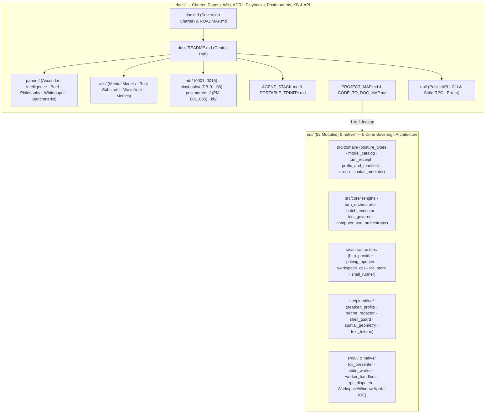

<!-- [LAYER: UI] -->
# HEAV3NS-MICRO Documentation — The Sovereign Intelligence Architecture

Documentation for **HEAV3NS-MICRO** (`v0.1.0`), the distilled Rust intelligence runtime of **[`HEAV3NS — The Sovereign Intelligence Architecture`](../doc.md)** (`HEAV3NS-MICRO`, `SPIDER`, `REWIND`, `BROCCOLI`, `SYNTHETIC SWARM`, `COMPUTER USE`, `THE HARNESS`), structured under the **HEAV3NS-JOY** 5-Zone Joyzoning architecture (`PLUMBING`, `DOMAIN`, `INFRASTRUCTURE`, `CORE`, `UI`). Organized using the **Diátaxis + Institutional Memory** architecture ([ADR-0009](adr/0009-diataxis-documentation-and-knowledge-governance.md)).

<p align="center">
  <a href="../doc.md">Sovereign Charter (doc.md)</a> ·
  <a href="GETTING_STARTED.md">Getting Started</a> ·
  <a href="papers/ascendant-intelligence.md">Ascendant Intelligence</a> ·
  <a href="wiki/README.md">Wiki</a> ·
  <a href="adr/README.md">ADRs</a> ·
  <a href="playbooks/README.md">Playbooks</a> ·
  <a href="postmortems/README.md">Postmortems</a> ·
  <a href="kb/README.md">Knowledge Base</a> ·
  <a href="api/README.md">API & CLI</a> ·
  <a href="papers/companion-brief.md">Papers</a> ·
  <a href="../README.md">Repository README</a>
</p>

---

## Table of contents

- [At a glance](#at-a-glance)
- [The Seven Sovereign Pillars](#the-seven-sovereign-pillars)
- [Documentation architecture (Diátaxis + Institutional Memory)](#documentation-architecture-diátaxis--institutional-memory)
- [How HEAV3NS-MICRO differs](#how-heav3ns-micro-differs)
- [Project configuration](#project-configuration)
- [Start here](#start-here)
- [Reading paths by audience](#reading-paths-by-audience)
- [ADRs, Playbooks, Wiki, Postmortems, & Knowledge Base](#adrs-playbooks-wiki-postmortems--knowledge-base)
- [Where to document what](#where-to-document-what)
- [Release & policy](#release--policy)
- [Local development](#local-development)
- [Principles](#principles)

---

## At a glance

Workspace-verified figures (`v0.1.0`):

| Metric | Value | Source |
| :--- | :--- | :--- |
| Crate version | **0.1.0** (`2021` edition) | [`Cargo.toml`](../Cargo.toml) |
| Sovereign Intelligence Pillars | **7** (`HEAV3NS-MICRO`, `SPIDER`, `REWIND`, `BROCCOLI`, `SYNTHETIC SWARM`, `COMPUTER USE`, `THE HARNESS`) | [`doc.md`](../doc.md) · [`papers/ascendant-intelligence.md`](papers/ascendant-intelligence.md) |
| Canonical architectural zones | **5** (`PLUMBING`, `DOMAIN`, `INFRASTRUCTURE`, `CORE`, `UI`) | [`stability.config.json`](../stability.config.json) |
| Rust source modules (`src/`) | **82** (`12` Plumbing · `31` Domain · `11` Infra · `20` Core · `8` UI/roots, all `< 800` lines Tier 1 Optimal) | [`docs/PROJECT_MAP.md`](PROJECT_MAP.md) |
| Total Joyzoning-audited workspace files | **309+** files (`502` local dependency edges) | [`VALIDATION_REPORT.md`](../VALIDATION_REPORT.md) |
| Formal `I<Name>` contracts | **64** traits (`22` port traits in `src/domain/interfaces/mod.rs` + `42` entity & module contracts) | [`src/domain/interfaces/mod.rs`](../src/domain/interfaces/mod.rs) |
| Built-in agent tools | **31** native tools (`15` core active + `16` on-demand via `tool_search` 8-slot LRU + `execute_tools` 32-step batch) | [`src/core/tool_specs.rs`](../src/core/tool_specs.rs) & [`src/core/tool_registry.rs`](../src/core/tool_registry.rs) |
| Execution postures & governance | **5-stop** cycle (`Ask -> AcceptEdits -> Plan -> AutoReview -> FullAccess` via `Shift+Tab`) + fail-closed `RepoConstitution` | [`src/domain/types/posture_types.rs`](../src/domain/types/posture_types.rs) |
| Frontier model & pricing catalog | **Auto-refreshing** 2026 baseline + live `~/.heav3ns/pricing_catalog.json` (`https://openrouter.ai/api/v1/models`, `12h` TTL) | [`src/domain/types/model_catalog.rs`](../src/domain/types/model_catalog.rs) & [`src/infrastructure/pricing_updater.rs`](../src/infrastructure/pricing_updater.rs) |
| Interactive slash commands | **35** command arms (`/help`, `/mode`, `/posture`, `/preview-request`, `/receipts`, `/turn`, `/restore`, `/undo`, `/models`, `/context`, `/prompt`, `/tools`, `/vfs`, `/diff`, `/commit`, `/skills`, `/rewind`, `/doctor`, `/computer`, `/browser`, `/vision`, `/spatial`, `/legion`, etc.) | [`src/core/slash_and_swarm.rs`](../src/core/slash_and_swarm.rs) |
| Memory & snapshot substrates | **16 MiB** `ArenaAllocator` ($O(1)$ rewind) + pure-Rust SHA-256 `WorkspaceSnapshotCas` (`WouldBlock`-safe `/undo`) | [`src/domain/arena.rs`](../src/domain/arena.rs) & [`src/infrastructure/workspace_cas.rs`](../src/infrastructure/workspace_cas.rs) |
| Spatial grounding throughput | **$\le 0.40\ \mu\text{s}$** per operation (`> 240,000` ops/sec) | [`src/core/spatial_tests.rs`](../src/core/spatial_tests.rs) |
| Rust unit & integration tests | **77** passed (`0` failures) across substrate, spatial, computer-use, prompt/shell-guard zenith, and Codewhale zenith suites | `cargo test` |
| Agent Flight Test scenarios | **5** (`FT-01..FT-05`, `19/19` checks passing) | [`src/core/flight_runner.rs`](../src/core/flight_runner.rs) |
| Native macOS AppKit Tests | **321** tests passing (`0` failures) | [`native/Tests/Heav3nsCodeTests/`](../native/Tests/Heav3nsCodeTests/) |
| Joyzoning Stability Index ($SI$) | **100% (`SOVEREIGN`, $E_S = 0.0043$)** | [`VALIDATION_REPORT.md`](../VALIDATION_REPORT.md) |
| Joyzoning Build Health | **100% (`Grade: A+ — SOVEREIGN`, `0` violations, `0` advisories, `0` optimization notices)** | [`VALIDATION_REPORT.md`](../VALIDATION_REPORT.md) |
| Architecture Decision Records (ADRs) | **15** + template (`ADR-0001..0015`) | [`docs/adr/README.md`](adr/README.md) |
| Operational Playbooks | **6** runbooks (`PB-01..06`) | [`docs/playbooks/README.md`](playbooks/README.md) |
| Blameless Engineering Postmortems | **5** + template (`PM-001..005`) | [`docs/postmortems/README.md`](postmortems/README.md) |
| Concept Wiki, KB & Papers | **4** wiki guides · **3** KB articles · **5** papers | [`docs/wiki/README.md`](wiki/README.md) · [`docs/kb/README.md`](kb/README.md) · [`docs/papers/README.md`](papers/README.md) |

---

## The Seven Sovereign Pillars

| Pillar | Role | Primary Docs & Papers |
| :--- | :--- | :--- |
| **`HEAV3NS-MICRO`** | Distilled intelligence runtime, KV-cache `PrefixStabilityTracker`, `RequestManifest`, auto-refreshing `ModelPricingCatalog`, and self-healing parser | [Whitepaper](papers/whitepaper.md) · [ADR-0003](adr/0003-self-healing-tool-call-parser.md) · [ADR-0012](adr/0012-lean-system-prompt-and-kv-cache-prefix-determinism.md) · [ADR-0015](adr/0015-auto-refreshing-frontier-model-catalog.md) |
| **`SPIDER`** | Structural perception of UI regions/affordances and static AST dependency graphs | [Ascendant Intelligence](papers/ascendant-intelligence.md) · [ADR-0011](adr/0011-sovereign-intelligence-and-spatial-computer-use.md) |
| **`REWIND`** | Temporal continuity across Arena ($O(1)$), SHA-256 `WorkspaceSnapshotCas` (`/undo` / `/restore`), VFS baselines, TransactionJournal, and Display snapshots | [Portable Trinity](PORTABLE_TRINITY.md) · [ADR-0002](adr/0002-arena-allocator-and-o1-tick-rewind.md) · [ADR-0004](adr/0004-two-phase-vfs-staging-and-transaction-journal.md) · [ADR-0014](adr/0014-codewhale-distillation-posture-cas-and-receipts.md) |
| **`BROCCOLI`** | Durable behavioral knowledge store, confidence calibration, TF-IDF memory, and evolutionary skill DAG | [Knowledge Handling](kb/knowledge-handling-architecture.md) · [ADR-0011](adr/0011-sovereign-intelligence-and-spatial-computer-use.md) |
| **`SYNTHETIC SWARM`** | 5-specialist parallel cognitive consultation (`ConflictResolver`) & 7-specialist Legion formations | [Ascendant Intelligence](papers/ascendant-intelligence.md) · [Agent Stack](AGENT_STACK.md) · [ADR-0012](adr/0012-lean-system-prompt-and-kv-cache-prefix-determinism.md) |
| **`COMPUTER USE`** | 9-stage closed-loop embodied agency & Double-Wrapped Spatial Action Mediation (`Wrapper A` + `B`) | [Ascendant Intelligence](papers/ascendant-intelligence.md) · [Whitepaper](papers/whitepaper.md) · [ADR-0011](adr/0011-sovereign-intelligence-and-spatial-computer-use.md) |
| **`THE HARNESS`** | 5-Zone Joyzoning substrate, 5-stop `ExecutionPosture`, macOS Seatbelt sandbox, `TurnReceipt`, 31 tools (`tool_search` + `execute_tools`), multiplexed RPC worker, and AppKit `HEAV3NS-CODE` IDE | [Architecture (Current)](architecture/current.md) · [ADR-0005](adr/0005-dag-wave-scheduler-concurrency.md) · [ADR-0010](adr/0010-native-desktop-integration-and-rpc-protocol.md) · [ADR-0013](adr/0013-shell-command-defenses-and-pipeline-sanitization.md) · [ADR-0014](adr/0014-codewhale-distillation-posture-cas-and-receipts.md) |

---

## Documentation architecture (Diátaxis + Institutional Memory)

| Quadrant / Pillar | Purpose | Entry Hub |
| :--- | :--- | :--- |
| **1. Tutorials (Learning)** | Hands-on 10-minute onboarding from clone to running flight tests, posture inspection, and REPL turns | [Getting Started](GETTING_STARTED.md) |
| **2. Playbooks (Task / Incident)** | Step-by-step incident triage (`PB-01..06`) & runtime recovery runbooks | [Playbooks Hub](playbooks/README.md) · [Operations Runbook](OPERATIONS.md) |
| **3. Reference (Information)** | Rust traits (`64`), CLI flags, `31` tool specifications, multiplexed RPC methods, and typed error catalogs | [API & CLI Hub](api/README.md) · [Public API](api/public-api.md) |
| **4. Wiki & Papers (Explanation)** | Foundational charter, mental models, memory arena layout, spatial mediation, and whitepapers | [Engineering Wiki](wiki/README.md) · [Papers Hub](papers/README.md) · [Ascendant Intelligence](papers/ascendant-intelligence.md) |
| **5. ADRs (Decision Provenance)** | Immutable MADR records (`ADR-0001..0015`) explaining *why* each architectural choice was made | [ADR Registry](adr/README.md) |
| **6. Postmortems (Reliability Memory)** | Blameless SRE postmortems (`PM-001..005`) linking edge cases to code guards & regression tests | [Postmortems Hub](postmortems/README.md) |
| **7. Knowledge Base (Symptom & Heuristic Memory)** | Symptom-to-fix matrix, technical FAQ, & 3-tier runtime knowledge handling | [Knowledge Base Hub](kb/README.md) |

---

## How HEAV3NS-MICRO differs

| Typical agent runtime | HEAV3NS-MICRO (`HEAV3NS` Sovereign Architecture) |
|-----------------------|---------------|
| Solitary model wrapper with no structural or spatial grounding | **7-Pillar Computational Civilization** (`HEAV3NS-MICRO`, `SPIDER`, `REWIND`, `BROCCOLI`, `SYNTHETIC SWARM`, `COMPUTER USE`, `THE HARNESS`) |
| Blind `(x, y)` UI clicks that hit modals, disabled buttons, or off-screen elements | **Double-Wrapped Spatial Action Architecture (`Wrapper A` + `Wrapper B`)** with $\le 0.40\ \mu\text{s}$ grounding, 2D occlusion union, automatic off-screen pre-scroll, and postcondition verification ([ADR-0011](adr/0011-sovereign-intelligence-and-spatial-computer-use.md)) |
| Schema-mutating "plan modes" that invalidate prompt KV caches every toggle | **5-Stop Runtime Posture Gate (`Ask`, `AcceptEdits`, `Plan`, `AutoReview`, `FullAccess`)** + `<context_update>` blocks + `PrefixStabilityTracker` preserving 100% static prefix identity ([ADR-0014](adr/0014-codewhale-distillation-posture-cas-and-receipts.md)) |
| Stale hardcoded model tables and fake `$0.0000` cost estimates | **Auto-Refreshing 2026 Frontier `ModelPricingCatalog`** (`~/.heav3ns/pricing_catalog.json` via OpenRouter `/api/v1/models`) + honest `BillingMetering` (`Metered`, `LocalNoBill`, `Subscription`, `Unknown`) ([ADR-0015](adr/0015-auto-refreshing-frontier-model-catalog.md)) |
| Unverified filesystem mutations, Git-only diffs, and clobbered edits | **Pure-Rust SHA-256 `WorkspaceSnapshotCas`** (`WouldBlock`-safe `/undo`, non-Git `/diff`), `FileReadTracker` staleness guards, two-phase `SessionVfs`, and prose-free `TurnReceipt` (`heav3ns.receipt/v1`) ([ADR-0004](adr/0004-two-phase-vfs-staging-and-transaction-journal.md), [ADR-0014](adr/0014-codewhale-distillation-posture-cas-and-receipts.md)) |
| Sequential or unbounded tool schemas bloating every turn | **31 Native Tools (`15` core + `16` on-demand via `tool_search` 8-slot LRU + `execute_tools` 32-step batch)** & **DAG Wave Scheduler** ([ADR-0005](adr/0005-dag-wave-scheduler-concurrency.md), [ADR-0014](adr/0014-codewhale-distillation-posture-cas-and-receipts.md)) |
| Unsandboxed shell commands, pipe deadlocks, and `.env` leakage | **Parameterized macOS Seatbelt SBPL (`sandbox-exec`)**, concurrent stdout/stderr pipe drain with `-pgid` timeout kills, and dual-scope `CredentialDenyScope` ([ADR-0008](adr/0008-secret-redaction-and-security-policy.md), [ADR-0013](adr/0013-shell-command-defenses-and-pipeline-sanitization.md), [ADR-0014](adr/0014-codewhale-distillation-posture-cas-and-receipts.md)) |



---

## Project configuration

- **Language & Edition**: Rust 2021 edition (`Cargo.toml`) + Swift 5.9 / AppKit (`native/Package.swift`)
- **Joyzoning Configuration**: [`stability.config.json`](../stability.config.json) enforcing `strict` theme across 5 canonical zones (`100%` Stability Index, $E_S = 0.0043$, `Grade: A+ — SOVEREIGN`)
- **Agent Operating Rules**: [`AGENTS.md`](../AGENTS.md), [`SOUL.md`](../SOUL.md), and [`doc.md`](../doc.md) (plus optional fail-closed `.heav3ns/constitution.json`)
- **Documentation Verification**: `node bin/docs-check.mjs` verifying link integrity, Diátaxis taxonomies, and metric sync

---

## Start here

1. **Exploring the Sovereign Vision?** Read [`doc.md`](../doc.md), [The Ascendant Computational Intelligence](papers/ascendant-intelligence.md), and [`ROADMAP.md`](../ROADMAP.md).
2. **New to HEAV3NS-MICRO?** Follow the [Getting Started Tutorial](GETTING_STARTED.md).
3. **Facing a runtime incident or CI block?** Jump to the [Playbooks Hub](playbooks/README.md) or look up symptoms in the [Knowledge Base](kb/symptom-diagnosis-matrix.md).
4. **Exploring the architecture?** Read [System Architecture (Current)](architecture/current.md), [Agent Stack](AGENT_STACK.md), and [Substrate Primitives](PORTABLE_TRINITY.md).
5. **Authoring code changes?** Review [Codebase Standards](CODEBASE_STANDARDS.md) and the [Sovereign Constitution](CONSTITUTION.md).

---

## Reading paths by audience

| Audience | Recommended path | Time |
|----------|------------------|------|
| **Coding agent (immediate task)** | [`AGENTS.md`](../AGENTS.md) → [`SOUL.md`](../SOUL.md) → [Symptom Matrix](kb/symptom-diagnosis-matrix.md) → [Playbook PB-01](playbooks/architectural-violation-remediation.md) | ~5 min |
| **New adopter (evaluator)** | [`doc.md`](../doc.md) → [Companion brief](papers/companion-brief.md) → [ADR Registry](adr/README.md) → [Getting Started](GETTING_STARTED.md) | ~10 min |
| **On-call operator / SRE** | [Operations Runbook](OPERATIONS.md) → [Operational Playbooks](playbooks/README.md) → [Blameless Postmortems](postmortems/README.md) | ~15 min |
| **Architect / theorist** | [Ascendant Intelligence](papers/ascendant-intelligence.md) → [Philosophy](papers/philosophy.md) → [Whitepaper](papers/whitepaper.md) | ~30 min |
| **Substrate / runtime integrator** | [Agent stack](AGENT_STACK.md) → [Knowledge-Based Handling](kb/knowledge-handling-architecture.md) → [Substrate Primitives](PORTABLE_TRINITY.md) | ~20 min |
| **Doc / core contributor** | [Maintainer Guide](MAINTAINER.md) → [Docs Guide](DOCS_GUIDE.md) → [Code-to-Doc Map](CODE_TO_DOC_MAP.md) | ~10 min |

---

## ADRs, Playbooks, Wiki, Postmortems, & Knowledge Base

- **[ADRs (`docs/adr/`)](adr/README.md)**: Architectural decisions (`ADR-0001..0015`) recorded in MADR format with formal verification commands.
- **[Playbooks (`docs/playbooks/`)](playbooks/README.md)**: Diagnostic runbooks (`PB-01..06`) with triage cards, Mermaid trees, and mitigation steps.
- **[Wiki (`docs/wiki/`)](wiki/README.md)**: Conceptual mental models, execution wave geometry, CAS/Arena memory layouts, and receipt schemas.
- **[Postmortems (`docs/postmortems/`)](postmortems/README.md)**: Retrospectives (`PM-001..005`) tracing failures to code guards, regression tests, and ADRs.
- **[Knowledge Base (`docs/kb/`)](kb/README.md)**: 3-tier knowledge handling, symptom resolution matrix, and deep technical FAQs.

---

## Where to document what

- **New Architectural Pattern**: Create an ADR in [`docs/adr/`](adr/README.md) using [`0000-adr-template.md`](adr/0000-adr-template.md).
- **Incident or Failure Mode**: File a postmortem in [`docs/postmortems/`](postmortems/README.md) and link it in [`docs/kb/symptom-diagnosis-matrix.md`](kb/symptom-diagnosis-matrix.md).
- **Operational Procedure**: Add an incident playbook in [`docs/playbooks/`](playbooks/README.md).
- **Deep Explanatory Guide**: Add a chapter in [`docs/wiki/`](wiki/README.md) or paper in [`docs/papers/`](papers/README.md).

---

## Release & policy

- **[Maintainer Guide](MAINTAINER.md)**: CI verification commands, pre-release checklists, and automated guardrail audits.
- **[Release Process](RELEASING.md)**: Semantic versioning, changelog maintenance, and crate release instructions.
- **[CI Integration](CI_INTEGRATION.md)**: Automated GitHub Actions pipelines and local Git hook enforcement.
- **[Security Policy](SECURITY_BEST_PRACTICES.md)**: Vulnerability disclosure, macOS Seatbelt SBPL sandbox policies, dual-scope credential guards, and secret redactor guarantees.

---

## Local development

```bash
# 1. Run all 77 Rust unit, spatial, computer-use, zenith, Codewhale & integration tests
cargo test

# 2. Inspect outbound request manifest, verification receipts, and live 2026 model catalog
cargo run -- preview-request
cargo run -- receipts
cargo run -- models

# 3. Run the 5-scenario Agent Flight suite (FT-01..FT-05)
cargo run -- --flight

# 4. Run all 321 Native macOS AppKit tests
cd native && swift test && cd ..

# 5. Verify Joyzoning architectural sovereignty & StabilityDoctor (100% SI, Grade A+)
node /Users/bozoegg/Desktop/HEAV3NS-JOY/bin/joy-check.mjs . --theme strict
node /Users/bozoegg/Desktop/HEAV3NS-JOY/bin/joy-check.mjs . --doctor

# 6. Verify documentation links, structure, and metrics
node bin/docs-check.mjs
```

---

## Principles

1. **Sovereignty**: Clear 5-Zone layer boundaries with strict dependency inversion (`64` `I<Name>` traits, `22` port contracts in `src/domain/interfaces/`).
2. **Emergent Systems Intelligence**: Cooperation across `HEAV3NS-MICRO`, `SPIDER`, `REWIND`, `BROCCOLI`, `SYNTHETIC SWARM`, `COMPUTER USE`, and `THE HARNESS`.
3. **Deterministic Memory, Prefix Stability & Reversibility**: Contiguous 16-MiB arena allocation ($O(1)$ rewind), pure-Rust SHA-256 `WorkspaceSnapshotCas` (`WouldBlock`-safe `/undo`), baseline-verified two-phase VFS staging, and KV-cache-immutable prompt prefixes (`PrefixStabilityTracker` + `RequestManifest`).
4. **Grounded Embodied Agency & Honest Verification**: Double-Wrapped Spatial Action Mediation (`Wrapper A` Grounding + `Wrapper B` Execution Assurance) and prose-free `TurnReceipt` (`heav3ns.receipt/v1`) verification with honest `BillingMetering`.
5. **Verifiability**: 100% test pass rate (`77` Rust + `321` AppKit tests) and automated documentation parity across the workspace.
