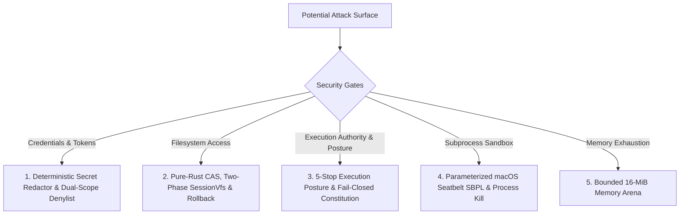

<!-- [LAYER: UI] -->
# Security Best Practices & Policies

  <a href="README.md">Docs Hub</a> ·
  <a href="OPERATIONS.md">Operations</a> ·
  <a href="CONSTITUTION.md">Constitution</a> ·
  <a href="../SECURITY.md">Security Policy</a>

Security guarantees, threat modeling, sandboxing boundaries, and credential protections in **HEAV3NS-MICRO**.

---

## 1. Threat Model & Defense-in-Depth

When autonomous agents execute tools on a developer machine or CI runner, potential attack vectors include:
1. **Prompt Injection**: Malicious instructions embedded in scanned codebases prompting the agent to exfiltrate files or execute destructive commands.
2. **Credential Leakage**: Accidental inclusion of API keys, SSH keys, or environment secrets in progress events or session journals.
3. **Arbitrary File Destruction**: Malformed tool arguments overwriting critical host files outside the repository.
4. **Denial of Service**: Infinite loops or recursive allocations exhausting system memory.

---

## 2. Security Pillars in HEAV3NS-MICRO

### 1. Deterministic Secret Redactor & Dual-Scope Denylist (`src/plumbing/secret_redactor.rs`)
All text routed to progress events, session JSONL persistence, or tool outputs is inspected by the [`DeterministicSecretRedactor`](../src/plumbing/secret_redactor.rs):
- Matches high-entropy tokens: OpenAI API keys (`sk-...`), Anthropic keys, GitHub PATs (`ghp_...`), AWS credentials (`AKIA...`), and generic bearer authorization headers.
- Replaces matches with cryptographic placeholders (`[REDACTED_API_KEY]`) before emission.
- Enforces `CredentialDenyScope`: `.env*` files, `.ssh/id_rsa`, `.aws/credentials`, `.kube/config`, `.gnupg`, `.netrc`, `.git-credentials` are strictly blocked in model context while allowing non-sensitive templates like `.env.example` and `.env.template` ([ADR-0008](adr/0008-secret-redaction-and-security-policy.md), [ADR-0014](adr/0014-codewhale-distillation-posture-cas-and-receipts.md)).

### 2. Pure-Rust Workspace CAS & Two-Phase VFS Isolation
Tools cannot write directly to physical disk without passing through safety layers:
- Mutations are staged in memory via [`SessionVfs`](../src/infrastructure/vfs_store.rs).
- Pre-mutation baseline disk hashes (`VfsDiskBaseline`) prevent overwriting files altered by outside processes.
- Unwanted mutations can be undone via [`TransactionJournal`](../src/infrastructure/transaction_journal.rs) or pure-Rust SHA-256 [`WorkspaceSnapshotCas`](../src/infrastructure/workspace_cas.rs) with `WouldBlock` protection.

### 3. 5-Stop Execution Posture & Fail-Closed Constitution
Agent sessions operate under a 5-stop execution posture ([`ExecutionPosture`](../src/domain/types/posture_types.rs)):
- **`Ask`**: Every mutating tool call prompts the operator.
- **`AcceptEdits`**: Allows bounded file mutations without prompting; commands still prompt.
- **`Plan`**: Enforces strict read-only execution at the governor level without altering wire tool schemas.
- **`AutoReview`**: Executes edits and verifies changes against automated checks.
- **`FullAccess`**: Unrestricted agent execution for autonomous runs.
- **Fail-Closed Governance**: Repository constitutions (`.heav3ns/constitution.json`) are strictly validated via `RepoConstitution::parse_strict`. Any syntax or parsing error defaults to `AuthorizationVerdict::AskUser`.

### 4. Parameterized macOS Seatbelt Sandbox, Env Scrubbing & Process-Group Termination
Subprocess execution (`execute_shell_command_sandboxed` and `ProjectRunner::start`) scrubs sensitive credential environment variables (`SafetyPolicy::sensitive_env_vars()`, covering `*_API_KEY`, `*_ACCESS_KEY`, `*_SECRET*`, `*_TOKEN`, `*_PRIVATE_KEY`, `*_PASSWORD`, and known provider/VCS tokens) before spawning child processes. Shell commands generate dynamic SBPL profiles (`/usr/bin/sandbox-exec`) blocking writes to `.git/hooks`, `.git/config`, `~/.ssh`, `~/.aws`, `~/.gnupg`, and system binaries, run with Unix `.process_group(0)`, and terminate `-pgid` on timeout or cancellation with concurrent stdout/stderr draining. `ProjectRunner` additionally enforces `workspace_root` `cwd` path-escape rejection and `256 KiB` bounded output capture, while the `127.0.0.1:1455` OAuth loopback callback escapes HTML output and bounds per-connection reads to 5s.

### 5. Bounded Memory Slab
The 16-MiB memory arena enforces a strict physical ceiling on runtime memory consumption, preventing rogue prompts from inducing system-wide Out-Of-Memory thrashing.

---

## 3. Reporting a Vulnerability

If you discover a security vulnerability in HEAV3NS-MICRO, please report it via private email to **security@heav3ns.org** rather than opening a public issue. See [`SECURITY.md`](../SECURITY.md) for our coordinated disclosure timeline.
