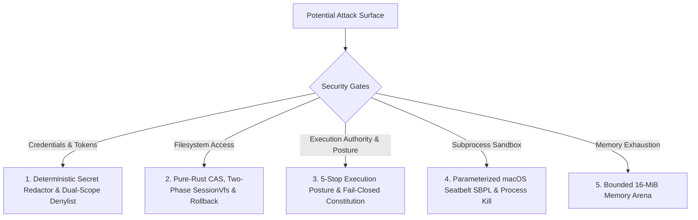

<!-- [LAYER: UI] -->
# Security Best Practices & Policies

  <a href="README.md">Docs Hub</a> ·
  <a href="OPERATIONS.md">Operations</a> ·
  <a href="CONSTITUTION.md">Constitution</a> ·
  <a href="../SECURITY.md">Security Policy</a>

Security guarantees, threat modeling, sandboxing boundaries, and credential protections in **HEAV3NS-MICRO**.

---

## 1. Threat Model & Defense-in-Depth

When autonomous agents execute tools on a developer machine or CI runner, potential attack vectors include:
1. **Prompt Injection**: Malicious instructions embedded in scanned codebases prompting the agent to exfiltrate files or execute destructive commands.
2. **Credential Leakage**: Accidental inclusion of API keys, SSH keys, or environment secrets in progress events or session journals.
3. **Arbitrary File Destruction**: Malformed tool arguments overwriting critical host files outside the repository.
4. **Denial of Service**: Infinite loops or recursive allocations exhausting system memory.

---

## 2. Security Pillars in HEAV3NS-MICRO

### 1. Deterministic Secret Redactor & Dual-Scope Denylist (`src/plumbing/secret_redactor.rs`)
All text routed to progress events, session JSONL persistence, or tool outputs is inspected by the [`DeterministicSecretRedactor`](../src/plumbing/secret_redactor.rs):
- Matches high-entropy tokens: OpenAI API keys (`sk-...`), Anthropic keys, GitHub PATs (`ghp_...`), AWS credentials (`AKIA...`), and generic bearer authorization headers.
- Replaces matches with cryptographic placeholders (`[REDACTED_API_KEY]`) before emission.
- Enforces `CredentialDenyScope`: `.env*` files, `.ssh/id_rsa`, `.aws/credentials`, `.kube/config`, `.gnupg`, `.netrc`, `.git-credentials` are strictly blocked in model context while allowing non-sensitive templates like `.env.example` and `.env.template` ([ADR-0008](adr/0008-secret-redaction-and-security-policy.md), [ADR-0014](adr/0014-codewhale-distillation-posture-cas-and-receipts.md)).

### 2. Pure-Rust Workspace CAS & Two-Phase VFS Isolation
Tools cannot write directly to physical disk without passing through safety layers:
- Mutations are staged in memory via [`SessionVfs`](../src/infrastructure/vfs_store.rs), which normalizes `./` path components, skips symlinks during workspace revision scans, and incrementally cleans up staged keys on partial `commit_all` failures.
- Pre-mutation baseline disk hashes (`VfsDiskBaseline`) prevent overwriting files altered by outside processes.
- Unwanted mutations can be undone via [`TransactionJournal`](../src/infrastructure/transaction_journal.rs) (`64 MiB` total rollback buffer cap, `EACCES` non-clobber guard, and monotonic checkpoint IDs) or pure-Rust SHA-256 [`WorkspaceSnapshotCas`](../src/infrastructure/workspace_cas.rs) (`0o600` receipt logs, path-traversal rejection in `undo_turn_changes`, monotonic-nonce atomic temp writes, and `WouldBlock` protection).

### 3. 5-Stop Execution Posture & Fail-Closed Constitution
Agent sessions operate under a 5-stop execution posture ([`ExecutionPosture`](../src/domain/types/posture_types.rs)):
- **`Ask`**: Every mutating tool call prompts the operator.
- **`AcceptEdits`**: Allows bounded file mutations without prompting; commands still prompt.
- **`Plan`**: Enforces strict read-only execution at the governor level without altering wire tool schemas.
- **`AutoReview`**: Executes edits and verifies changes against automated checks.
- **`FullAccess`**: Unrestricted agent execution for autonomous runs.
- **Swarm, GUI & Wave Governance**: `AgentEngine::run_swarm` inherits the parent `ExecutionPosture` into specialist child engines (`Autonomous` authority is restricted to `AutoReview`/`FullAccess`), `evaluate_tool_posture` inspects sub-actions on `computer_use`, `browser_use`, and `spatial_interact` so mutating GUI actions cannot bypass `Plan`/`Ask` gates, `ToolRegistry::partition_waves` normalizes aliased/stringified path arguments and isolates unknown-resource mutations into separate waves, `run_command` propagates non-zero exits into `ToolExecutionRecord.success`, and `ToolCallArgParser` rejects floats and percentage strings for `ParamType::Integer`.
- **Fail-Closed Governance**: Repository constitutions (`.heav3ns/constitution.json`) are strictly validated via `RepoConstitution::parse_strict`. Any syntax or parsing error defaults to `AuthorizationVerdict::AskUser`.

### 4. Parameterized macOS Seatbelt Sandbox, Env Scrubbing & Process-Group Termination
Subprocess execution (`execute_shell_command_sandboxed` and `ProjectRunner::start`) scrubs sensitive credential environment variables (`SafetyPolicy::sensitive_env_vars()`, covering `SSH_AUTH_SOCK`, `KUBECONFIG`, `GPG_AGENT_INFO`, `AWS_PROFILE`, `AWS_SHARED_CREDENTIALS_FILE`, `*_API_KEY`, `*_ACCESS_KEY`, `*_SECRET*`, `*_TOKEN`, `*_PRIVATE_KEY`, `*_PASSWORD`, and known provider/VCS tokens) before spawning child processes. `ToolRegistry` canonicalizes `run_command` `cwd` values to prevent workspace escapes, while shell commands generate dynamic SBPL profiles (`/usr/bin/sandbox-exec`), fail closed when OS sandbox isolation is unavailable in non-`Unrestricted` modes, block writes to `.git/hooks`, `.git/config`, `~/.ssh`, `~/.aws`, `~/.gnupg`, and system binaries, run with Unix `.process_group(0)`, and terminate `-pgid` on timeout or cancellation with concurrent stdout/stderr draining. `ProjectRunner` additionally enforces `workspace_root` `cwd` path-escape rejection and `256 KiB` bounded output capture, while the `127.0.0.1:1455` OAuth loopback callback escapes HTML output and bounds per-connection reads to 5s.

### 5. SSRF, Cleartext API-Key & Display Lease Guards
- **Navigation & Browser URL Validation (`src/plumbing/vision_and_dom.rs`)**: `validate_navigation_url` blocks `http(s)` SSRF targets across standard and 1–4 part non-standard IPv4 encodings (decimal, hex, octal, e.g., `127.1`, `127.0.1`, `017700000001`), IPv4-mapped IPv6 `[::ffff:...]`, loopback, RFC1918 private networks, CGNAT `100.64.0.0/10`, link-local/ULA IPv6, and cloud IMDS endpoints, and percent-decodes `file://` URLs to block path traversal (`..`) and sensitive host files (`.ssh`, `.aws`, `.env`, `/etc/`). `redact_cdp_url` preserves `#fragment` boundaries, fallback browser HTML escapes interpolated URLs, and DOM snapshots are capped at `MAX_DOM_SNAPSHOT_BYTES` (`64 KiB`).
- **Transport & OAuth Endpoint Isolation (`src/infrastructure/http_provider.rs`, `src/infrastructure/codex_oauth.rs`, `src/ui/rpc_dispatch.rs`)**: Both `HttpProvider::complete` and `probe_openai_compatible_models` refuse to transmit API keys over non-loopback cleartext `http://` endpoints; `CodexAccountStore` validates OAuth URLs against exact `127.0.0.1`/`localhost`/`[::1]` hosts (rejecting `localhost.attacker.com` prefix bypasses); and `rpc_dispatch` enforces fail-closed canonical workspace containment, `SafetyPolicy::check_path`, `SafetyPolicy::scan_for_threats` on `memory.write`, empty-diff isolation on unmodified `changes.read` targets, and `16 MiB` bounded reads across `spider.check`, `files.list`, `files.read`, `files.readBinary`, and `changes.read`.
- **Human-Lease Fencing (`src/domain/computer_use.rs`)**: `VirtualDisplayState` enforces `assert_agent_may_act` across pointer/keyboard/window mutations as well as `lease_acquire`, `lease_release`, `clipboard_write`, `register_window`, `browser_navigate`, `execute_drive_preview`, and `execute_browser_action`.

### 6. Bounded Memory Slab
The 16-MiB memory arena enforces a strict physical ceiling on runtime memory consumption, preventing rogue prompts from inducing system-wide Out-Of-Memory thrashing.

---

## 3. Reporting a Vulnerability

If you discover a security vulnerability in HEAV3NS-MICRO, please report it via private email to **security@heav3ns.org** rather than opening a public issue. See [`SECURITY.md`](../SECURITY.md) for our coordinated disclosure timeline.

---

## Recursive Hardening Invariants (Waves 8–21)

- **Dangling Symlink, Traversal & Credential-Scope Containment**: `canonicalize_best_effort` in `src/infrastructure/search_tools.rs` resolves dangling symlinks via `fs::read_link` (bounded to 16 hops) rather than falling back to lexical workspace paths; `DeterministicSecretRedactor::classify_sensitive_path` lexically resolves `..` segments; and `SessionVfs::commit_all` rejects `..` traversal and symlinked parent directories.
- **Command, Heredoc & Exfiltration Defenses**: `inspect_command_security` enforces a 16-level `sh -c` recursion ceiling, normalizes `rm` targets (`//`, `/./`, `~/*`, `$HOME/*`), catches bundled `curl` short-flag uploads (`-sT`, `-sF`, `-sd`) and credential-pipe `Deny` before `RequireApproval`, excludes `sort -o`/`--output`, `rg --pre`, and flag-preceded `git -C ... -c` from `ReadOnlySafe`, and normalizes whitespace in `SafetyPolicy::check_command`. `ShellCommandGuard` in `src/plumbing/shell_guard.rs` distinguishes POSIX `>&1`/`>&2`/`>&-` fd duplication from file-output redirection and catches `&>`/`&>>` and flag-bearing heredoc pipelines under ADR-0015/ADR-0016.
- **Bounded I/O, `O(N)` Parsers & UTF-8 Safety**: `parse_sse_events` and `compute_streaming_arguments_delta` avoid `O(N^2)` rescanning on malformed streams; `paginate_text_response` advances across multi-byte UTF-8 boundaries; `WorkspaceSnapshotCas::load_recent_receipts` recovers lossy UTF-8 tails; and file reads are bounded across `VfsDiskBaseline` (`16 MiB`), `FileSessionPersistence` (`32 MiB`), `WorkspacePromptProbe` (`256 KiB`), `search_file_lines` (`2 MiB`, `is_file()`), and `TransactionJournal` (`8 MiB`, `is_file()`).
- **OAuth, Config & Credential Isolation**: `is_safe_oauth_url` rejects `@` userinfo bypasses; `run_init_wizard` unconditionally overwrites `api_key` and keys `provider_endpoints` by canonical provider ID; `USER_CONFIG_IO_LOCK` serializes `Heav3nsUserConfig` read-modify-write updates; and `MODEL_SELECT_SEQ` prevents out-of-order `models.select` races.
- **Durable Atomic Persistence & Rollback Integrity**: `atomic_write_file`, `store_blob`, and `atomic_write_workspace_file` call `sync_all()` before `fs::rename`; `WorkspaceSnapshotCas::capture_snapshot` fails closed on manifest persistence errors before GC; `rewind_to_snapshot` truncates future snapshots/CAS entries while preserving receipts at/before snapshot `0`; `SessionCompactor` preserves active-turn `[User, Assistant(tc), Tool]` pairs and clears `transcript` on full rewind; `MemoryStore` caps entries (`128`), field sizes (`2048` bytes), and envelope size (`24,576` bytes); and `format_append_only_context_update` escapes `<`/`>` to block XML fence breakout.
- **Spatial, CUA & Native AppKit Lifecycle Guards**: `SpatialPoint`, `SpatialRect`, `parse_drag_points`, `analyze_spider_structural_relationships`, `VirtualDisplayState`, and `ComputerUseOrchestrator` guard against non-finite floats, `i32`/`i64` overflow, and stale `frame_seq`/`active_window_id`/`failure_counts` state. In `native/`, `RuntimeClient.deinit` releases `historyReservation`, `QueuedInstructions` guards `window` and forces sheet dismissal on `dispose()`, `NSTableView` delegates guard row indices, viewport persistence clamps ranges and resets on conversation switch, and async RPC callbacks verify `self.client === source` and monotonic request tokens.
- **RPC Turn Serialization & Posture Enforcement**: `stdio_worker.rs` bounds `spawned_turns` to `32` (`RUNTIME_QUEUE_FULL`), serializes `task.submit` via `legacy_turn_gate`, rejects mid-turn `conversation.{select,create,delete}` with `TURN_IN_PROGRESS`, and routes `computer.action`, `browser.action`, and `browser.navigate` through `ToolRegistry::execute_single` (blocking `skills.forge` / `skills.lint` mutations in `ExecutionPosture::Plan`).
