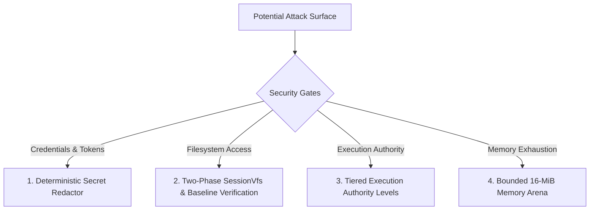

<!-- [LAYER: UI] -->
# Security Best Practices & Policies

  <a href="README.md">Docs Hub</a> ·
  <a href="OPERATIONS.md">Operations</a> ·
  <a href="CONSTITUTION.md">Constitution</a> ·
  <a href="../SECURITY.md">Security Policy</a>

Security guarantees, threat modeling, sandboxing boundaries, and credential protections in **HEAV3NS-MICRO**.

---

## 1. Threat Model & Defense-in-Depth

When autonomous agents execute tools on a developer machine or CI runner, potential attack vectors include:
1. **Prompt Injection**: Malicious instructions embedded in scanned codebases prompting the agent to exfiltrate files or execute destructive commands.
2. **Credential Leakage**: Accidental inclusion of API keys, SSH keys, or environment secrets in progress events or session journals.
3. **Arbitrary File Destruction**: Malformed tool arguments overwriting critical host files outside the repository.
4. **Denial of Service**: Infinite loops or recursive allocations exhausting system memory.

---

## 2. Security Pillars in HEAV3NS-MICRO

### 1. Deterministic Secret Redactor (`src/plumbing/secret_redactor.rs`)
All text routed to progress events, session JSONL persistence, or tool outputs is inspected by the [`DeterministicSecretRedactor`](../src/plumbing/secret_redactor.rs):
- Matches high-entropy tokens: OpenAI API keys (`sk-...`), GitHub PATs (`ghp_...`), AWS credentials (`AKIA...`), and generic bearer authorization headers.
- Replaces matches with cryptographic placeholders (`[REDACTED_API_KEY]`) before emission.
- Interdicts access to sensitive system paths (`~/.ssh`, `~/.aws`, `~/.gnupg`, `/etc/shadow`) ([ADR-0008](adr/0008-secret-redaction-and-security-policy.md)).

### 2. Two-Phase VFS Isolation
Tools cannot write directly to physical disk without passing through [`SessionVfs`](../src/infrastructure/vfs_store.rs):
- Mutations are staged in memory.
- Pre-mutation baseline disk hashes (`VfsDiskBaseline`) prevent overwriting files altered by outside processes.
- Unwanted mutations can be undone via [`TransactionJournal`](../src/infrastructure/transaction_journal.rs).

### 3. Tiered Execution Authority Levels
Agent sessions operate under explicit authority levels ([`ExecutionAuthorityLevel`](../src/domain/types/runtime.rs)):
- **`ReadOnly`**: Can only invoke read-only inspection tools (`fs_read`, `search_grep`, `git_status`).
- **`WorkspaceWrite`**: Can stage and commit file modifications inside the repository.
- **`ShellExecute`**: Permitted to run arbitrary shell commands (`shell_execute`).
- **`FullSovereign`**: Unrestricted agent execution.

### 4. Bounded Memory Slab
The 16-MiB memory arena enforces a strict physical ceiling on runtime memory consumption, preventing rogue prompts from inducing system-wide Out-Of-Memory thrashing.

---

## 3. Reporting a Vulnerability

If you discover a security vulnerability in HEAV3NS-MICRO, please report it via private email to **security@heav3ns.org** rather than opening a public issue. See [`SECURITY.md`](../SECURITY.md) for our coordinated disclosure timeline.
