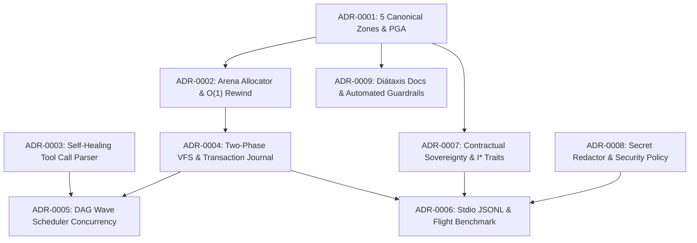

<!-- [LAYER: UI] -->
# Architecture Decision Records (ADRs)

  <a href="../README.md">Docs Hub</a> ·
  <a href="../wiki/README.md">Wiki</a> ·
  <a href="../playbooks/README.md">Playbooks</a> ·
  <a href="../postmortems/README.md">Postmortems</a> ·
  <a href="../kb/README.md">Knowledge Base</a> ·
  <a href="../architecture/current.md">Architecture</a> ·
  <a href="../CONSTITUTION.md">Constitution</a>

An **Architecture Decision Record (ADR)** captures a significant architectural choice in **HEAV3NS-MICRO**, its context, the alternatives evaluated, its consequences, and the **executable verification commands** (`cargo test`, `joy-check`, or `docs-check`) that keep the decision continuously enforced in the codebase.

Our ADR format follows **MADR (Markdown Any Decision Records)**, extended with an explicit `## Verification` section so no ADR ever degrades into unverified prose.

---

## Decision dependency graph

---

## Canonical ADR index

| ADR | Title | Status | Surface | Enforced By |
| :--- | :--- | :---: | :--- | :--- |
| [Template](0000-adr-template.md) | Canonical MADR Template for HEAV3NS-MICRO | Template | Governance | [`bin/docs-check.mjs`](../../bin/docs-check.mjs) |
| [ADR-0001](0001-five-canonical-zones-and-geographic-alignment.md) | Five Canonical Zones & Principle of Geographic Alignment (PGA) | **Accepted** | Spatial Architecture | `joy-check --theme strict` |
| [ADR-0002](0002-arena-allocator-and-o1-tick-rewind.md) | Contiguous 16-MiB Arena Slab & $O(1)$ Tick Watermark Rewind | **Accepted** | Substrate Memory | `test_arena_allocator_alignment_and_o1_rewind` |
| [ADR-0003](0003-self-healing-tool-call-parser.md) | Streaming Self-Healing JSON Repair & Deduplication Engine | **Accepted** | Substrate Parsing | `test_self_healing_parser_and_streaming_dedup` |
| [ADR-0004](0004-two-phase-vfs-staging-and-transaction-journal.md) | Two-Phase Staged VFS with Disk Baseline & Rollback Journal | **Accepted** | Filesystem Safety | `test_vfs_baseline_verification_and_snapshot_rewind` |
| [ADR-0005](0005-dag-wave-scheduler-concurrency.md) | Topological Wave Scheduling for Concurrent Read/Write Tool Waves | **Accepted** | Tool Execution | `test_wave_scheduler_partitioning` |
| [ADR-0006](0006-stdio-jsonl-and-flight-test-harness.md) | Headless Stdio JSONL Worker Protocol & 5-Scenario Flight Test | **Accepted** | Agent Execution | `test_agent_flight_suite_passes_100_percent` |
| [ADR-0007](0007-contractual-sovereignty-and-i-interfaces.md) | Contractual Sovereignty via Pure `I<Name>` Port Interfaces | **Accepted** | Core Architecture | `src/domain/interfaces/mod.rs` |
| [ADR-0008](0008-secret-redaction-and-security-policy.md) | Deterministic Secret Redaction & Sensitive Path Interdiction | **Accepted** | Runtime Security | `test_secret_redactor_and_sensitive_path_guard` |
| [ADR-0009](0009-diataxis-documentation-and-knowledge-governance.md) | Diátaxis + Institutional Memory Documentation Architecture | **Accepted** | Documentation | `node bin/docs-check.mjs` |

---

## ADR lifecycle & governance rules

1. **Immutability after acceptance**: Once an ADR is marked **Accepted**, its core decision is historical record. If requirements evolve, create a new ADR superseding the previous one.
2. **Required sections**: Every numbered ADR must include:
   - `## Status`
   - `## Context`
   - `## Decision`
   - `## Consequences`
   - `## Verification`
3. **Automated guardrail**: `npm run docs:check` verifies that every ADR in `docs/adr/` starts with `<!-- [LAYER: UI] -->`, contains all required sections, is indexed in `docs/adr/README.md`, and has zero broken links.
