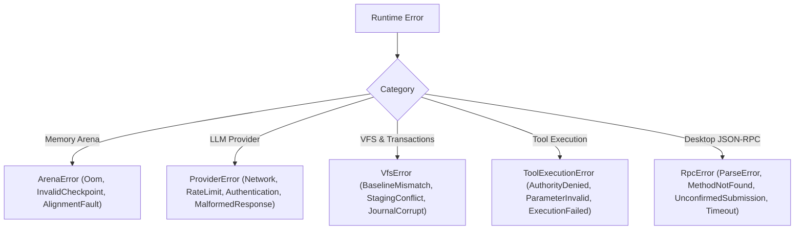

<!-- [LAYER: UI] -->
# Error Catalog & Diagnostics

  <a href="README.md">API Hub</a> ·
  <a href="public-api.md">Public API</a> ·
  <a href="cli.md">CLI Reference</a> ·
  <a href="../kb/symptom-diagnosis-matrix.md">Symptom Matrix</a> ·
  <a href="../playbooks/README.md">Playbooks</a>

Comprehensive catalog of runtime error variants, provider codes, VFS conflict causes, desktop JSON-RPC codes, and remediation guidance in **HEAV3NS-MICRO**.

---

## 1. Substrate Error Taxonomy

Errors in HEAV3NS-MICRO are organized into domain-specific error enums providing actionable diagnostics:

---

## 2. Arena Errors (`src/domain/arena.rs`)

| Code / Variant | Description | Remediation |
| :--- | :--- | :--- |
| `ArenaOom` | The 16-MiB memory slab is exhausted. | Run `/compact` to summarize dialogue history, or increase `HEAV3NS_ARENA_CAPACITY_BYTES`. See [PB-02](../playbooks/arena-exhaustion-and-oom-triage.md). |
| `InvalidCheckpoint` | Attempted to rewind to a watermark pointer greater than the current allocation offset. | Verify turn lifecycle invariant ordering. |
| `AlignmentFault` | Requested alignment is not a power of two. | Use 8-byte alignment for 64-bit platform compatibility. |

---

## 3. Provider Errors & Error Taxonomy (`src/domain/pricing_and_taxonomy.rs`)

| Code / Variant | Description | Remediation |
| :--- | :--- | :--- |
| `ErrorCategory::Budget` | HTTP 402 / `insufficient_quota`. Marked non-recoverable with 0 retries. | Refill provider account credits or switch to economy/local model. |
| `ErrorCategory::RateLimit` | HTTP 429 status. Evaluated with jittered exponential backoff delay. | Wait for backoff window or switch model tier. |
| `llm_auth_rejected_unsent` (`CREDENTIAL_REJECTED_UNSENT_CODE`) | Request blocked prior to sending due to missing or invalid credentials. | Reconnect provider API key in AppKit composer or export environment variable. |
| `ProviderError::Authentication` | Invalid or missing API key in environment (`OPENAI_API_KEY`, etc.). | Export the required credential variable. |
| `ProviderError::MalformedResponse` | Upstream provider emitted non-JSON or unsupported envelope. | Handled automatically by self-healing parser; inspect raw debug logs. |
| `ProviderError::Timeout` | Provider request exceeded configured timeout duration. | Check network connectivity or provider service status. |

---

## 4. CAS Undo, VFS & Staging Errors (`src/infrastructure/workspace_cas.rs`, `src/infrastructure/vfs_store.rs`)

| Code / Variant | Description | Remediation |
| :--- | :--- | :--- |
| `UndoError::WouldBlock` | User or external process modified workspace file after turn finished. | Safe guard against clobbering user work. Review manual diff or pass `--force`. |
| `UndoError::NoSnapshots` | No pre/post turn CAS trees found for the active session. | Ensure turn was executed and recorded in `.heav3ns/cas/`. |
| `FileReadTracker::ReadBeforeWrite` | Mutating tool attempted write to file without reading current contents. | Read file before editing to ensure context coherence. |
| `FileReadTracker::StaleExternalModification` | File modified on disk externally after initial read. | Re-read file to synchronize external edits before writing. |
| `VfsBaselineMismatch` | Target file was modified on disk by an external process between staging and commit. | Review conflicting changes; re-read target file and re-stage overlay. See [PB-04](../playbooks/vfs-commit-conflict-and-journal-rollback.md). |
| `StagingConflict` | Multiple mutating tools staged conflicting hunks for the same file in the same turn. | Ensure wave scheduler partitions conflicting write tools. |
| `JournalRollbackFailed` | The reverse patch could not be applied cleanly during transaction rollback. | Inspect file manually or restore from git snapshot. |

---

## 5. Security & Tool Errors (`src/core/tool_governor.rs`)

| Code / Variant | Description | Remediation |
| :--- | :--- | :--- |
| `AuthorityDenied` | Tool invocation requires an authority level higher than current session setting. | Elevate session authority via `--authority` or adjust prompt scope. |
| `SensitivePathBlocked` | Attempted access to protected filesystem path (`~/.ssh`, etc.). | Path interdicted by deterministic security policy. See [PB-05](../playbooks/secret-leakage-and-security-interdiction.md). |
| `SecretDetected` | Sensitive credential identified in tool input or output. | Redacted automatically by `DeterministicSecretRedactor`. |

---

## 6. Desktop JSON-RPC Error Codes (`src/ui/rpc_dispatch.rs`)

When communicating with the AppKit Native Desktop client via `--stdio --desktop-worker`, errors conform to standard JSON-RPC 2.0 error specifications:

| Code | Label | Meaning | Client Handling in AppKit |
| :---: | :--- | :--- | :--- |
| `-32700` | `PARSE_ERROR` | Received invalid JSON framing or unclosed quote. | Reconnects transport stream; logs raw bytes. |
| `-32600` | `INVALID_REQUEST` | Message is not a valid JSON-RPC 2.0 object. | Discards malformed frame; preserves composer draft. |
| `-32601` | `METHOD_NOT_FOUND` | Method not supported by active runtime capabilities. | Disables UI action; presents warning pill. |
| `-32602` | `INVALID_PARAMS` | Method parameters failed schema validation. | Rejects client request without updating state. |
| `-32603` | `INTERNAL_ERROR` | Unhandled runtime panic or internal substrate fault. | Presents non-blocking notice with copyable error. |
| `-32001` | `FILE_NOT_FOUND` | Inspected file does not exist in workspace tree. | Resets inspection viewport to parent directory. |
| `-32002` | `FILE_READ_FAILED` | File exceeds maximum byte limit or is inaccessible. | Shows truncation notice or binary fallback. |
| `-32003` | `MEMORY_SAVE_UNCERTAIN` | Persistence of conversation memory timed out. | Flushes input stream; leaves memory draft dirty. |
| `-32004` | `SUBMISSION_UNCONFIRMED` | Runtime was interrupted before task acceptance. | Enables "Check Status" button; prevents replay. |
| `-32005` | `TASK_LOOKUP_TIMEOUT` | Querying unconfirmed task status exceeded 200ms. | Keeps draft preserved; allows manual status check. |
| `-32006` | `APPROVAL_REQUIRED` | Tool requires user verification before execution. | Docked approval bar displays operation details. |
