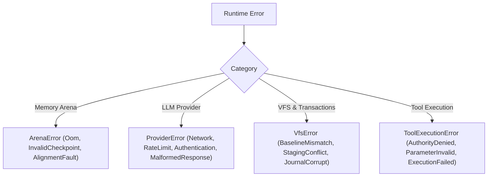

<!-- [LAYER: UI] -->
# Error Catalog & Diagnostics

  <a href="README.md">API Hub</a> ·
  <a href="public-api.md">Public API</a> ·
  <a href="cli.md">CLI Reference</a> ·
  <a href="../kb/symptom-diagnosis-matrix.md">Symptom Matrix</a>

Comprehensive catalog of runtime error variants, provider codes, VFS conflict causes, and remediation guidance in **HEAV3NS-MICRO**.

---

## 1. Substrate Error Taxonomy

Errors in HEAV3NS-MICRO are organized into domain-specific error enums providing actionable error messages:

---

## 2. Arena Errors (`src/domain/arena.rs`)

| Code / Variant | Description | Remediation |
| :--- | :--- | :--- |
| `ArenaOom` | The 16-MiB memory slab is exhausted. | Run `/compact` to summarize dialogue history, or increase `HEAV3NS_ARENA_CAPACITY_BYTES`. See [PB-02](../playbooks/arena-exhaustion-and-oom-triage.md). |
| `InvalidCheckpoint` | Attempted to rewind to a watermark pointer greater than the current allocation offset. | Verify turn lifecycle invariant ordering. |
| `AlignmentFault` | Requested alignment is not a power of two. | Use 8-byte alignment for 64-bit platform compatibility. |

---

## 3. Provider Errors (`src/domain/types/tick_result.rs`)

| Code / Variant | Description | Remediation |
| :--- | :--- | :--- |
| `ProviderError::Authentication` | Invalid or missing API key in environment (`OPENAI_API_KEY`, etc.). | Export the required credential variable. |
| `ProviderError::RateLimited` | Provider responded with HTTP 429 status. | Exponential backoff is triggered automatically; adjust quota or switch providers. |
| `ProviderError::MalformedResponse` | Upstream provider emitted non-JSON or unsupported envelope. | Handled automatically by self-healing parser; inspect raw debug logs. |
| `ProviderError::Timeout` | Provider request exceeded configured timeout duration. | Check network connectivity or provider service status. |

---

## 4. VFS & Staging Errors (`src/infrastructure/vfs_store.rs`)

| Code / Variant | Description | Remediation |
| :--- | :--- | :--- |
| `VfsBaselineMismatch` | Target file was modified on disk by an external process between staging and commit. | Review conflicting changes; re-read target file and re-stage overlay. See [PB-04](../playbooks/vfs-commit-conflict-and-journal-rollback.md). |
| `StagingConflict` | Multiple mutating tools staged conflicting hunks for the same file in the same turn. | Ensure wave scheduler partitions conflicting write tools. |
| `JournalRollbackFailed` | The reverse patch could not be applied cleanly during transaction rollback. | Inspect file manually or restore from git snapshot. |

---

## 5. Security & Tool Errors (`src/core/tool_governor.rs`)

| Code / Variant | Description | Remediation |
| :--- | :--- | :--- |
| `AuthorityDenied` | Tool invocation requires an authority level higher than current session setting. | Elevate session authority via `--authority` or adjust prompt scope. |
| `SensitivePathBlocked` | Attempted access to protected filesystem path (`~/.ssh`, etc.). | Path interdicted by deterministic security policy. See [PB-05](../playbooks/secret-leakage-and-security-interdiction.md). |
| `SecretDetected` | Sensitive credential identified in tool input or output. | Redacted automatically by `DeterministicSecretRedactor`. |
