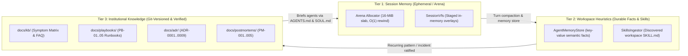

<!-- [LAYER: UI] -->
# Knowledge Base & Knowledge-Based Handling Hub

  <a href="../README.md">Docs Hub</a> ·
  <a href="../adr/README.md">ADRs</a> ·
  <a href="../playbooks/README.md">Playbooks</a> ·
  <a href="../wiki/README.md">Wiki</a> ·
  <a href="../postmortems/README.md">Postmortems</a> ·
  <a href="../api/errors.md">Error Catalog</a> ·
  <a href="../GLOSSARY.md">Glossary</a>

Welcome to the **HEAV3NS-MICRO Knowledge Base (`docs/kb/`)**—the central hub for **Knowledge-Based Handling**, symptom-first troubleshooting, diagnostic code lookups, and technical FAQs.

In **HEAV3NS-MICRO**, knowledge is not static prose: it operates as a **3-Tier Knowledge Lifecycle** connecting ephemeral session memory (arena scratchpad and VFS overlays), durable workspace heuristics (session memories and skills), and verified institutional documentation (`docs/kb/`, `docs/adr/`, `docs/playbooks/`, `docs/postmortems/`).

---

## 3-Tier Knowledge Lifecycle

---

## Knowledge Base Index

| Article | Description | Primary Audience |
| :--- | :--- | :--- |
| **[Knowledge-Based Handling Architecture](knowledge-handling-architecture.md)** | Specification of the 3-Tier Knowledge System in HEAV3NS-MICRO: session memory, semantic facts, and institutional documentation. | Engineers, architects, & coding agents |
| **[Symptom & Diagnostic Code Resolution Matrix](symptom-diagnosis-matrix.md)** | Instant Symptom → Root Cause → Fix Command → Playbook/ADR lookup table covering all error variants and failure modes. | On-call operators, CI owners, & developers |
| **[Deep Technical FAQ & Edge Cases](faq-and-edge-cases.md)** | Answers to complex edge cases: large files, token budgeting, VFS baseline reconciliation, and custom tool additions. | Adopters, systems engineers, & reviewers |

---

## Quick Symptom Router (Top 10 Most Common Issues)

| What you see | Immediate command | Deep dive |
| :--- | :--- | :--- |
| `SPI-206` Domain I/O or layer leak | `npm run joy-check` | [Playbook PB-01](../playbooks/architectural-violation-remediation.md) |
| `SPI-201` Circular dependency in Rust code | `npm run joy-check` | [Playbook PB-01](../playbooks/architectural-violation-remediation.md) |
| `SPI-208` Missing `[LAYER]` header | Add `// [LAYER: <ZONE>]` on line 1 | [Playbook PB-01](../playbooks/architectural-violation-remediation.md) |
| `ArenaOom` memory exhaustion | Run `/compact` in session | [Playbook PB-02](../playbooks/arena-exhaustion-and-oom-triage.md) |
| Flight test scenario assertion fails | `cargo run -- --flight` | [Playbook PB-03](../playbooks/flight-test-failures-and-parser-desync.md) |
| JSON bracket mismatch or parse failure | `cargo test test_self_healing_parser_and_streaming_dedup` | [Playbook PB-03](../playbooks/flight-test-failures-and-parser-desync.md) |
| `VfsBaselineMismatch` on `/commit` | Re-read target file with `fs_read` | [Playbook PB-04](../playbooks/vfs-commit-conflict-and-journal-rollback.md) |
| Rollback an unwanted committed file change | Run `/rewind` | [Playbook PB-04](../playbooks/vfs-commit-conflict-and-journal-rollback.md) |
| `SensitivePathBlocked` error | Confine file paths to `workspace_root` | [Playbook PB-05](../playbooks/secret-leakage-and-security-interdiction.md) |
| Unredacted credential detected | Update `src/plumbing/secret_redactor.rs` | [Playbook PB-05](../playbooks/secret-leakage-and-security-interdiction.md) |
