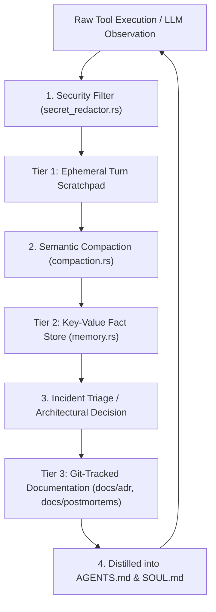

<!-- [LAYER: UI] -->
# Knowledge-Based Handling Architecture

  <a href="README.md">KB Hub</a> ·
  <a href="symptom-diagnosis-matrix.md">Symptom Matrix</a> ·
  <a href="../wiki/mental-models.md">Mental Models</a> ·
  <a href="../PORTABLE_TRINITY.md">Substrate Primitives</a>

Architecture and lifecycle specification for **Knowledge-Based Handling** in **HEAV3NS-MICRO**, governing how knowledge transitions from ephemeral session context into persistent repository documentation.

---

## 1. The 3-Tier Knowledge Model

Knowledge in an autonomous agent system exists at three distinct temporal scales:

### Tier 1: Ephemeral Session Memory
- **Location**: In-memory `ArenaAllocator` and staged `SessionVfs` overlays.
- **Scope**: Current agent turn and immediate conversation scratchpad.
- **Lifecycle**: Reclaimed automatically via $O(1)$ pointer rewind at the end of each turn.

### Tier 2: Durable Workspace Heuristics
- **Location**: `AgentMemoryStore` (`src/domain/memory.rs`) and workspace `SKILL.md` manifests.
- **Scope**: Multi-turn dialogue context, extracted key-value facts, and specialized workflow procedures.
- **Lifecycle**: Persisted across session restarts via JSONL session journals.

### Tier 3: Institutional Git-Versioned Knowledge
- **Location**: `docs/kb/`, `docs/adr/`, `docs/playbooks/`, `docs/postmortems/`.
- **Scope**: Repository-wide architectural invariants, verified postmortems, and normative decision records.
- **Lifecycle**: Permanent, version-controlled, and continuously validated by `bin/docs-check.mjs`.

---

## 2. Knowledge Ingestion & Promotion Lifecycle

### Knowledge Promotion Criteria
1. **Ad-Hoc Fact to Memory Store**: When an agent discovers a project-specific convention (e.g. "Run `cargo test` before submitting changes"), it stores it using `session_memory_store`.
2. **Recurring Incident to Postmortem**: When a failure recurs or causes a runtime abort, it is elevated to a formal blameless postmortem in `docs/postmortems/`.
3. **Architectural Fix to ADR**: When a code defense is introduced, the underlying design choice is ratified as an Architecture Decision Record in `docs/adr/`.

---

## 3. Secret Screening & Untrusted Input Framing

All ingested text, command outputs, and external tool responses are treated as **untrusted**:
- **Zero Credential Retention**: High-entropy strings matching API keys or tokens are stripped before storing in `AgentMemoryStore`.
- **Untrusted XML Framing**: Heuristic facts recalled from external files are wrapped in `<workspace_heuristics trust="untrusted">` tags to prevent prompt injection from tricking the agent into executing privileged commands.
