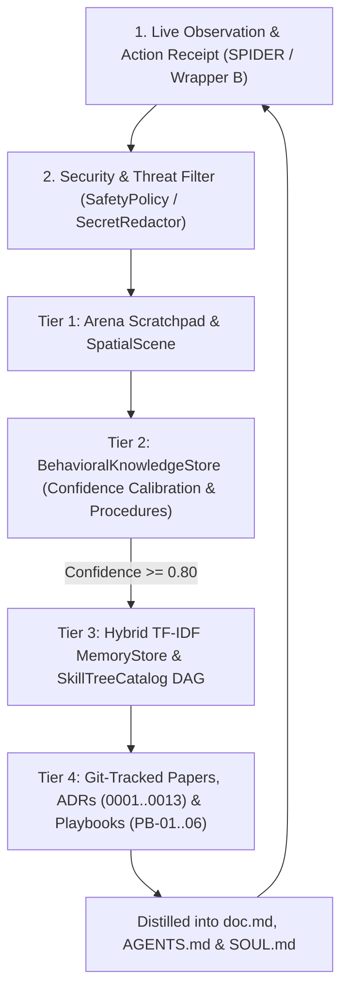

<!-- [LAYER: UI] -->
# Knowledge-Based Handling Architecture (`BROCCOLI` · `REWIND` · Institutional Memory)

  <a href="README.md">KB Hub</a> ·
  <a href="../../doc.md">Sovereign Charter (doc.md)</a> ·
  <a href="symptom-diagnosis-matrix.md">Symptom Matrix</a> ·
  <a href="../wiki/mental-models.md">Mental Models</a> ·
  <a href="../PORTABLE_TRINITY.md">Substrate Primitives</a>

Architecture and lifecycle specification for **Knowledge-Based Handling** in **HEAV3NS-MICRO**, governing how knowledge transitions from ephemeral turn observations (`SPIDER`) into persistent behavioral wisdom (`BROCCOLI`) and Git-versioned institutional memory.

---

## 1. The 4-Tier Knowledge Model

Knowledge in **HEAV3NS — The Sovereign Intelligence Architecture** operates across four complementary temporal scales:

### Tier 1: Ephemeral Turn & Spatial Scene Scratchpad (`REWIND`)
- **Location**: In-memory 16-MiB `ArenaAllocator`, staged `SessionVfs` overlays, and active `SpatialScene` / `EnvironmentalObservation`.
- **Lifecycle**: Reclaimed in $O(1)$ time via `SlabBufferSnapshot` pointer rewind or reconciled across layout epochs (`reconcile_state`).

### Tier 2: Empirical Behavioral & Procedural Knowledge (`BROCCOLI`)
- **Location**: [`BehavioralKnowledgeStore`](../../src/infrastructure/behavioral_store.rs) (`LearnedInteractionPattern`, `LearnedWorkflowProcedure`, `KnownFailureModeRecord`).
- **Scope**: Calibrates Laplace-smoothed interaction confidence across UI targets, synthesizes multi-step recovery workflows (e.g., `click` to focus $\to$ `type`, or `Escape` modal dismissal $\to$ `click`), and informs the 5-specialist `SYNTHETIC SWARM` consultation.
- **Grounding Sovereignty**: Supervised by `ConflictResolver` — live `SPIDER` environmental observations always override conflicting historical assumptions.

### Tier 3: Semantic Workspace Memory & Evolutionary Skill DAG (`BROCCOLI`)
- **Location**: [`MemoryStore`](../../src/domain/memory.rs) (hybrid TF-IDF + FNV-1a recall) and [`SkillTreeCatalog`](../../src/domain/skill_tree.rs) (Kahn's topological DAG & Soul Drop Vault).
- **Lifecycle**: High-confidence patterns ($\ge 0.80$) in `BehavioralKnowledgeStore` automatically synchronize into `MemoryStore`, while reusable capabilities are forged and linted (`SkillDoctor`) in `SkillTreeCatalog`.

### Tier 4: Institutional Git-Versioned Knowledge
- **Location**: `doc.md`, `ROADMAP.md`, `docs/papers/`, `docs/adr/` (`ADR-0001..0013`), `docs/playbooks/` (`PB-01..06`), `docs/postmortems/` (`PM-001..005`).
- **Lifecycle**: Permanent, version-controlled, and continuously verified by `node bin/docs-check.mjs`.

---

## 2. Knowledge Ingestion & Promotion Lifecycle

---

## 3. Secret Screening & Zero-Trust Framing

All ingested text, DOM snapshots, command outputs, and imported skills are treated as **untrusted**:
- **Zero Credential Retention**: `DeterministicSecretRedactor` strips 8 families of API keys, bearer tokens, and private keys before storage.
- **Prompt Injection & C2 Interdiction**: `SafetyPolicy::scan_for_threats` and `SkillTreeCatalog::lint_and_autofix_skill` inspect skill nodes and DOM payloads for prompt-injection and exfiltration patterns.
