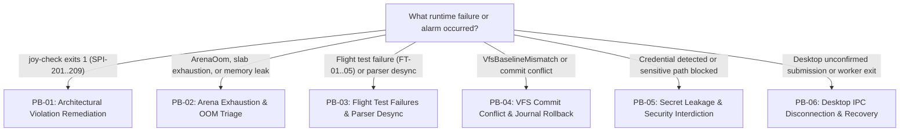

<!-- [LAYER: UI] -->
# Operational & Incident Playbooks

  <a href="../README.md">Docs Hub</a> ·
  <a href="../adr/README.md">ADRs</a> ·
  <a href="../wiki/README.md">Wiki</a> ·
  <a href="../postmortems/README.md">Postmortems</a> ·
  <a href="../kb/README.md">Knowledge Base</a> ·
  <a href="../OPERATIONS.md">Operations Runbook</a>

Actionable, step-by-step operational runbooks modeled on Google SRE and high-reliability engineering incident practices. Use these playbooks when an automated gate fails, a flight test regresses, an arena exhausts its slab, or a filesystem mutation encounters conflicts.

---

## Triage Router (Pick the right playbook in 10 seconds)

---

## Playbook Catalog & Severity Matrix

| ID | Playbook | Severity | Trigger Symptoms / Error Codes | First Command to Run |
| :--- | :--- | :---: | :--- | :--- |
| **[PB-01](architectural-violation-remediation.md)** | [Architectural Violation Remediation](architectural-violation-remediation.md) | `SEV-2` | `SPI-201`, `SPI-205`, `SPI-206`, `SPI-208`, `SPI-209` | `npm run joy-check` |
| **[PB-02](arena-exhaustion-and-oom-triage.md)** | [Arena Exhaustion & OOM Triage](arena-exhaustion-and-oom-triage.md) | `SEV-1` | `ArenaOom`, allocation failure, slab > 14 MiB | `cargo run -- --smoke` |
| **[PB-03](flight-test-failures-and-parser-desync.md)** | [Flight Test Failures & Parser Desync](flight-test-failures-and-parser-desync.md) | `SEV-2` | Flight test exit `1`, JSON bracket mismatch | `cargo run -- --flight` |
| **[PB-04](vfs-commit-conflict-and-journal-rollback.md)** | [VFS Commit Conflict & Journal Rollback](vfs-commit-conflict-and-journal-rollback.md) | `SEV-2` | `VfsBaselineMismatch`, clobbered disk write | `cargo run -- -- -p "/vfs"` |
| **[PB-05](secret-leakage-and-security-interdiction.md)** | [Secret Leakage & Security Interdiction](secret-leakage-and-security-interdiction.md) | `SEV-1` | `SensitivePathBlocked`, unmasked token in event | `cargo test test_secret_redactor_and_sensitive_path_guard` |
| **[PB-06](desktop-ipc-and-unconfirmed-submission-recovery.md)** | [Desktop IPC Disconnection & Recovery](desktop-ipc-and-unconfirmed-submission-recovery.md) | `SEV-2` | `SUBMISSION_UNCONFIRMED`, worker exit, Check Status | `cd native && swift test` |

---

## Standard Operating Discipline

1. **Inspect before modifying**: Run non-mutating status checks (`/status`, `/vfs`, `--smoke`) before applying manual fixes.
2. **Atomic rollback**: If a committed file modification breaks the build, invoke `/rewind` immediately rather than attempting speculative manual edits.
3. **Escalate after 3 failed attempts**: If an automated agent cannot resolve an issue within 3 attempts, escalate to a human maintainer.
