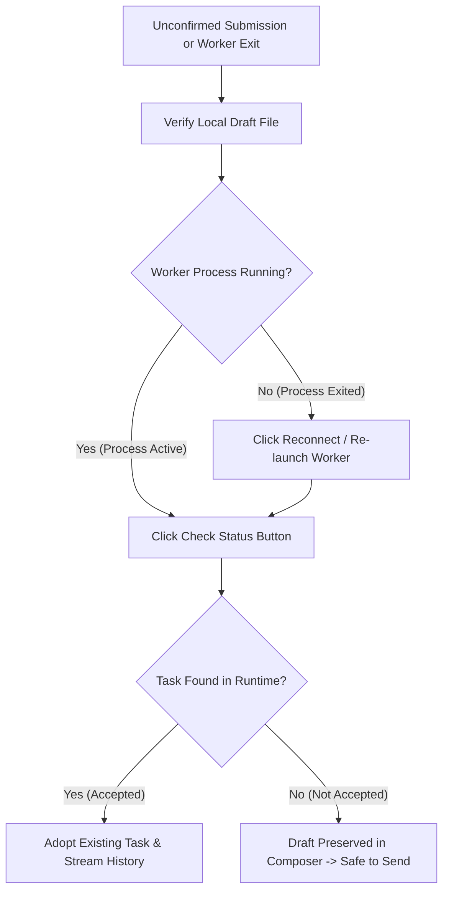

<!-- [LAYER: UI] -->
# PB-06: Desktop IPC Disconnection & Unconfirmed Submission Recovery

- **Playbook ID**: `PB-06`
- **Severity**: `SEV-2`
- **Owner**: Desktop Integration & IPC Engineering Team
- **Trigger Symptoms**: "Check Status" pill in AppKit toolbar, `SUBMISSION_UNCONFIRMED`, worker exit code `99`, frame parser timeout.
- **Governing Architecture**: [`ADR-0010`](../adr/0010-native-desktop-integration-and-rpc-protocol.md) · [`src/ui/stdio_worker.rs`](../../src/ui/stdio_worker.rs) · [`native/Sources/Heav3nsCode/WorkspaceWindow+Execution.swift`](../../native/Sources/Heav3nsCode/WorkspaceWindow+Execution.swift)

---

## Triage at a glance

When the native AppKit client communicates with the `heav3ns-micro` substrate over stdio, network delays, system sleep cycles, or worker restarts can cause an in-flight prompt submission to become unconfirmed. Under the **Zero-Replay Invariant**, the native client never blindly resubmits an unconfirmed task; instead, it preserves the composer draft and surfaces a non-blocking **"Check Status"** control (`task.lookup`).



---

## Remediation steps

### Step 1: Verify Local Draft Preservation
The AppKit client automatically persists composer contents and attachments via `WorkspaceDraftStore`:
```bash
# Inspect the active workspace draft file
cat "$WORKSPACE_ROOT/.heav3ns/drafts/draft.json"
```
*Expected*: The unconfirmed prompt text and file attachments are intact.

### Step 2: Query Unconfirmed Task Status (`task.lookup`)
When the worker process reconnects, click **"Check Status"** in the composer notice bar. This issues an idempotent `task.lookup` call:
```json
{
  "jsonrpc": "2.0",
  "id": 101,
  "method": "task.lookup",
  "params": {
    "submissionId": "<UUID>"
  }
}
```
- **If `found: true`**: The substrate recorded the instruction before the transport dropped. The client updates the transcript, attaches to the active run, and follows tool progress in the Walkthrough pane without resubmission.
- **If `found: false`**: The substrate never received or accepted the instruction. The client notifies the user that no acceptance record exists and leaves the draft ready to send.

### Step 3: Verify Substrate Health
Run a fast smoke test to confirm the local Rust runtime is functional:
```bash
cargo run -- --smoke
```

---

## Verification

```bash
# Verify protocol test coverage for lookup timeouts and draft preservation
cd native && swift test --filter InspectionNavigationTests && cd ..
cargo test
```
