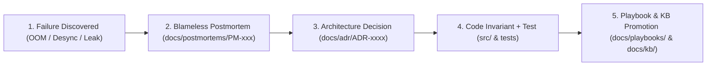

<!-- [LAYER: UI] -->
# Blameless Engineering Postmortems

  <a href="../README.md">Docs Hub</a> ·
  <a href="../adr/README.md">ADRs</a> ·
  <a href="../playbooks/README.md">Playbooks</a> ·
  <a href="../wiki/README.md">Wiki</a> ·
  <a href="../kb/README.md">Knowledge Base</a> ·
  <a href="../OPERATIONS.md">Operations Runbook</a>

In **HEAV3NS-MICRO**, every operational failure, memory exhaustion, or parser desync is treated as a **system design flaw, never an individual or model failure**. Modeled on Google SRE blameless postmortem practices, each retrospective must close the engineering loop by producing:
1. A permanent **code guard or invariant** in `src/`
2. An **automated regression test** in `src/core/substrate_tests.rs`
3. A normative **Architecture Decision Record** in [`docs/adr/`](../adr/README.md)
4. An operational **Playbook / Knowledge Base entry** in [`docs/playbooks/`](../playbooks/README.md) and [`docs/kb/`](../kb/README.md)

---

## Closed-Loop Incident Learning Pipeline

---

## Postmortem Registry

| ID | Title | Severity | Subsystem | Preventative ADR & Test | Status |
| :--- | :--- | :---: | :--- | :--- | :---: |
| [Template](0000-postmortem-template.md) | Canonical Blameless Postmortem Template | Template | All Zones | [`bin/docs-check.mjs`](../../bin/docs-check.mjs) | Active |
| **[PM-001](PM-001-arena-allocator-oom-on-unbounded-streaming-tokens.md)** | [Arena Allocator OOM on Unbounded Streaming Tokens](PM-001-arena-allocator-oom-on-unbounded-streaming-tokens.md) | `SEV-1` | `ArenaAllocator` / Memory | [ADR-0002](../adr/0002-arena-allocator-and-o1-tick-rewind.md) · `test_arena_allocator_alignment_and_o1_rewind` | Resolved |
| **[PM-002](PM-002-vfs-disk-baseline-mismatch-and-clobbered-writes.md)** | [VFS Disk Baseline Mismatch & Clobbered External Writes](PM-002-vfs-disk-baseline-mismatch-and-clobbered-writes.md) | `SEV-1` | `SessionVfs` / Filesystem | [ADR-0004](../adr/0004-two-phase-vfs-staging-and-transaction-journal.md) · `test_vfs_baseline_verification_and_snapshot_rewind` | Resolved |
| **[PM-003](PM-003-streaming-json-parser-deadlock-on-escaped-delimiters.md)** | [Streaming JSON Parser Deadlock on Escaped Delimiters](PM-003-streaming-json-parser-deadlock-on-escaped-delimiters.md) | `SEV-2` | `json_repair` / Parsing | [ADR-0003](../adr/0003-self-healing-tool-call-parser.md) · `test_self_healing_parser_and_streaming_dedup` | Resolved |
| **[PM-004](PM-004-unredacted-bearer-tokens-in-tool-call-arguments.md)** | [Unredacted Bearer Tokens in Tool Call Arguments](PM-004-unredacted-bearer-tokens-in-tool-call-arguments.md) | `SEV-1` | `secret_redactor` / Security | [ADR-0008](../adr/0008-secret-redaction-and-security-policy.md) · `test_secret_redactor_and_sensitive_path_guard` | Resolved |
| **[PM-005](PM-005-wave-scheduler-circular-dependency-deadlock.md)** | [Wave Scheduler Circular Dependency Deadlock](PM-005-wave-scheduler-circular-dependency-deadlock.md) | `SEV-2` | `WaveScheduler` / Concurrency | [ADR-0005](../adr/0005-dag-wave-scheduler-concurrency.md) · `test_wave_scheduler_partitioning` | Resolved |

---

## Postmortem Standards

1. **No "Model Hallucination" as Terminal Root Cause**: Ask *why the parser, schema, or substrate permitted or encouraged that failure*.
2. **Mandatory Sections**:
   - `## Summary`
   - `## Root cause`
   - `## Action items`
   - `## Lessons learned`
3. **Closed-Loop Resolution**: Every postmortem must add or update a symptom row in [`docs/kb/symptom-diagnosis-matrix.md`](../kb/symptom-diagnosis-matrix.md).
