<!-- [LAYER: UI] -->
# HEAV3NS-MICRO Engineering Wiki

  <a href="../README.md">Docs Hub</a> ·
  <a href="../../doc.md">Sovereign Charter (doc.md)</a> ·
  <a href="../papers/ascendant-intelligence.md">Ascendant Intelligence</a> ·
  <a href="../adr/README.md">ADRs</a> ·
  <a href="../playbooks/README.md">Playbooks</a> ·
  <a href="../postmortems/README.md">Postmortems</a> ·
  <a href="../kb/README.md">Knowledge Base</a> ·
  <a href="../GETTING_STARTED.md">Getting Started</a> ·
  <a href="../GLOSSARY.md">Glossary</a>

Welcome to the **HEAV3NS-MICRO Engineering Wiki**—the concept-first encyclopedia explaining how the seven sovereign pillars of **[`HEAV3NS — The Sovereign Intelligence Architecture`](../../doc.md)** (`HEAV3NS-MICRO`, `SPIDER`, `REWIND`, `BROCCOLI`, `SYNTHETIC SWARM`, `COMPUTER USE`, `THE HARNESS`) function under the hood through mental models, Rust memory architecture, execution wave geometry, spatial mediation, and metric forensics.

---

## Visual Substrate Topology

```mermaid
flowchart LR
  subgraph S1 ["1. Spatial Sovereignty (Joyzoning)"]
    Z["5 Canonical Zones (70 Rust Modules)<br/>DOMAIN · CORE · INFRA · PLUMBING · UI"]
    P["Principle of Geographic Alignment"]
    C["39 Formal I* Traits in src/domain/"]
  end

  subgraph S2 ["2. REWIND, BROCCOLI & Parsing"]
    A["16-MiB Arena Slab Allocator<br/>Bump pointer + O(1) tick rewind"]
    J["3-Stage Self-Healing JSON Parser<br/>Bracket balancing + Streaming dedup"]
    B["BehavioralKnowledgeStore & SkillDAG<br/>Confidence calibration + Procedures"]
  end

  subgraph S3 ["3. SPIDER, SWARM, CUA & THE HARNESS"]
    M["Double-Wrapped Spatial Mediator<br/>Wrapper A Grounding + Wrapper B Assurance"]
    V["SessionVfs & TransactionJournal<br/>FNV-1a baseline + Atomic rollback"]
    W["DAG Wave Scheduler<br/>29 native tools · Read/Write wavefronts"]
  end

  S1 --> S2 --> S3
```

---

## Wiki Encyclopedia Chapters

| Chapter | Description | Target Audience |
| :--- | :--- | :--- |
| **[Mental Models (`mental-models.md`)](mental-models.md)** | The 7 core mental models: *The Arena Slab (`REWIND`)*, *The Two-Phase VFS*, *The Wavefront (`THE HARNESS`)*, *The Self-Healing Parser (`HEAV3NS-MICRO`)*, *The Double-Wrapped Spatial Gate (`COMPUTER USE`)*, *The Spider & Broccoli Loop*, and *The Five Sovereign Rooms*. | Humans and AI agents onboarding to HEAV3NS-MICRO |
| **[Rust Substrate Architecture (`rust-substrate-architecture.md`)](rust-substrate-architecture.md)** | Deep dive into pointer arithmetic, arena slab layout, memory alignment, zero-allocation parsing, and `"v": 1` stdio JSON-RPC IPC. | Systems programmers & performance engineers |
| **[Tool System & Execution Wavefront (`tool-system-and-execution-wavefront.md`)](tool-system-and-execution-wavefront.md)** | Concurrency geometry of the DAG wave scheduler, read/write barrier partitioning, and all `29` native tool specs. | AI tool builders & runtime developers |
| **[Metrics & Memory Encyclopedia (`metrics-and-memory-encyclopedia.md`)](metrics-and-memory-encyclopedia.md)** | Formulas for token estimation, arena memory budgeting, FNV-1a hashing, Bayesian confidence calibration, 2D occlusion union, and Joyzoning stability indexing ($E_S = 0.0041$). | Architects & code auditors |
