<!-- [LAYER: UI] -->
# HEAV3NS-MICRO Engineering Wiki

  <a href="../README.md">Docs Hub</a> ·
  <a href="../adr/README.md">ADRs</a> ·
  <a href="../playbooks/README.md">Playbooks</a> ·
  <a href="../postmortems/README.md">Postmortems</a> ·
  <a href="../kb/README.md">Knowledge Base</a> ·
  <a href="../GETTING_STARTED.md">Getting Started</a> ·
  <a href="../GLOSSARY.md">Glossary</a>

Welcome to the **HEAV3NS-MICRO Engineering Wiki**—the concept-first encyclopedia explaining **how the substrate functions under the hood** through mental models, Rust memory architecture, execution wave geometry, and metric forensics.

---

## Visual Substrate Topology

```mermaid
flowchart LR
  subgraph S1 ["1. Spatial Sovereignty (Joyzoning)"]
    Z["5 Canonical Zones<br/>DOMAIN · CORE · INFRA · PLUMBING · UI"]
    P["Principle of Geographic Alignment"]
    C["Strict I* Traits in domain/interfaces/"]
  end

  subgraph S2 ["2. Substrate Memory & Parsing"]
    A["16-MiB Arena Slab Allocator<br/>Bump pointer + O(1) tick rewind"]
    J["Self-Healing JSON Parser<br/>Bracket balancing + Streaming dedup"]
    R["Deterministic Secret Redactor<br/>Path guard + API token masking"]
  end

  subgraph S3 ["3. Execution & Filesystem Safety"]
    V["SessionVfs Two-Phase Staging<br/>FNV-1a baseline reality check"]
    T["TransactionJournal<br/>Atomic rollback & undo ledger"]
    W["DAG Wave Scheduler<br/>Parallel reads + serialized writes"]
  end

  S1 --> S2 --> S3
```

---

## Wiki Encyclopedia Chapters

| Chapter | Description | Target Audience |
| :--- | :--- | :--- |
| **[Mental Models (`mental-models.md`)](mental-models.md)** | The 5 core mental models: *The Arena Slab*, *The Reality Shield*, *The Two-Phase VFS*, *The Wavefront*, and *The Clean Domain*. | Humans and AI agents onboarding to HEAV3NS-MICRO |
| **[Rust Substrate Architecture (`rust-substrate-architecture.md`)](rust-substrate-architecture.md)** | Deep dive into pointer arithmetic, arena slab layout, memory alignment, and zero-allocation parsing. | Systems programmers & performance engineers |
| **[Tool System & Execution Wavefront (`tool-system-and-execution-wavefront.md`)](tool-system-and-execution-wavefront.md)** | Concurrency geometry of the DAG wave scheduler, read/write barrier partitioning, and 23 native tool specs. | AI tool builders & runtime developers |
| **[Metrics & Memory Encyclopedia (`metrics-and-memory-encyclopedia.md`)](metrics-and-memory-encyclopedia.md)** | Formulas for token estimation, arena memory budgeting, FNV-1a hashing, and Joyzoning stability indexing. | Architects & code auditors |

---

## Quick Navigation by Question ("How do I...?")

| Question | Answer |
| :--- | :--- |
| *Why does HEAV3NS-MICRO use an arena instead of standard Box/Vec?* | Read [Mental Models §1](mental-models.md) and [ADR-0002](../adr/0002-arena-allocator-and-o1-tick-rewind.md) |
| *How does the two-phase VFS prevent clobbering external disk edits?* | Read [Mental Models §2](mental-models.md) and [PB-04](../playbooks/vfs-commit-conflict-and-journal-rollback.md) |
| *How are parallel tool calls scheduled without race conditions?* | Read [Tool System & Wavefront](tool-system-and-execution-wavefront.md) and [ADR-0005](../adr/0005-dag-wave-scheduler-concurrency.md) |
| *What happens when an LLM emits broken or truncated JSON?* | Read [Rust Substrate Architecture §3](rust-substrate-architecture.md) and [ADR-0003](../adr/0003-self-healing-tool-call-parser.md) |
| *How do I run the full offline verification suite?* | Run `cargo run -- --flight` and see [Getting Started](../GETTING_STARTED.md) |
