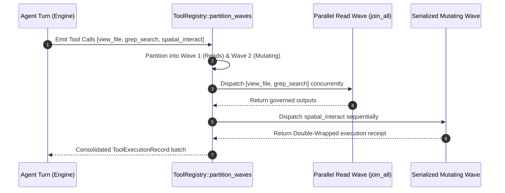

<!-- [LAYER: UI] -->
# Tool System & Execution Wavefront (`29` Native Tools)

  <a href="README.md">Wiki Hub</a> ·
  <a href="../api/cli.md">CLI Reference</a> ·
  <a href="../PORTABLE_TRINITY.md">Substrate Primitives</a> ·
  <a href="../adr/0005-dag-wave-scheduler-concurrency.md">ADR-0005</a> ·
  <a href="../adr/0011-sovereign-intelligence-and-spatial-computer-use.md">ADR-0011</a>

Architecture of the **29 native agent tools** declared in [`src/core/tool_specs.rs`](../../src/core/tool_specs.rs) and the concurrency wavefront managed by [`ToolRegistry::partition_waves`](../../src/core/tool_registry.rs).

---

## 1. Concurrency Geometry & Wave Scheduling

When an agent emits multiple tool calls in a single turn, [`ToolRegistry::partition_waves`](../../src/core/tool_registry.rs) partitions them into conflict-free execution waves:

---

## 2. The 29 Native Tools Catalog (`src/core/tool_specs.rs`)

### A. Filesystem & VFS Operations (`12` Tools)
1. `view_file`: Read file contents with line range pagination. (ReadOnly)
2. `write_file`: Create or overwrite a file with TransactionJournal backup. (Mutating)
3. `replace_file_content`: Exact or fuzzy single-block replacement. (Mutating)
4. `multi_replace_file_content`: Atomic multi-hunk file replacement. (Mutating)
5. `edit_file_anchored`: Line-anchor and FNV-1a hash-guarded file edit. (Mutating)
6. `apply_unified_diff`: Apply standard unified diff or V4A `*** Begin Patch` multi-file patches. (Mutating)
7. `delete_file`: Delete a workspace file with rollback backup. (Mutating)
8. `move_file`: Move or rename a file within the workspace. (Mutating)
9. `list_dir`: List directory contents. (ReadOnly)
10. `find_files`: Glob and substring file path discovery. (ReadOnly)
11. `file_info`: Inspect file byte length, timestamps, and FNV-1a hash. (ReadOnly)
12. `directory_tree`: Render recursive workspace directory tree. (ReadOnly)

### B. Search, Refactoring & Git Diff (`4` Tools)
13. `grep_search`: Fast regex/literal content search across workspace files. (ReadOnly)
14. `search_symbols`: Polyglot symbol extractor (`fn`, `struct`, `trait`, `class`, `interface`). (ReadOnly)
15. `batch_replace_regex`: Workspace-wide regex replacement with dry-run preview. (Mutating)
16. `get_workspace_diff`: Unified diff of current workspace changes. (ReadOnly)

### C. Shell Execution & Journal Rewind (`2` Tools)
17. `run_command`: Execute shell command with timeout, PTY ANSI responder, and `ShellCommandGuard` / `SafetyPolicy` defenses (`ADR-0015` compound heredoc file-write blocks and `ADR-0016` terminal file dump blocks with UTF-8 preservation). (Mutating)
18. `rollback_last_mutation`: Undo the most recent file mutation via `TransactionJournal`. (Mutating)

### D. Memory, Spill Recovery & Skills (`5` Tools)
19. `save_memory`: Save a durable fact into `MemoryStore` (`BROCCOLI`). (Mutating)
20. `search_memory`: Hybrid TF-IDF + FNV-1a semantic recall across stored memories. (ReadOnly)
21. `retrieve_spill_content`: Retrieve line ranges from oversized tool outputs spilled by `ToolOutputGovernor`. (ReadOnly)
22. `list_skills`: Discover workspace `SKILL.md` manifests. (ReadOnly)
23. `use_skill`: Load full instructions for a named skill. (ReadOnly)

### E. Embodied Computer Use, Spatial Mediation, Vision & Swarm (`6` Tools)
24. `computer_use`: Set-of-Marks GUI interaction (`capture`, `click`, `type`, `key`, `scroll`, `orchestrate` 9-stage closed loop, `observe`, `interpret`, `consult_swarm`, `undo`, `redo`, `query_ledger`, `audit_health`). (Mutating)
25. `browser_use`: Zero-trust DOM snapshotter (`snapshot`, `navigate` with SSRF/IMDSv2 guard, `click`, `type`, `evaluate`). (Mutating)
26. `vision_inspect`: Binary image header codec (`PNG`, `JPEG`, `GIF`, `WebP`, `BMP`, `SVG`) and synthetic SVG/BMP generator. (ReadOnly)
27. `skill_forge`: Evolutionary Skill Tree & Soul Drop Vault (`list_dag`, `forge`, `apply_pack`, `clone`, `lint`, `autofix`, `sync_vault`, `export`, `ingest`, `soul_status`). (Mutating)
28. `engage_swarm`: `The Legion` 7-specialist topological task classifier (`classify_task_for_legion`). (ReadOnly)
29. `spatial_interact`: First-class Double-Wrapped Spatial Action engine (`ground`, `execute` with off-screen auto-scroll, `plan`, `execute_plan`, `query` directional relationships, `reconcile` DOM+SoM, `audit`, `orchestrate`). (Mutating)

---

## 3. Sticky Dynamic Tool Schema Routing & Token Optimization

Rather than transmitting all 29 tool schemas (`~4,278` tokens) unconditionally on every turn, [`ToolRegistry::select_tool_schemas_for`](../../src/core/tool_registry.rs) partitions tools into **Core Active** and **On-Demand Specialist** sets:
- **Core Active Subset (`15` tools, `~1,510` tokens)**: `view_file`, `write_file`, `replace_file_content`, `multi_replace_file_content`, `apply_unified_diff`, `delete_file`, `list_dir`, `find_files`, `grep_search`, `search_symbols`, `run_command`, `rollback_last_mutation`, `save_memory`, `search_memory`, `retrieve_spill_content`.
- **On-Demand Specialist Subset (`14` tools)**: `edit_file_anchored`, `move_file`, `file_info`, `directory_tree`, `batch_replace_regex`, `get_workspace_diff`, `list_skills`, `use_skill`, `computer_use`, `browser_use`, `vision_inspect`, `skill_forge`, `engage_swarm`, `spatial_interact`.
- **Sticky Session Retention**: Specialist tools unlock automatically when user prompts or prior turns reference GUI, browser, vision, skills, or swarm capabilities, and remain unlocked for the duration of the task so multi-step workflows never suffer amnesia. This saves **`2,768` tokens (`64.7%`)** per coding turn.
- **Specialist Scope Isolation**: When executing subagent tasks in `The Legion` swarm, `engage_swarm` is automatically stripped from exposed schemas and blocked by [`AgentEngine::without_swarm_delegation`](../../src/core/engine.rs) to prevent runaway recursive delegation.
