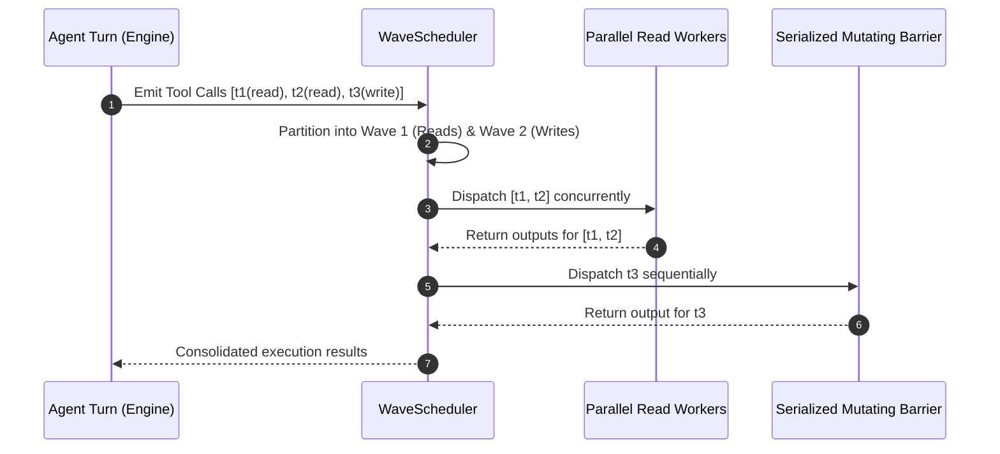

<!-- [LAYER: UI] -->
# Tool System & Execution Wavefront

  <a href="README.md">Wiki Hub</a> ·
  <a href="../api/cli.md">CLI Reference</a> ·
  <a href="../PORTABLE_TRINITY.md">Substrate Primitives</a> ·
  <a href="../adr/0005-dag-wave-scheduler-concurrency.md">ADR-0005</a>

Architecture of the 23 native agent tools and the concurrency wavefront managed by [`WaveScheduler`](../../src/core/tool_governor.rs).

---

## 1. Concurrency Geometry & Wave Scheduling

When an agent emits multiple tool calls in a single turn, executing them naively introduces major race conditions. The DAG Wave Scheduler partitions tool calls into two distinct execution phases:

---

## 2. The 23 Native Tools Catalog

Built-in tools declared in [`src/core/tool_specs.rs`](../../src/core/tool_specs.rs) and registered in [`src/core/tool_registry.rs`](../../src/core/tool_registry.rs):

### Filesystem Inspection & Mutation
1. `fs_read`: Read file contents with byte range support. (ReadOnly)
2. `fs_write`: Stage file creation or overwrite in SessionVfs. (Mutating)
3. `fs_remove`: Stage file removal in SessionVfs. (Mutating)
4. `fs_list`: List directory contents with depth recursion. (ReadOnly)
5. `fs_stat`: Query file metadata, size, and permissions. (ReadOnly)

### Search & Code Navigation
6. `search_grep`: Regex text search across workspace files. (ReadOnly)
7. `search_symbol`: Locate class, function, and trait symbol definitions. (ReadOnly)
8. `search_path`: Glob path search for matching filenames. (ReadOnly)

### Patching & Diffs
9. `patch_apply`: Apply unified diff hunks with fuzzy healing. (Mutating)
10. `patch_preview`: Preview simulated patch changes without staging. (ReadOnly)
11. `diff_unified`: Generate unified diff between disk and staged overlay. (ReadOnly)

### Git Operations
12. `git_status`: Inspect working directory state and modified files. (ReadOnly)
13. `git_diff`: Retrieve git diff for specific commits or working tree. (ReadOnly)
14. `git_log`: Query recent commit history and messages. (ReadOnly)

### Shell Execution
15. `shell_execute`: Execute arbitrary terminal command under timeout. (Mutating, Requires `ShellExecute` authority)

### Virtual File System & Transactions
16. `session_vfs_status`: Inspect currently staged overlays and baselines. (ReadOnly)
17. `session_vfs_commit`: Atomically commit all staged overlays to disk. (Mutating)
18. `session_rollback`: Revert the last committed file transaction. (Mutating)

### Memory & State
19. `session_memory_store`: Store key-value semantic fact. (Mutating)
20. `session_memory_recall`: Query stored memories by key or topic. (ReadOnly)

### Skills & Swarm Coordination
21. `skill_invoke`: Invoke an ingested workspace `SKILL.md` workflow. (Mutating)
22. `swarm_delegate`: Delegate sub-task to specialist agent. (Mutating)
23. `agent_status`: Inspect active sub-agent states and progress. (ReadOnly)
